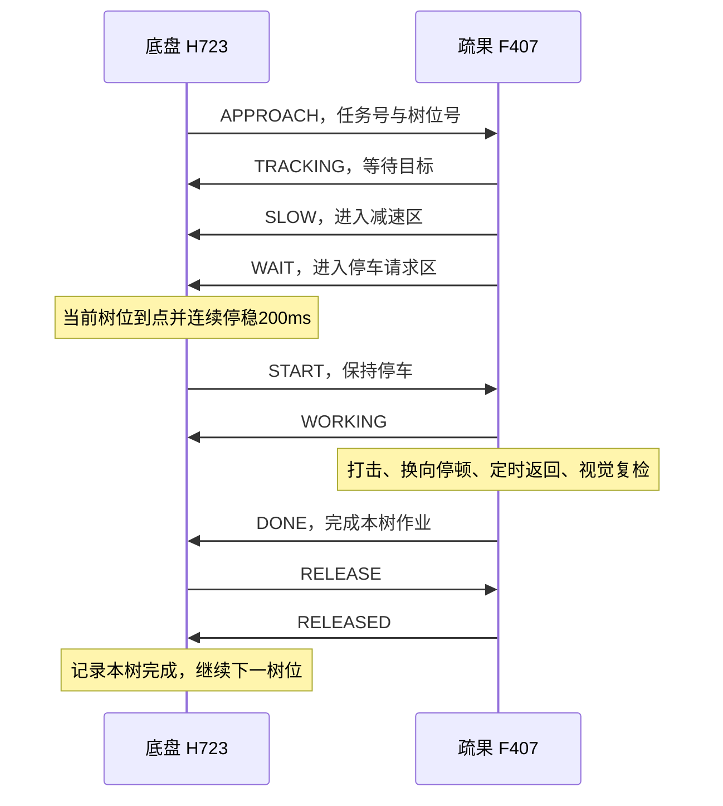

# 全图与疏果联合调试

## 当前作业流程

底盘负责全图路线、当前树位和停车位置。疏果端根据视觉偏移阈值提出 SLOW/WAIT 请求，底盘在当前指定树位到点停稳后下发 START。疏果端执行动作、定时返回、等待新图像复检，确认本树无待处理目标后报告 DONE。底盘完成 RELEASE/RELEASED 确认后驶向下一棵。



视觉 dx 用于减速区和停车请求区的阈值判断，以及 OLED、串口诊断。车辆位置由全图定位控制。当前阈值位于疏果工程的 `BSP/vision_motor.h`，中心 WORK_DX_CENTER=0，减速半宽100像素，停车请求半宽30像素。进入停车请求区要求至少3帧新图像并持续200ms。

START 后等待至少200ms及新视觉帧，同一区域稳定至少3帧、200ms才启动对应电机。打击600ms、换向停止50ms、返回600ms、轮次等待50ms。返回后再等待至少300ms和新图像复检。新区域继续按同样流程处理，区域0连续至少500ms且至少3帧后才正常完成。

同一区域本树最多动作2次，达到上限后报告故障并保持停车。单树作业上限8秒，底盘端另有12秒事务上限。接近事务上限60秒，到树位后5秒没有WAIT请求会以 TREE_REQUEST_TIMEOUT 结束全图。500ms无有效对端报文会撤销作业许可。故障期间已经启动的电机继续执行原定时返回，返回期间上报 ABORTING，定时动作结束后上报 FAULT。

机械回位目前依据定时反转和电机阶段结束。实际回位、机构净空和疏果效果需要现场验收。

## 两端固件与 CAN 协议

| 设备 | 联合调试配置 | 构建产物 |
| --- | --- | --- |
| 底盘 H723 | `build-local.ps1 -Mode FullMapWork`，内部使用模式6与 WORK_STATION_ENABLED=1 | `firmware/build/FullMapWork/robot.hex` |
| 疏果 F407 | ELBOW_TEST_MODE=2，当前源码默认值 | `firmware-elbow/MDK-ARM/RED_Demo/RED_Demo.hex` |

底盘 StraightTest 镜像用于全图行驶调试，树位按2秒驻留。联合疏果使用 FullMapWork 镜像，树位等待本次作业完成回执。

总线采用经典 CAN、标准数据帧、1Mbit/s。F407 CAN2 PB12/PB13 通过收发器连接 H723 CAN3 PD12/PD13 对应的总线接口。总线供电、共地和终端电阻按现有硬件接线核对。

| ID | 发送者 | 数据用途 |
| --- | --- | --- |
| 0x601 | S21C | 四路激光，左、右、后、前，每路两字节大端毫米值 |
| 0x611 | H723 | 版本2的任务与许可命令 |
| 0x610 | F407 | 版本2的请求与作业结果 |

版本2固定8字节。

| 字节 | 含义 |
| --- | --- |
| 0 | 版本号2 |
| 1 | 状态码 |
| 2–5 | 32位任务号，小端，每次树位作业递增 |
| 6 | 树位号1–12，握手时为0 |
| 7 | 结果码 |

树位号为 `2×(沟号−1)+树序`，树序1为西侧、2为东侧。G7通行，G6至G1各有两个作业点。区域1–4继续由疏果控制器选择对应电机。

| 状态码 | 含义与发送方 |
| --- | --- |
| 1 SYNC | 底盘请求握手 |
| 2 READY | 疏果端就绪 |
| 3 START | 底盘在当前树位停稳后许可作业 |
| 4 WORKING | 疏果端正在作业与复检 |
| 5 DONE | 疏果端完成本树 |
| 6 RELEASE | 底盘确认本树完成 |
| 7 RELEASED | 疏果端确认释放事务 |
| 8 ABORT | 底盘取消事务 |
| 9 FAULT | 疏果端故障且定时动作已经结束 |
| 10 ABORTING | 疏果端故障，正在完成定时返回 |
| 11 HELLO | 疏果端启动通知 |
| 12 APPROACH | 底盘指定下一作业树位 |
| 13 SLOW | 疏果端请求减速 |
| 14 WAIT | 疏果端请求停车作业 |
| 15 TRACKING | 疏果端等待当前树位进入视觉阈值 |

状态变化立即发送，持续状态每100ms重发。任务号、树位号、版本和方向检查用于过滤过期或不匹配的消息。重复请求按当前状态应答，同一任务不会重复初始化动作。新的树位在前一任务 RELEASED 后建立。版本1仍适用于 ELBOW_TEST_MODE=0 的原视觉主导协同。

结果码0正常，1重试次数上限，2单树超时，3视觉异常，4位置异常，5链路异常，6停车超时，7底盘反馈异常，8对端复位，9协议异常，10原协议跳过，11版本2任务取消。

## 精简后的 VOFA 操作

共7组、31个按钮。

| 组 | 内容 |
| --- | --- |
| 00 | 停车、连通检查 |
| 01 | 全图状态、起点登记、准备、开始、暂停、继续 |
| 02 | 行驶五档0.30/0.40/0.50/0.60/0.70m/s，默认0.30 |
| 03 | 接近五档0.05/0.10/0.15/0.20/0.25m/s，默认0.10 |
| 04 | 疏果状态查询、停稳后重新握手 |
| 05 | 整车、遥控、激光、轮组和CAN状态 |
| 06 | 波形、全图日志和简洁显示 |

行驶和接近档位均在停车且任务未准备时设置，参数保存在本次上电 RAM。接近档位在当前树位收到 SLOW/WAIT 后限制速度，终点规划和净空检查也参与限速。

VOFA选择 FireWater/UDP，本地1347，远端127.0.0.1:1348。桥接使用 COM12、921600，后台保留完整日志。当前机器的启动入口为 `E:/vofa+/x64/Mango-VOFA-Test-OPEN-AREA.cmd`，启动脚本也支持 `-Port` 指定重新枚举后的串口。

联调顺序如下。

1. 两块板分别更新上述配置的固件，整车停稳完成IMU标定，视觉持续输出合法帧。
2. 连接UDP，点“连通检查”和“查看疏果任务与握手”。确认 `enabled=1、online=1、phase=1`。
3. 车辆移回入口并对准，SWA约1000、SWC=1500、摇杆回中。关闭SWD，登记起点，选择两组速度。
4. 打开SWD，点准备，收到本次 `map_arm_ready=1` 后4秒内点开始。
5. 观察当前树位的 SLOW、WAIT、WORKING、DONE、RELEASED 顺序。只有完成本次事务后，该树才计入 `trees_done`。
6. 中止可用00组停车或关闭SWD。发生故障后等待定时返回结束，关闭SWD并停稳，再点“停稳后重新握手”。确认READY后重新登记起点、准备与开始。

疏果F407在动作中单独复位会丢失定时返回阶段，底盘保持故障行走锁。该情况需要现场确认机构已回位、车辆停稳，再重新上电两端并握手。相机或总线短时异常且疏果控制器持续运行时，原动作会完成定时返回，随后可使用面板重新握手。

`TEST_WORK`是显式状态查询，`TEST_WORK_EVENT`记录事务阶段变化。底盘链路阶段值0=SYNC、1=READY、2=APPROACH、3=WORKING、4=RELEASE、5=DONE、6=FAULT。`slow/wait`是本任务的请求标志，`hold`是行走锁，`returned`记录疏果端定时动作结束的报告。`TEST_MAP_STATUS`同时显示 `speed` 与 `approach`。

## 仿真与验收记录

`firmware-elbow/tests/verify_work_can.py`编译两端真实 CAN 处理和作业状态机，并与底盘全图导航闭环组合运行。使用50ms视觉更新、100ms持续报文、轮式里程比例误差3.2%和执行器滞后。

五档行驶速度与五档接近速度的25种组合均完成7条垄和12个树位事务，共300次动作。检查项包含到点前禁止启动、停车期间输出为零、返回完成后确认释放、重复报文幂等、故障锁存、断线后返回和显式重新握手。另有原协议、独立视觉测试、OLED、UDP转发与完整底盘主机回归。

仿真耗时和测试结论保存在本机 `firmware/build/station-joint.log`。实体 CAN 总线、视觉现场阈值、实际停车精度、机械回位和疏果效果待实机联调。

## 相机关闭与激光显示

相机关闭时作业等待视觉就绪，当前源码显示 `W:WAIT_CAM`。激光数据继续由 CAN2 的0x601接收，读取和显示独立运行。

| 激光显示 | 含义 |
| --- | --- |
| WAIT | 启动后尚无合法测距帧 |
| 数字加mm | 最近300ms内有合法0x601帧，当前原始值在0–15000mm |
| OFFLINE | 超过300ms没有新测距帧 |
| INVALID | 原始值超过15000mm |

离线回归覆盖相机关闭后20次独立激光更新、数据超时、恢复、毫秒计数回绕，以及模式2的OLED测距行刷新。现场曾报告激光数字停止更新，当时没有取得有效底盘串口状态，实体原因待下次上电核对0x601、采集板供电和实际显示。

## 2026-11-11部署进度

两端分别完成原固件备份与下载校验。

| 控制器 | 已烧录HEX SHA256 | 结果 |
| --- | --- | --- |
| H723 FullMapWork | `F85E646971A2EB094844FC0DEB939D27DC8011F0DC2C8091BD992891C1D7FA7B` | Verified OK，已复位 |
| F407 模式2 | `D49F7D492005BF6A03D8066D86973356D6502D177CFC7A7F2E2DBD6438C751BD` | Verified OK，已复位 |

H723原1MB备份为 `firmware/build/backup/before-station-work-20261111-164012-373.bin`，F407原512KB备份为 `firmware/build/backup/before-elbow-station-20261111-170450-990.bin`，均在写入前读回校验。

随后用户关闭相机与两板电源，转为离线测试。离线补测发现相机曾就绪后断开，疏果端空闲状态可能保留READY，本次源码已修复，恢复视觉后重新握手。此补充修复的F407候选HEX SHA256为 `E0BFD8026E868EF41B53D7CA79B0E6AB753F92BE06AF3CD5CEFA8FE58829299A`，已完成0错误、0警告构建，待下次上电更新F407。H723当前已烧录镜像可配套使用。

VOFA源文件、E盘安装副本和用户默认context均已更新为31条命令并核对一致。断电后按用户要求结束现场监听，后续使用联合启动入口重新连接UDP。25种组合、300次作业属于离线模拟，完整实车联合运行和疏果效果验收待进行。

<a id="offline-review-pr16"></a>
## PR #16本机离线复审补充（2026-11-11）

底盘与肘击器的任务主链为APPROACH → SLOW/WAIT → 映射树位到点停稳 → START → WORKING → DONE → RELEASE → RELEASED。作业期间底盘行走锁持续有效，错误任务/树号及提前释放不能解除锁；取消或故障后已启动的电机继续原定时返回，收到FAULT后才允许停稳重新握手。定时结束不等于真实机构到位，现场仍须验收回位与净空。

复审复现并修正两项问题。

- 首树任务刚建立时，F407上一空闲状态的READY可能仍在途中。旧代码将其视为对端复位并立即结束路线。当前在本任务收到TRACKING/SLOW/WAIT之前忽略该旧READY，也不刷新对端有效时间；确认任务后再收到READY仍按复位故障处理。回归分别验证旧报文、确认后复位及连续旧READY不能绕过500ms超时。
- F407周期OLED原本一次传完整1024字节显存。按生产驱动的5µs延时逐次计数，整屏仅规定延时就占151240µs，GPIO调用与CPU开销尚未计入。160ms主循环回放中，单树四区域动作触发8秒作业超时。当前每次只传128×8的一页，规定延时18905µs，期间可返回主循环收CAN和推进电机；状态文字每100ms重绘，整屏按8页轮转。动作和图像复检期间推迟屏幕重初始化。显示回归检查8页推进、错误恢复门禁和生产I2C调用预算；25ms调度回放中，单树四区域7000ms完成并确认释放。

本机使用MSYS2 UCRT64 GCC 16.2.0、Python 3.10运行完整主机回归，包含49项Python测试、25种全图速度组合的300次树位事务及上述新增专项。PATH原先命中32位MinGW GCC 6.3，出现浮点常量断言和聚合初始化告警失败；切换工具链后通过，未因此修改运行参数。该机可先在PowerShell为本次终端选择工具链，再执行根README中的检查命令。

```powershell
$env:PATH = 'D:\EmbeddedToolchain\msys2\ucrt64\bin;' + $env:PATH
gcc --version
powershell -NoProfile -ExecutionPolicy Bypass -File firmware/tests/run_host_tests.ps1
```

H723的FullMapWork、StraightTest、ManualStandalone各97源文件构建通过。F407当前31个C文件通过Cortex-M4 ARM GCC编译与可重定位链接，HAL和OLED字库存在原有告警；本机没有ARMCC5，未复现当前追加修复后的Keil最终链接和HEX。原PR中的0错误/0警告及镜像哈希属于追加复审前的队友构建。

本机证据归档于`firmware/build/review-pr16/`，不提交生成日志和二进制。当前H723与F407均有新增源码修复，**下一次实车联调前应重新构建并烧录H723 FullMapWork和F407 ELBOW_TEST_MODE=2**；上面的已部署哈希及旧F407候选哈希不包含这些追加修复。现场还要验证总线负载、主循环实测耗时、实际停车位置、四区域连续动作、返回净空和疏果效果。
