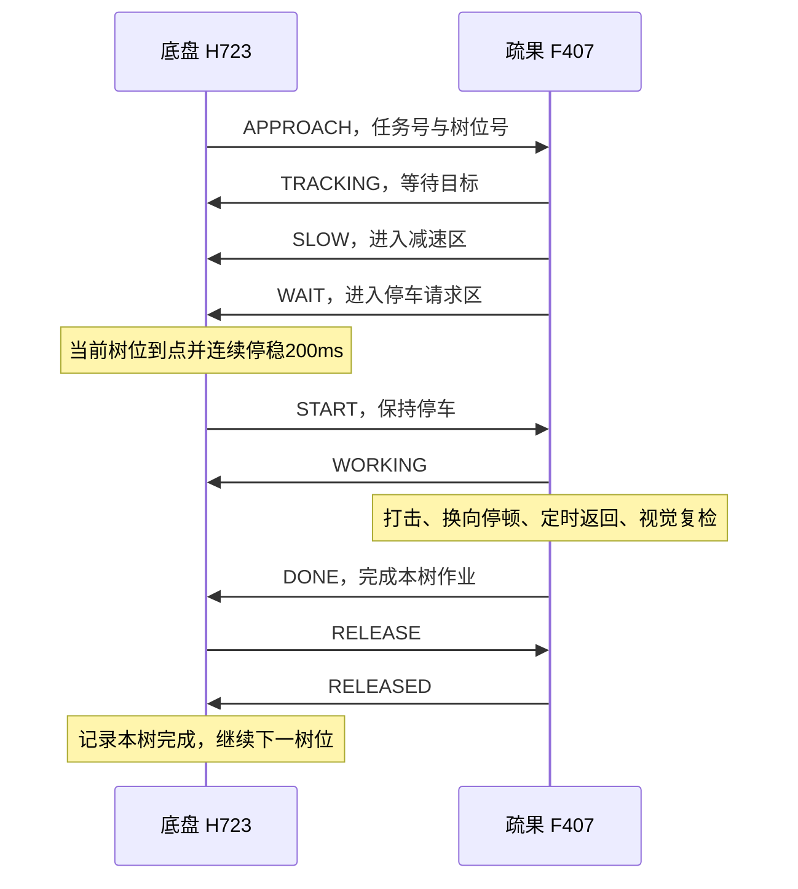

# 全图与疏果联合调试

<a id="navigation-only-mode"></a>
## 单独跑图与联合疏果模式

FullMapWork固件可在VOFA的01组选择两种运行方式，上电默认WORK。

| 面板选项 | 串口命令 | 行为 |
| --- | --- | --- |
| 选择单独跑图模式 | MAP MODE NAV | 独立完成全图路线，12个树位分别停留2秒，允许肘击器和视觉断电 |
| 选择联合疏果模式 | MAP MODE WORK | 开始前等待疏果端READY，到树位后等待疏果与完成握手 |

车辆停稳且任务处于IDLE、READY、DONE或FAULT时可选择。ARMED、RUNNING、PAUSED及机构尚在执行的作业事务期间会拒绝切换。实际切换会清除旧起点，重新登记起点后再准备。重复选择当前模式保持登记结果。模式和速度均保存在本次上电RAM，复位后FullMapWork恢复WORK。StraightTest固件可选择NAV。

单独跑图步骤如下。

1. 关闭SWD，回中停稳，选“单独跑图模式”，确认回执MODE_NAV_SELECTED及状态mode=NAV。
2. 移至入口并对准，登记起点，选择行驶速度。
3. 打开SWD，点击准备，收到map_arm_ready=1后4秒内点击开始。
4. 查看TEST_MAP_STATUS、TEST_MAP_TREE和激光波形。NAV运行期间疏果端的READY、HELLO、SLOW、WAIT及掉线状态均不参与路线裁决，底盘按导航测试的树点停留时间运行。

底盘遥控许可、IMU与电机反馈、激光、地图包络和起点登记仍参与导航。切回WORK后重新登记起点，并确认疏果端和视觉已就绪。TEST_WORK的enabled字段为当前作业模式是否启用，available表示镜像是否包含联合疏果功能。

## 当前作业流程

底盘负责全图路线、当前树位和停车位置。疏果端根据视觉偏移阈值提出 SLOW/WAIT 请求，底盘在当前指定树位到点停稳后下发 START。疏果端执行动作、定时返回、等待新图像复检，确认本树无待处理目标后报告 DONE。底盘完成 RELEASE/RELEASED 确认后驶向下一棵。



视觉 dx 用于减速区和停车请求区的阈值判断，以及 OLED、串口诊断。车辆位置由全图定位控制。当前阈值位于疏果工程的 `BSP/vision_motor.h`，中心 WORK_DX_CENTER=0，减速半宽100像素，停车请求半宽30像素。进入停车请求区要求至少3帧新图像并持续200ms。

START 后等待至少200ms及新视觉帧，同一区域稳定至少3帧、200ms才启动对应电机。打击600ms、换向停止50ms、返回600ms、轮次等待50ms。返回后再等待至少300ms和新图像复检。新区域继续按同样流程处理，区域0连续至少500ms且至少3帧后才正常完成。

同一区域本树最多动作2次，达到上限后报告故障并保持停车。单树作业上限8秒，底盘端另有12秒事务上限。接近事务上限60秒，到树位后5秒没有WAIT请求会以 TREE_REQUEST_TIMEOUT 结束全图。500ms无有效对端报文会撤销作业许可。故障期间已经启动的电机继续执行原定时返回，返回期间上报 ABORTING，定时动作结束后上报 FAULT。

机械回位目前依据定时反转和电机阶段结束。实际回位、机构净空和疏果效果需要现场验收。

## 两端固件与 CAN 协议

| 设备 | 联合调试配置 | 构建产物 |
| --- | --- | --- |
| 底盘 H723 | `build-local.ps1 -Mode FullMapWork`，内部使用模式6与 WORK_STATION_ENABLED=1 | `firmware/build/FullMapWork/robot.hex` |
| 疏果 F407 | ELBOW_TEST_MODE=2，当前源码默认值 | `firmware-elbow/MDK-ARM/RED_Demo/RED_Demo.hex` |

底盘 StraightTest 镜像用于全图行驶调试，树位按2秒驻留。联合疏果使用 FullMapWork 镜像，树位等待本次作业完成回执。

总线采用经典 CAN、标准数据帧、1Mbit/s。F407 CAN2 PB12/PB13 通过收发器连接 H723 CAN3 PD12/PD13 对应的总线接口。总线供电、共地和终端电阻按现有硬件接线核对。

| ID | 发送者 | 数据用途 |
| --- | --- | --- |
| 0x601 | S21C | 四路激光，左、右、后、前，每路两字节大端毫米值 |
| 0x611 | H723 | 版本2的任务与许可命令 |
| 0x610 | F407 | 版本2的请求与作业结果 |

版本2固定8字节。

| 字节 | 含义 |
| --- | --- |
| 0 | 版本号2 |
| 1 | 状态码 |
| 2–5 | 32位任务号，小端，每次树位作业递增 |
| 6 | 树位号1–12，握手时为0 |
| 7 | 结果码 |

树位号为 `2×(沟号−1)+树序`，树序1为西侧、2为东侧。G7通行，G6至G1各有两个作业点。区域1–4继续由疏果控制器选择对应电机。

| 状态码 | 含义与发送方 |
| --- | --- |
| 1 SYNC | 底盘请求握手 |
| 2 READY | 疏果端就绪 |
| 3 START | 底盘在当前树位停稳后许可作业 |
| 4 WORKING | 疏果端正在作业与复检 |
| 5 DONE | 疏果端完成本树 |
| 6 RELEASE | 底盘确认本树完成 |
| 7 RELEASED | 疏果端确认释放事务 |
| 8 ABORT | 底盘取消事务 |
| 9 FAULT | 疏果端故障且定时动作已经结束 |
| 10 ABORTING | 疏果端故障，正在完成定时返回 |
| 11 HELLO | 疏果端启动通知 |
| 12 APPROACH | 底盘指定下一作业树位 |
| 13 SLOW | 疏果端请求减速 |
| 14 WAIT | 疏果端请求停车作业 |
| 15 TRACKING | 疏果端等待当前树位进入视觉阈值 |

状态变化立即发送，持续状态每100ms重发。任务号、树位号、版本和方向检查用于过滤过期或不匹配的消息。重复请求按当前状态应答，同一任务不会重复初始化动作。新的树位在前一任务 RELEASED 后建立。版本1仍适用于 ELBOW_TEST_MODE=0 的原视觉主导协同。

结果码0正常，1重试次数上限，2单树超时，3视觉异常，4位置异常，5链路异常，6停车超时，7底盘反馈异常，8对端复位，9协议异常，10原协议跳过，11版本2任务取消。

## 精简后的 VOFA 操作

共7组、33个按钮，01组增加单独跑图和联合疏果选择。

| 组 | 内容 |
| --- | --- |
| 00 | 停车、连通检查 |
| 01 | 全图状态、起点登记、准备、开始、暂停、继续 |
| 02 | 行驶五档0.30/0.40/0.50/0.60/0.70m/s，默认0.30 |
| 03 | 接近五档0.05/0.10/0.15/0.20/0.25m/s，默认0.10 |
| 04 | 疏果状态查询、停稳后重新握手 |
| 05 | 整车、遥控、激光、轮组和CAN状态 |
| 06 | 波形、全图日志和简洁显示 |

行驶和接近档位均在停车且任务未准备时设置，参数保存在本次上电 RAM。接近档位在当前树位收到 SLOW/WAIT 后限制速度，终点规划和净空检查也参与限速。

VOFA选择 FireWater/UDP，本地1347，远端127.0.0.1:1348。桥接使用 COM12、921600，后台保留完整日志。当前机器的启动入口为 `E:/vofa+/x64/Mango-VOFA-Test-OPEN-AREA.cmd`，启动脚本也支持 `-Port` 指定重新枚举后的串口。

联调顺序如下。

1. 两块板分别更新上述配置的固件，整车停稳完成IMU标定，视觉持续输出合法帧。
2. 连接UDP，点“连通检查”和“查看疏果任务与握手”。确认 `enabled=1、online=1、phase=1`。
3. 车辆移回入口并对准，SWA约1000、SWC=1500、摇杆回中。关闭SWD，登记起点，选择两组速度。
4. 打开SWD，点准备，收到本次 `map_arm_ready=1` 后4秒内点开始。
5. 观察当前树位的 SLOW、WAIT、WORKING、DONE、RELEASED 顺序。只有完成本次事务后，该树才计入 `trees_done`。
6. 中止可用00组停车或关闭SWD。发生故障后等待定时返回结束，关闭SWD并停稳，再点“停稳后重新握手”。确认READY后重新登记起点、准备与开始。

疏果F407在动作中单独复位会丢失定时返回阶段，底盘保持故障行走锁。该情况需要现场确认机构已回位、车辆停稳，再重新上电两端并握手。相机或总线短时异常且疏果控制器持续运行时，原动作会完成定时返回，随后可使用面板重新握手。

`TEST_WORK`是显式状态查询，`TEST_WORK_EVENT`记录事务阶段变化。底盘链路阶段值0=SYNC、1=READY、2=APPROACH、3=WORKING、4=RELEASE、5=DONE、6=FAULT。`slow/wait`是本任务的请求标志，`hold`是行走锁，`returned`记录疏果端定时动作结束的报告。`TEST_MAP_STATUS`同时显示 `speed` 与 `approach`。

## 仿真与验收记录

`firmware-elbow/tests/verify_work_can.py`编译两端真实 CAN 处理和作业状态机，并与底盘全图导航闭环组合运行。使用50ms视觉更新、100ms持续报文、轮式里程比例误差3.2%和执行器滞后。

五档行驶速度与五档接近速度的25种组合均完成7条垄和12个树位事务，共300次动作。检查项包含到点前禁止启动、停车期间输出为零、返回完成后确认释放、重复报文幂等、故障锁存、断线后返回和显式重新握手。另有原协议、独立视觉测试、OLED、UDP转发与完整底盘主机回归。

仿真耗时和测试结论保存在本机 `firmware/build/station-joint.log`。实体 CAN 总线、视觉现场阈值、实际停车精度、机械回位和疏果效果待实机联调。

## 相机关闭与激光显示

相机关闭时作业等待视觉就绪，当前源码显示 `W:WAIT_CAM`。激光数据继续由 CAN2 的0x601接收，读取和显示独立运行。

| 激光显示 | 含义 |
| --- | --- |
| WAIT | 启动后尚无合法测距帧 |
| 数字加mm | 最近300ms内有合法0x601帧，当前原始值在0–15000mm |
| OFFLINE | 超过300ms没有新测距帧 |
| INVALID | 原始值超过15000mm |

离线回归覆盖相机关闭后20次独立激光更新、数据超时、恢复、毫秒计数回绕，以及模式2的OLED测距行刷新。现场曾报告激光数字停止更新，当时没有取得有效底盘串口状态，实体原因待下次上电核对0x601、采集板供电和实际显示。

## 2026-11-11部署进度

两端分别完成原固件备份与下载校验。

| 控制器 | 已烧录HEX SHA256 | 结果 |
| --- | --- | --- |
| H723 FullMapWork | `F85E646971A2EB094844FC0DEB939D27DC8011F0DC2C8091BD992891C1D7FA7B` | Verified OK，已复位 |
| F407 模式2 | `D49F7D492005BF6A03D8066D86973356D6502D177CFC7A7F2E2DBD6438C751BD` | Verified OK，已复位 |

H723原1MB备份为 `firmware/build/backup/before-station-work-20261111-164012-373.bin`，F407原512KB备份为 `firmware/build/backup/before-elbow-station-20261111-170450-990.bin`，均在写入前读回校验。

随后用户关闭相机与两板电源，转为离线测试。离线补测发现相机曾就绪后断开，疏果端空闲状态可能保留READY，本次源码已修复，恢复视觉后重新握手。此补充修复的F407候选HEX SHA256为 `E0BFD8026E868EF41B53D7CA79B0E6AB753F92BE06AF3CD5CEFA8FE58829299A`，已完成0错误、0警告构建，待下次上电更新F407。H723当前已烧录镜像可配套使用。

VOFA源文件、E盘安装副本和用户默认context均已更新为31条命令并核对一致。断电后按用户要求结束现场监听，后续使用联合启动入口重新连接UDP。25种组合、300次作业属于离线模拟，完整实车联合运行和疏果效果验收待进行。

<a id="offline-review-pr16"></a>
## PR #16本机离线复审补充（2026-11-11）

底盘与肘击器的任务主链为APPROACH → SLOW/WAIT → 映射树位到点停稳 → START → WORKING → DONE → RELEASE → RELEASED。作业期间底盘行走锁持续有效，错误任务/树号及提前释放不能解除锁；取消或故障后已启动的电机继续原定时返回，收到FAULT后才允许停稳重新握手。定时结束不等于真实机构到位，现场仍须验收回位与净空。

复审复现并修正两项问题。

- 首树任务刚建立时，F407上一空闲状态的READY可能仍在途中。旧代码将其视为对端复位并立即结束路线。当前在本任务收到TRACKING/SLOW/WAIT之前忽略该旧READY，也不刷新对端有效时间；确认任务后再收到READY仍按复位故障处理。回归分别验证旧报文、确认后复位及连续旧READY不能绕过500ms超时。
- F407周期OLED原本一次传完整1024字节显存。按生产驱动的5µs延时逐次计数，整屏仅规定延时就占151240µs，GPIO调用与CPU开销尚未计入。160ms主循环回放中，单树四区域动作触发8秒作业超时。当前每次只传128×8的一页，规定延时18905µs，期间可返回主循环收CAN和推进电机；状态文字每100ms重绘，整屏按8页轮转。动作和图像复检期间推迟屏幕重初始化。显示回归检查8页推进、错误恢复门禁和生产I2C调用预算；25ms调度回放中，单树四区域7000ms完成并确认释放。

本机使用MSYS2 UCRT64 GCC 16.2.0、Python 3.10运行完整主机回归，包含49项Python测试、25种全图速度组合的300次树位事务及上述新增专项。PATH原先命中32位MinGW GCC 6.3，出现浮点常量断言和聚合初始化告警失败；切换工具链后通过，未因此修改运行参数。该机可先在PowerShell为本次终端选择工具链，再执行根README中的检查命令。

```powershell
$env:PATH = 'D:\EmbeddedToolchain\msys2\ucrt64\bin;' + $env:PATH
gcc --version
powershell -NoProfile -ExecutionPolicy Bypass -File firmware/tests/run_host_tests.ps1
```

H723的FullMapWork、StraightTest、ManualStandalone各97源文件构建通过。F407当前31个C文件通过Cortex-M4 ARM GCC编译与可重定位链接，HAL和OLED字库存在原有告警；本机没有ARMCC5，未复现当前追加修复后的Keil最终链接和HEX。原PR中的0错误/0警告及镜像哈希属于追加复审前的队友构建。

本机证据归档于`firmware/build/review-pr16/`，不提交生成日志和二进制。当前H723与F407均有新增源码修复，**下一次实车联调前应重新构建并烧录H723 FullMapWork和F407 ELBOW_TEST_MODE=2**；上面的已部署哈希及旧F407候选哈希不包含这些追加修复。现场还要验证总线负载、主循环实测耗时、实际停车位置、四区域连续动作、返回净空和疏果效果。

<a id="deployment-20261112"></a>
## 2026-11-12部署与单独跑图候选

PR #16合并后源码a9f0cc3已在本机重新构建，H723和F407分别完成下载校验与复位。H723原1MB与F407原512KB均已读取并校验，保存在本机firmware/build/deployed/latest-dual-20261112-110621-030。F407 Keil ARMCC5构建0错误、0警告。

| 镜像 | HEX SHA256 | 状态 |
| --- | --- | --- |
| H723当日首次FullMapWork | 32C4B96C7F3E194369CDA41A1A812249890D3261B9DDE18496FAC62C32E9E111 | 已Verified OK |
| F407模式2 | 5E646088B5AEB05FF8B3A97954E63D094D6106B0B8622508E280E8C72E237BBA | 已Verified OK |
| H723新增NAV/WORK选择 | 6049F2373C680F96BAA5067135565471D76F75A6FD4A910306BD6D528B72427A | 已Verified OK，随后被283F版本替代 |
| H723前一版运动优化 | 283FEB043E222536CAA2F96F1A0F8ABF23621B24683018C549D9B03FA21C8255 | 已Verified OK，随后被00CF版替代 |
| H723前一行进纠偏版 | 00CF24D134D8A0393225AD87FAA1C62AD88F5EB244DB3902D296BED3EB5E6889 | 16:07已Verified OK并复位；已被E6B版替代 |

现场token3、4、5均在入口段因WORK_PEER_FAULT退出。疏果端READY短暂退回SYNC后分别约135、112、112ms恢复，底盘已锁存退出。最新一轮定位纵坐标从约-0.22m到1.23m后停止，停车附近激光有效掩码0xf、遥控和硬件许可正常。现有底盘日志可确认握手撤销触发停车，视觉断帧、串口接收错误等具体来源仍需疏果端证据。

NAV新增回归通过实际UART分发入口，覆盖离线疏果端、SYNC/FAULT反复切换、运行中拒绝模式切换、机构作业锁和WORK重新检查就绪。完整主机回归、49项Python测试、25种组合的300次联合事务及FullMapWork、StraightTest各97源文件构建通过。VOFA三处副本均已更新为33条并核对一致。

首次尝试NAV下载曾受CMD_INFO失败阻塞；重连后已完成6049及283F两个后续版本的校验、写入与复位。旧失败记录不代表后续没有烧录。

<a id="nav-correction-20261112"></a>
## 2026-11-12入口暂停与行进纠偏排查

原始记录为`firmware/build/logs/straight-console-20261112-134852.log`，现场车端为283F版本、NAV、速度0.70m/s、接近0.15m/s。token2、3、4有ROUTE_COMPLETE，不把正常2秒树位驻留或所有重复测试都称为G4故障。

token5入口到G7的两次停顿均为RANGE_PAUSE，遥控、硬件和四路测距有效位正常。按事件中的轮速计算，前向动态停车线至少如下；实际保护还取轮速与上一周期指令中的较大值。

| 事件t_ms | 前距 | 前向轮速 | 动态停车线下界 | 暂停至恢复 |
| --- | --- | --- | --- | --- |
| 1046535 | 1245mm | 0.580m/s | 2072mm | 1994ms |
| 1050528 | 1065mm | 0.523m/s | 1729mm | 1301ms |

门限公式为`0.100 + 0.5*v + v*v/(2*0.10)`米。正常运动减速度已设0.60m/s²，保护预算仍独立按0.10m/s²计算，因此超过1米的短暂前距也能触发零输出暂停。前距曾在相邻采集间隔由2797变1245mm、由2215变835mm，随后又恢复远值；变化量不能由当时车速解释。反光、测量目标切换或采集异常的具体来源未确认，S21C仍未更新。此候选未修改该保护预算，不能承诺入口两次停顿已消除。

G4故障链在token1中为：前后配对估计误差约-47至-52mm，旧逻辑超过35mm后设置hold_along，停止沿垄行驶并重新准备横向轮向；随后后距99mm触发RANGE_PAUSE，暂停期间定位修正继续收敛，最终MAP_ENVELOPE。100mm近距和实际车体包络保持有效，不能把这次持续近距直接删作单帧毛刺。

本轮候选做两项运动修复：较大居中误差在行进中只连续降速并叠加横向纠偏，到终点窗口内才允许hold_along；起步仍按共同进度保持已准备轮向，行进后平移与角速度各自限加速度，避免航向反转削弱直线制动。段末居中判稳、20mm到点、60mm过点回调上限、0.05m/s反向上限和作业机构锁均保留。

新增生产代码耦合回归使用full_map_test、auto_motion、chassis以及实际IK/FK和轮向门控，加入约83ms转向滞后、50ms驱动滞后与10Hz测距。G4前后各38mm误差两种情况均完成第一树位：候选4.92秒、门控重新关闭1次、持续运动纠偏111个周期、最小前后距121mm、最终横差8mm。调整前源码在同一场景需6.31秒、门控重新关闭2次、仅4个运动纠偏周期，并使新回归失败。以上是离线模型结果，未覆盖机械滑移、真实激光跳变及所有载荷，不能代替实车验收。

为后续定位，暂停/故障新增TEST_MAP_GUARD，near/brake/stale分别标出100mm近距、动态预算和时效问题，budget_mm顺序为左/右/后/前。现有TEST_MAP_AISLE行增加align和limit，表示实际轮向门控及本周期速度上限；未增加周期日志行数。完整调度日志预算回归仍通过。

完整主机回归、49项Python测试、25种组合共300次树位事务，以及FullMapWork、StraightTest、ManualStandalone各97源构建通过。FullMapWork HEX SHA256为`00CF24D134D8A0393225AD87FAA1C62AD88F5EB244DB3902D296BED3EB5E6889`，用户重新确认停稳后已于16:07烧录，Verified OK并复位。原源码、工作区补丁、283F镜像、原始日志快照、对照回归及构建证据归档于`firmware/build/deployed/nav-correction-20261112-140942/`，本地入口为`firmware/build/active-correction-tuning.txt`。写入前通过DAP 332107140234、HID 400kHz核验芯片ID `0x10016483`及Cortex-M7 CPUID，完整1MB原固件保存在该目录`before-flash.bin`，已读回校验并核对前一版HEX。`h723-backup.log`和`h723-flash.log`包含备份与下载完成标记。

更新后已重新启动COM12/921600→UDP1348，VOFA1347保持连接，PING收到车端ok=1回执，WAVE已启用且13通道持续更新；新原始日志为`straight-console-20261112-160951.log`。新TEST_MAP_AISLE的align/limit字段已在实机输出中确认。IMU标定2000/2000、电机与CAN反馈正常、四路激光有效位0xf、命令为零。

随后曾无遥控帧，并进一步发生串口失流/乱码及HID、USB Bulk两种后端CMD_INFO无响应。电脑端只重启桥接未能恢复，Windows拒绝无管理员权限的软件USB重启；用户实际重连Horco后，串口与遥控恢复。最新记录为`straight-console-20261112-165229.log`，UDP1348桥接进程22036、VOFA1347保持连接，13通道波形正常。两次失败探测与USB重启日志保留在本次部署目录，未重复写入固件。

用户将SWC置1500后，实测遥控online=1、HOST、SWD=1000、回中且停稳；已通过UDP设置NAV、行驶0.70m/s和接近0.15m/s，两个参数均收到车端ok=1回执，周期状态确认mode=NAV、speed=0.70、approach=0.15。当前origin=0，未自动登记起点或发送ARM/GO。只在实际回到入口对准后登记起点，再由操作者放行SWD、ARM/GO。当前33条命令无需为上述内部修复变更；入口激光动态暂停仍待单独处理和实测。

<a id="laser-odom-20261112"></a>
## 2026-11-12激光/里程计一致性、连续纠偏和中文日志候选

用户指出此前没有真正用里程计判断新激光数据是否合理。核对00CF车端版本后，确认旧laser_prediction只桥接失效/过期的前后数据，超过0.5m/s会关闭，仍为有效位的数据会直接重写锚点；全图又直接用该值做动态制动判断。因此旧中值和丢样预测不能拦住6795→2767mm这种仍被标为有效的跳变。

候选在全图定位、前后配对和保护之前增加四路LaserMotionFilter。轮速按IMU航向积分到独立平面坐标，对比新距离与同期沿光束方向的位移；按60mm基础量、轮式位移误差及光束转角留创新余量。超过余量的新读数不更新可信锚点，也不作为新的定位/恢复证据。一般预测仅在真实源时间600ms、真实源起累计路程0.25m、累计转角3度内有效；只向行进方向使用预测时才将主速度限制为0.15m/s，侧向测距切换仍限制自身接近速度，避免反复拖慢主直线。预测值不增加旧净空，不伪造有效位或新时间戳。

新表面需3个独立源样本、跨度至少180ms，并与候选期间的里程/转角一致才重新接纳。重复中值不增加确认数。向某束接近速度超过0.10m/s、独立里程在该方向超过30mm而读数变化仍不超过5mm时，标为冻结；不断变化的CAN计数不能给冻结值续期。近距100mm及原有紧急制动包络仍直接保护，持续异常超过界限仍暂停。

入口另保留有界的地图/左墙导航：只有前向争议值比已登记北墙预测更远、左墙X观测新鲜、航向与既有未观测里程预算合格时，才用更保守的地图前距推进，最高0.25m/s。它不代替更近的新返回，不给真实观测时间续期；进入G7前仍必须得到真实北墙定位。此规则覆盖原先“前方远值冻结/不匹配、左墙正常”的入口场景。

纠偏调整包括：横向Kp由1.6提高到3.2，连续纠偏死区10降到5mm，横向上限仍0.10m/s；经过3次独立确认的附近已知边墙直接进入路径横差反馈，保留100ms低通与200ms短缺口保持。它不直接改写地图包络位置，也不依赖单帧边距。前后垄沟继续使用配对纠偏，较大误差的速度过渡改为25至60mm范围连续变化。地图余量不足20mm时，0.05m/s仅限制沿线推进，保留横向回正能力；实际包络、80mm横差退出、作业机构锁和手动VRB许可仍在。

专项与生产代码耦合结果如下，均为离线模型，不代表现场定位精度：

| 场景 | 候选结果 | 对照/边界 |
| --- | --- | --- |
| 0.50m/s，6795→1065mm新读数 | 拒绝新值作锚点、受限预测、保持非零行进 | 00CF原代码在同一回放进入暂停，新回归失败 |
| 0.70m/s，6795→2767mm新读数 | 同上；真实99mm输入仍立即暂停 | 确认、超时/超距、重复源、冻结、1.8m/s专项通过 |
| 入口持续20mm/s未观测横滑，10Hz测距、约83ms转向及50ms驱动滞后 | 0.50m/s最大横差24.7mm，14.15s到G7，行进段门控重闭0次；0.70m/s为25.6mm、13.01s、0次 | 00CF同0.50m/s场景44.3mm、18.83s、门控重闭5次 |
| G4初始前后偏差±38mm，同一真实底盘IK/FK及门控 | 4.61s完成树位，门控重闭0次，最小前后距121mm，终差约5.1mm | 未覆盖所有实车滑移和激光故障 |

中文日志在电脑桥接层生成，不改变车端命令或FireWater数值帧。VOFA普通文本改为UTF-8，常见起点/准备拒绝、运行/暂停、遥控和健康状态显示中文，并保留原因码。`vofa-zh-*.log`为UTF-8中文日志，`straight-console-*.log`仍保存完整串口原文便于复盘。Windows PowerShell脚本为UTF-8 BOM，安装启动器改为UTF-8及chcp65001，修复中文工程路径被ASCII写成问号的问题。33条命令不变，严格UTF-8 UDP回环、数值波形字节及面板/安装测试均通过。

完整主机回归、49项Python、25种组合的300次树位事务，以及FullMapWork/StraightTest/ManualStandalone各97源构建通过。FullMapWork SHA256为`E6B93D7CB4AE987C655404FB29BC9D8131DE9AC433711FC81BA9F334D4DD0C59`，**已Verified OK烧录并复位**。`h723-backup-reconnected.log`记录H723_BACKUP_VERIFIED，完整1MB原固件已读回校验；`h723-flash.log`记录LASER_ODOM_FLASH_OK。源码、前一版00CF镜像、失败回归对照和全部构建日志在`firmware/build/deployed/laser-odom-20261112-172819/`，入口为`firmware/build/active-laser-odom.txt`。建议烧录后先以0.50m/s复测入口与一轮全图，记录真实停止、最大横差和轮向门控；现场启动仍由操作者ARM/GO。


<a id="lane-tuning-20261112"></a>
### 2026-11-12实车入口与竖直换垄复核

原始日志`firmware/build/logs/straight-console-20261112-185429.log`。第一轮实际设置为0.30/0.10m/s，t=366157记录ROUTE_COMPLETE；五次暂停均near=0、brake=0，由必要方向数据被拒绝后失效触发。第二轮0.50/0.10入口四次暂停共4.506秒；右侧段3的26个500ms样本中15个为ALIGN，段7的25个样本中9个ALIGN，墙距反馈同时在约-33mm与融合定位之间切换。后续用户手动接管，不能将CONTROL_MODE_CHANGED当作入口保护原因。

用户明确要求入口到G7只用左侧贴墙与里程计，右侧不参与该段定位、常规限速和测距失效判断；接近前墙再判稳融合前向激光。当前E6B仍存在上述卡顿，后续候选尚在修改，未烧录。当前串口在线，本轮修改期间保留UDP监听，不自动发送ARM/GO。修改前源码、补丁、E6B镜像及实测日志快照位于`firmware/build/deployed/lane-tuning-20261112-191300/`。


本轮修订候选`1ECABF80D024AB78E0DCE62A242DB632A61A7F218CDC573D294FDFDC16709210`已完成完整主机回归、49项Python、25种速度组合/300次树位事务，以及FullMapWork、StraightTest、ManualStandalone各97源构建。归档为`firmware/build/deployed/lane-tuning-20261112-191300/`，含修改前源码、E6B镜像、现场日志快照、旧代码失败回放、修订源码哈希、最终测试及构建记录。已使用DAP 332107140234、HID实际400kHz核验H723芯片，原1MB完整备份读回校验成功，并核对原E6B镜像；新版已Verified OK并复位，标记LANE_TUNING_FLASH_OK。证据见h723-backup.log、before-flash.bin、h723-flash.log。实车运动效果仍待验收。

修订逻辑：

- 入口0段：纵向只用登记起点、轮速及IMU；左墙约束横向；右侧不参与定位、常规测距限速或失效暂停。距北墙光学投影约1.50m后锁定接近阶段，前向实际命中北墙且符合地图/里程预测，连续3个独立样本并跨180ms后才融合Y。重复缓存不确认。最后0.30m内仍要求真实北墙约束在500ms内，否则暂停等待，不能靠里程盲转入G7。登记起点仍需正对远端北墙。
- 入口地图距离单独标记odom，不伪造激光valid/update或定位观测时间。距离不确定量为20mm加未观测纵向行程的3.2%，且左墙失效时退回原定位里程预算。保留原始100mm全向近距保护及前向物理紧急包络，因此右侧普通跳变不会暂停，真实极近读数仍停车。
- 必要方向以主行程及实际反向回调为准；不足0.10m/s的正交纠偏不会把该束失效升级为全车暂停，先限制向失效方向的纠偏。真实近距、动态制动及超过该速度的实测关闭运动仍保护，反向过点回调仍检查对应方向。
- 墙距纠偏通过轮式位移传播，观测缺口最多到真实源300ms，控制参考仅在600ms内短暂保留；定位有效期与碰撞保护不续期。观测/融合回退以限幅创新连续衔接。附近墙与对面长光束按1/(0.15+距离)加权；单束维持原有每次最大5mm增量，长束不能与近墙等权拉偏位置并常年触发0.05m/s边界限速。
- 沿近墙缓行的小横向轮速可能在抵消未观测轮胎横滑。仅在切向速度>0.03m/s、超过法向2倍且法向<0.05m/s时，不以常值墙距单独判冻结；纯侧移、主方向接近的30mm冻结检测、独立时间戳超时保留。
- 0.7m侧边换垄只有在真实侧墙新鲜、纵向未校正里程<1.2m、后向实时远值和地图距离都大于完整制动预算时，才允许用独立标记的地图净空跨越后束远距离足迹切换；整板失联、后束真实近值均不符合这个条件。
- 低速逼近伴随较大航向修正时，整段起步坡道保持线/角速度比例；原代码只保持第一个周期，第二周期就可能再次关闭机械轮向门控。行进后的线/角坡道仍独立，机械约9度的门控没有放宽。
- 边缘逼近：端点轨迹规划延迟0.50→0.35s，软净空额外余量30→20mm，软速度跟踪余量0.03→0.02m/s。100mm硬线、动态制动的0.5s反应及0.10m/s²预算保持。没有增加最低强制速度，不会为了提速跨过停止包络。

离线生产控制耦合结果：

| 模型 | 时间 | 行进门控重闭 | 误差 |
| --- | --- | --- | --- |
| 旧E6B，右侧0.7m换垄，0.50m/s，55mm远墙偏置及近墙间歇缺帧 | 20.74s | 63 | 最终横差-21.3mm |
| 修订，右/左换垄0.30m/s | 4.05/4.11s | 0/0 | -5.0/+4.4mm |
| 修订，右/左换垄0.50m/s | 3.42/3.41s | 0/0 | -4.0/+4.2mm |
| 修订，右/左换垄0.70m/s | 3.50/3.48s | 0/0 | -4.5/+4.5mm |
| 入口0.50/0.70m/s，持续20mm/s未观测横滑 | 13.41/12.62s | 0/0 | 最大横差17.1/20.2mm |
| G4两侧38mm初始偏移，0.70m/s | 4.28/4.28s | 0/0 | 最终横差+4.1/-4.1mm，最短激光121mm |

近墙切换独立样本、后向2971/6711mm反复跳变、真实150mm后障碍、99mm前障碍、失效方向抑制、低速线角共坡道、纯侧向冻结、完整树点/握手均有回归。周期日志仍48ms以内，没有新增周期日志行；TEST_MAP_POSE增加odom、entry和fb_mm字段。entry=0/1/2分别表示入口纵向里程、近墙待确认、北墙已确认；odom标记地图/里程净空，fb_mm为连续控制横差，均不代表新增真实观测。原始英文日志与中文UTF8显示并存。

实车需要重新登记入口，由操作者点击ARM/GO；建议先0.50/0.10验证入口与两侧换垄，再判断是否继续升档。本轮未更改或烧录F407/S21C。


<a id="aisle-tuning-20261112"></a>
### 垄沟纠偏与重复调整优化（2026-11-12）

车端1ECA部署后的原始记录为`firmware/build/logs/straight-console-20261112-200431.log`。按成功GO分轮，第二轮0.50/0.10和第三轮0.70/0.10均ROUTE_COMPLETE。第二轮入口无暂停，六次0.7m竖直换垄各约3–4秒，行驶卡顿主要转移到垄沟内。

| 第二轮位置 | 触发时刻/恢复时刻（ms） | 停顿 | 证据 |
| --- | --- | --- | --- |
| G4 | 250184/251019 | 0.835s | 后143mm，动态制动线143mm；实测前后分量-0.056m/s |
| G3 | 274104/275019 | 0.915s | 右向主束5760mm被拒绝，stale=0x2，对侧左束600mm有效 |
| G3 | 280844/281503 | 0.659s | 前125mm，制动线127mm |
| G2 | 300373/301813 | 1.440s | 前187mm，制动线194mm；实测前后分量0.096m/s |
| G1 | 322706/324213 | 1.507s | 前118mm，制动线142mm |
| G1 | 325843/326920 | 1.077s | 后175mm，制动线178mm |

共6.433秒明确暂停，全部near=0；另有轮向准备与配对/融合横差来源切换。G3一处直接配对误差+26.5mm，而旧融合横差约-29.8mm，短暂失去配对后会反向拉回旧估计。后续第四轮0.70m/s在G4出现MAP_ENVELOPE，模型Y=2.345、yaw90.52度，已触及155mm车体的垄边净空；不能单独放宽包络掩盖纠偏问题。

修订内容：

1. 自动运动输入增加正/反横差速度上限，按前、后各自净空独立限制纠偏，保持主行程速度。规划在进入树垄端部前就使用该沟中部的地图截面预留20mm，真实短距更近则取更小值；该截面只用于规划，不作为虚构定位或激光样本。按0.10m/s²、0.60s加源龄、5mm额外距离及0.010m/s跟踪余量反解纠偏速度。原始100mm和0.5s动态制动故障线不改，不能强制抬高最小速度。
2. 前后测距已通过成对几何检查时，制动的关闭速度投影到真实垄面法向，补偿车身航向。原代码把body.vx直接当接近速度，5.5度斜身横移即使世界Y速度为0也会误判向后壁靠近。未知或失配几何继续使用原始保护路径。
3. 配对横差按轮式Y位移逐周期传播，真实源有效期最多300ms；独立源丢失后控制参考最多保持600ms，再有界回退融合位姿，不延长任何观测时间、valid或update。新鲜配对优先于旧南/北围栏参考，避免G1新配对已经到来却仍被旧墙参考阻塞。
4. 横向主测距发生真实远距突变时，只有实测对侧围栏新鲜并符合地图、垄面几何有效，且主束实时远值和地图净空均大于完整制动预算加100mm，才允许单独标记odom的地图净空补偿；真近距、整板断联、无对侧参考不满足条件。150mm实际主向障碍仍立即停止。
5. TEST_MAP_AISLE新增cross=正向,反向两个限速值；周期日志仍为原有行数，预算回归最大48ms。入口单左墙模式及所有速度档保持，未改树点位置、20mm到点窗口或30mm驻留重新定位门限。G1末树一次32mm位置偏离触发回调属于现有精度约束，不将其直接删除。

完整主机回归、49项Python、25组合共300次树位事务，以及三个模式各97源编译通过。新增回归覆盖5.5度斜身零法向速度、双向限速及准备提示约束、5760mm主束跳变的对侧观测补偿、独立配对时间戳过期，原真实近距/遥控/过点回调继续通过。加入60mm估计冲突的G4生产IK/FK及机械门控模型，1ECA为5.29秒/3次重闭，新候选4.67秒/1次，最终横差±13.8mm，最小真实测距117mm；普通G4为4.27秒/0次、最终±5.4mm。以上为离线结果，实车待复测。

候选FullMapWork SHA256 `A103D103EB69B9B3C53E354F4C91AFF470F177A3C13600F9C7D957C927A1904A`。归档`firmware/build/deployed/aisle-tuning-20261112-223646/`保留1ECA源码和镜像、原始日志、对照及回归/构建日志。已完成部署，下面记录实际备份、镜像验证及复位证据。

范围说明：第一轮ENTRY_NORTH_TIMEOUT中地图与前距不一致、后续FEEDBACK_OR_PERMIT及98mm前向近距均单独保留，本候选未声称一并解决。当前UDP端口1348仍由桥接维护，但串口最近没有有效新状态；用户已重新确认SWD关闭、停稳并授权更新，先完成1MB备份校验再写入。HID初次CMD_INFO失败，USB Bulk已成功核验H723，实际部署及恢复状态随后补记。


**A103部署完成：** 实际HID/Bulk先后出现CMD_INFO及长读取中断，400kHz、200kHz和USB会话复位后均有失败日志，均未执行写入。改为32KB分块读取并逐块verify_image，前30块成功，尾两块重新连接后完成校验；32块组合为完整1MB，另与原1ECA HEX的155808个有效字节逐一核对，证明在`backup-verification.json`。原文件为`before-flash.bin`，失败的部分读取另存，不作有效备份。

随后以USB Bulk实际200kHz写入A103，用5份稀疏HEX分块覆盖全部157656个镜像字节进行verify_image，保留原HEX空洞语义；5块全部通过后才reset run。`h723-flash-chunked.log`包含AISLE_PROGRAM_WRITTEN、IMAGE_PART_VERIFIED_00至04、AISLE_IMAGE_CHUNKS_VERIFIED及AISLE_TUNING_FLASH_OK。当前车端为A103，不是前一版1ECA。F407和S21C未改未烧录。

UDP已恢复：COM12/921600，命令1348、VOFA1347，桥接PID33532、VOFA PID24704，原始日志`firmware/build/logs/straight-console-20261112-233558.log`。收到静态PING回执、遥控online=1、health无阻塞、停止及零输出、新cross字段和13通道FW波形。助手只恢复NAV与烧录前最后设置0.70/0.25，没有发送ORIGIN/ARM/GO；之后操作者自行调整到0.60/0.20并登记、启动新轮，日志已记录入口POSE_OBSERVATION_PAUSE，仍须继续核查真实左墙观测约束，不将当前部署称为全部问题实车验收通过。最新运行参数以操作者新回执为准，助手不会在运行中覆盖。

<a id="round-rollback-20261113"></a>
### 2026-11-13实车回退与本轮复盘

**当前H723已按用户要求回退至1ECA（`1ECABF80…09210`），A103已撤回。** 用户确认停稳和SWD关闭后，先逐块读取并校验A103完整1MB，全部157656个有效镜像字节与归档A103一致，再写入1ECA；155808个有效字节分五块全部verify通过，完成复位。证据在`firmware/build/deployed/rollback-1eca-20261113-000841/`，日志含ROLLBACK_IMAGE_ALL_VERIFIED和ROLLBACK_1ECA_FLASH_OK。UDP桥接保持，回退后只读检查确认新鲜状态、停稳和零输出；FullMapWork恢复默认WORK、0.30/0.10与未登记起点，没有自动登记或启动。

最近A103一轮实际为0.50/0.10，入口两次POSE_OBSERVATION_PAUSE分别1.680和1.400秒，G7右向测距失效0.920秒，随后在段4因UART_ERROR_OR_OVERFLOW退出；前一轮也在乱码后因串口错误结束。入口两次near/brake/stale均0，定位条件切换与100mm近距不同。原日志缺少真实左墙约束年龄，不能断言每次都是物理测距丢帧。旧1ECA也出现过入口暂停，回退不能视为所有故障已消失。

工作区恢复1ECA基线后只新增两项候选：按最近实际接受的左墙源时间保持入口许可，保留300ms原失效上限；四类周期地图报告分时发送，事件即时输出并避开周期突发。原A103的横向限速/法向制动/对侧补偿没有保留。新增失败对照、完整主机回归、49项Python和25组合300次树位事务通过，三个模式各97源构建通过；8ms/条的日志调度模型最大批次32ms，两种WORK开关均通过，候选FullMapWork为`A12ACF1E…6C919D`，**未烧录**。串口乱码根因和G7异常主束继续保留，不以关闭保护代替验证。

逐轮事件、备份哈希、代码边界和本机证据见[本轮完整复盘](work/full-map/20261113-round-review.md)。

<a id="entry-log-pacing-deployed-20261113"></a>
### 2026-11-13入口真实约束与日志分时发送版已部署

用户追加“烧录”后，已部署FullMapWork `A12ACF1E1ADE6E75B45A7399679A1E74A204D0515D0892499D2C68B0276C919D`，当前车端由先前回退的1ECA更新为此版。固定镜像与测试源码归档一致；通过现有VOFA STOP取得停稳、回中、零输出后开始下载。再次完整读取并逐块校验1ECA原1MB，备份SHA256为`7ED5F8D55F996174E2D22774D6F12117356B72725F8047B8C660E17343015146`，其中155808个旧镜像有效字节全部匹配；新镜像156120个有效字节分五块全部verify通过并复位。证据归档于`firmware/build/deployed/entry-log-pacing-20261113-003003/`，日志包含CANDIDATE_IMAGE_ALL_VERIFIED及ENTRY_LOG_PACING_FLASH_OK。

COM12/921600桥接继续运行，UDP1348/VOFA1347、PING、地图状态、IMU及13通道波形已核验。新周期日志的独立t_ms字段已出现；当前IDLE、healthy=1、stopped=1、零输出、IMU 2000/2000、uart_fault=0。约54秒静态窗口内控制间隔最大39ms，不是运动验收结果。默认WORK、0.30/0.10、origin=0，没有自动登记或启动。F407/S21C未改。完整记录见[本轮复盘末节](work/full-map/20261113-round-review.md#优化版实际烧录)。
