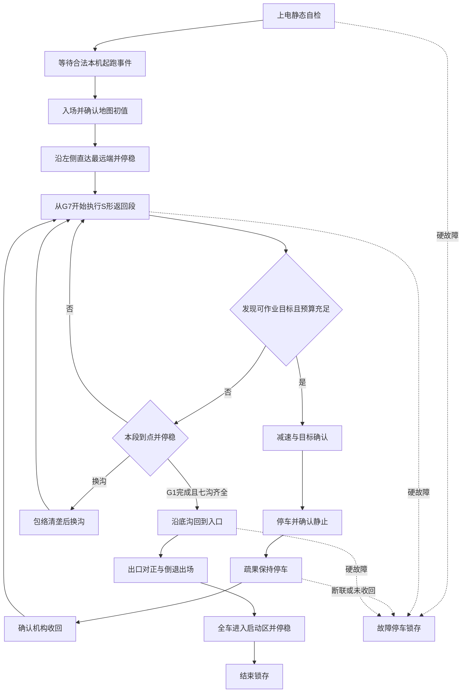

# 芒果疏果机器人底盘电控项目指南

> **2026-11-13当前车端已部署入口真实约束与日志分时发送优化版`A12ACF1E…6C919D`，基线为回退后的1ECA。** 完整回归、49项Python及三个模式构建通过。烧录前1ECA完整1MB已逐块读取校验，新镜像五块有效字节全部verify通过并复位。UDP1348/VOFA1347与13通道波形恢复，当前停稳、零输出、IMU 2000/2000；新版本实车运动效果待验收。FullMapWork默认WORK、0.30/0.10、origin=0，单独跑图先在VOFA选NAV并按实际入口重新登记。备份、校验和旧版复盘见[本轮记录](work/full-map/20261113-round-review.md)。

> 历史垄沟优化版`A103D103…1904A`曾完成烧录和分块校验，后按用户要求回退至1ECA，再部署上方两项优化。实现与历史验证见[垄沟分析](CAN_WORK_DEBUG.md#aisle-tuning-20261112)。

> 当前修订`1ECABF80…09210`完整回归及三个模式编译通过，已写入H723，Verified OK并复位，原1MB固件已完整备份校验。入口采用左侧贴墙、纵向里程计，1.5m内确认真实北墙后融合逼近；入口右侧跳变/超时不参与常规行驶准入。换垄使用连续纠偏与近墙优先定位，端点规划延迟0.35s，软限速额外距离20mm/速度余量0.02m/s；100mm、0.5s动态制动延迟、0.10m/s²制动预算和地图包络保留。实车待验收，详见[修订及验证](CAN_WORK_DEBUG.md#lane-tuning-20261112)。

> 2026-11-12激光/里程计一致性与连续纠偏版本`E6B93D7C…D0C59`已完成完整回归、49项Python和三个模式构建，并Verified OK烧录复位。实车0.30/0.10已完成全图，仍有5次暂停与换垄重复调轮；0.50/0.10入口4次暂停，正在针对修复。新桥接已加载中文UTF-8状态，显示拒绝原因、运行/暂停和纠偏信息；同名`vofa-zh-*.log`为中文记录，`straight-console-*.log`保留完整原文。入口起点范围仍为Y=-0.8至0m，前向应正对远端围栏，读数约4.56至5.36m。修复内容、仿真对照和保护边界见[最新联调记录](CAN_WORK_DEBUG.md#laser-odom-20261112)。

> 2026-11-12前一车端为行进纠偏版`00CF24D1…E6889`，16:07已Verified OK并复位，完整回归和三个模式构建通过。先前283F版入口两次停顿已复现为前向跳变读数触发0.10m/s²动态制动预算；G4发生过99mm近距暂停及MAP_ENVELOPE。新版保留原100mm、地图包络与动态制动门限，只修正行进纠偏和坡道耦合，实车效果待验收。证据及未验证项见[最新记录](CAN_WORK_DEBUG.md#nav-correction-20261112)。

> VOFA现为7组33条。01组“选择单独跑图模式”发送UI MAP MODE NAV，允许肘击器和视觉断电，底盘按全图路线及12个树位各停留2秒完成导航测试。“选择联合疏果模式”发送UI MAP MODE WORK，使用疏果就绪和完成握手。停稳且任务未准备时切换，切换后重新登记起点。FullMapWork上电默认WORK，StraightTest为NAV。当前模式见TEST_MAP_STATUS的mode字段。详细步骤见[联调说明](CAN_WORK_DEBUG.md#navigation-only-mode)。

> PR #16离线复审追加修复：忽略当前树任务尚未被对端确认时的在途READY，保留确认后复位和500ms超时保护；F407周期OLED改为逐页传送，动作/复检期间推迟屏幕重初始化。当前两端需重新构建烧录后联调，离线证据、工具链要求及已部署版本区别见[复审记录](CAN_WORK_DEBUG.md#offline-review-pr16)。以下烧录块为各阶段历史记录。

> 本次两端烧录均已Verified OK。断电后离线发现并修复相机断线后READY保留问题，最终F407候选待下次上电更新。配套代码位于firmware-elbow，部署哈希、备份与待办见[联调说明](CAN_WORK_DEBUG.md#2026-11-11部署进度)。

> 2026-11-11全图疏果协同候选位于 `feat/chassis-station-work`。操作与协议见[联合调试说明](CAN_WORK_DEBUG.md)。VOFA精简为31个按钮，行驶五档0.30至0.70m/s，接近五档0.05至0.25m/s。联合作业使用FullMapWork底盘固件和ELBOW_TEST_MODE=2疏果固件。两端编译及25种组合联合仿真通过，烧录与实机验收待进行。

> 2026-11-11遥控链路修复位于`fix/remote-link-recovery`，基于`167a09d`。UART5接收中断卡死会自动重启，SWA/SWD采用端点容差，失联后在回中、停稳及连续VRB许可满足时恢复。手动周期日志已控制发送批次。当前恢复步骤、回归覆盖和实车验证边界见2.1节。

> 当前部署：连续全图、默认0.20m/s（五档至0.60）、入口连续直达G7、段末±3°、终点20mm、激光100mm。已Verified OK并更新VOFA/桥接；最新操作见8.1.14–8.1.15，以下早期部署块为历史。


> 2026-11-09提交前实测补充。20261109-paused-guard部署后已记录4轮4m WALL完整往返，设置依次为速度/加速度1.50/0.20、1.00/0.20、0.50/0.10、1.00/0.20，均ROUND_COMPLETE。第一轮出程动态近距暂停、返程激光等待后恢复，其余3轮未记录暂停事件。各轮初始右墙距473/486/492/496mm，返程原始右距最大541/571/533/581mm，最大偏离68/85/41/85mm；返程航向误差峰值约1.73/2.07/1.34/2.29度。横向反馈基本跟随指令，返程偏左及沿墙方向标定仍待完善，轮式里程到点不代表地面位置精度验收。S21C厂家四路源码缺陷已回放复现，独立候选工程完成构建与主机测试，采集板尚未烧录。当前桥接日志`build/logs/s21c-audit-bridge.stdout.log`持续记录。

> 2026-11-09最新底盘部署`build/deployed/20261109-paused-guard/`，原1MB备份`build/backup/before-flash-20261109-210606-050.bin`，Verified OK并复位。修复LASER_WAIT恢复分支中单帧近距直接终止的问题，首次独立近距保持零输出并等待确认，重复缓存或越界原始值不确认；下一独立有效帧仍在同方向近距才报COLLISION_GUARD，清晰恢复则等待两帧有效更新和连续停稳200ms再续行。三点中值、动态制动保护、5秒恢复上限及近距停车保留。完整回归、43项Python测试和93源构建通过，包含现场token8后方103mm单帧恢复及持续近距终止回放。新版本实车运动待复测。最近token6为0.50/0.50设置，后方过期暂停后完成；token7为1.50/0.50，实际返程0.941m/s时后距2772mm低于5030mm动态保护线，暂停后完成；token8为1.80/0.50，等待中后方单帧103mm导致终止，本版修复该分支。底盘复位后参数恢复默认0.50m/s、0.20m/s²，HOST测试需重新选择参数。当前COM12/UDP1348至VOFA1347持续接收，日志`build/logs/s21c-audit-bridge.stdout.log`。S21C修复候选已构建、未烧录，原始测距跳变仍需后续采集端验证。

> 2026-11-09当前为三点中值修复版，归档`build/deployed/20261109-laser-median/`，原1MB备份`build/backup/before-flash-20261109-194629-915.bin`，已Verified OK并复位。下方相邻帧阈值版本已被本版替代。控制距离使用最近三个独立有效样本的中值，200ms内无新有效样本则重建窗口；同一时间戳不重复入窗，超过15m的原始值不入窗也不续期。0–1100mm立即进入近距保护，释放后由中值窗口恢复，持续抖动不再因相邻距离不接近而锁住旧缓存。关键数据过期或近距确认样本缺失，零输出等待最多5秒；两帧有效更新及连续停稳200ms后恢复，持续近距或持续失效仍停车。提前限速增加200ms前视、当前帧龄补偿及0.05m/s跟踪余量，总制动反应预算保持0.50s。正常运动的低幅反向反馈需持续100ms确认，反向超过0.30m/s及绝对超速立即停车。完整回归、43项Python测试及93源构建通过，包含1.8m/s上限、0.2/0.3/0.5加速度的延迟测距往返无误暂停场景。复位后STOP、停稳、零输出、硬件就绪及13通道波形已核查，UDP1348/VOFA1347持续监听，当前日志仍为`build/logs/laser-recovery-bridge.stdout.log`。新版本实车往返待复测。后方原始65xxx及范围内持续跳动仍存在，H723软件过滤无法确定其物理或采集端原因，需继续核查S21C原始解析、质量及量程。已取得用户提供的STP23L资料并核对单路例程风险，S21C实际四路采集工程仍待提供，见5.2节。

> 2026-11-09激光突变及恢复修复已烧录，归档`build/deployed/20261109-laser-recovery/`，原1MB备份`build/backup/before-flash-20261109-192804-444.bin`，Verified OK并复位。保留15m接收上限，原始波形不滤。控制距离的变化量门槛为100mm加3000mm/s乘帧间隔，计算间隔上限200ms；超过门槛的新值须在200ms内由下一独立时间戳样本确认，孤立突变不更新缓存和有效时间。0–1100mm读数直接进入保护路径，覆盖可配置车体边界和近距停车。确认时间增加的200ms计入制动预算，总延迟0.50s。关键方向逐路缓存仍在300ms过期，但运行时改为零输出LASER_WAIT，5秒内恢复后须取得两帧独立有效更新并连续停稳200ms才续行，保留航向与制动里程；未恢复时报LASER_RECOVERY_TIMEOUT。真实近距、许可撤销及硬件故障继续停车。新增TEST_PAUSE/TEST_PAUSE_RANGE事件，暂停与故障事件始终可见。完整主机回归、43项Python测试及93源构建通过，含前后尖峰回放、返程过期恢复、缓存重复帧不能恢复、真实调度器零输出及航向保持。烧录后PING、healthy=1、stopped=1、13通道波形正常，实车运动复测待完成。当前日志`build/logs/laser-recovery-bridge.stdout.log`，UDP1348持续桥接COM12/921600至VOFA1347。

> 2026-11-09激光波形版本已部署，归档`build/deployed/20261109-laser-wave/`，备份`build/backup/before-flash-20261109-185752-398.bin`，烧录Verified OK并复位。新增13通道FW帧，通道定义见第4节，周期100ms。COM12桥接增加串口异常每秒重试、连续5秒无有效状态时重新打开串口，并清除旧ARM/GO会话。当前UDP1348桥接至VOFA1347，WAVE已开启，PING、IDLE、healthy=1及13通道帧已收到。完整主机回归、43项Python测试、额外重连会话回归及93源构建通过。断电重连实车复测仍待完成。此前token6在出程3.991m后刚进入BACK，因后方逐路数据过期`stale_mask=0x4`而报LASER_INVALID_OR_STALE，本版增加观测，未修改该退出策略。当前持续日志为`build/logs/laser-wave-bridge.stdout.log`。

> 2026-11-09最新部署为`build/deployed/20261109-guard-stop/`，原1MB备份`build/backup/before-flash-20261109-171103-759.bin`，Verified OK并复位。五档速度0.50/1.00/1.50/1.80/2.00m/s，默认0.50；ACCEL在停车未ARM时可设0.05–0.50m/s²，面板提供0.10/0.20/0.30/0.50，默认0.20。规划减速度仍0.15m/s²，激光制动预算0.10m/s²。贴墙Kp=1.0，横向上限0.08m/s、变化率0.08m/s²；模式6航向Kp=1.2、角速度上限0.06rad/s。手动各轮限速保留1.5m/s，上位机各轮上限2.0m/s。保护暂停持续给零速，等待独立有效测距及连续200ms停稳后恢复；暂停制动中的反向反馈单独处理，正常运动的方向保护及绝对超速保护保留。完整回归和93源构建通过，新参数完整实车往返待复测。UDP桥接已修复Windows端口重置异常，当前后台持续监听1348并独占COM12，VOFA本地1347，运行日志`build/logs/persistent-bridge.stdout.log`。以下同日早期部署为历史记录。

> 2026-11-09后续部署为`build/deployed/20261109-laser-guard/`，烧录Verified OK并复位，原1MB备份为`build/backup/before-flash-20261109-160222-714.bin`。保留15m逐路过滤，新增近距跨独立有效帧确认。首次近距立即给零速并保持任务暂停，下一独立有效帧恢复正常则续行，连续近距则锁定COLLISION_GUARD；缓存重复值和越界原始值不会作为第二次有效确认，300ms未得到有效确认时报GUARD_SAMPLE_TIMEOUT。完整主机回归通过，实车验证待做。贴墙参数仍为Kp=0.5、横向上限0.02m/s、横向变化率0.02m/s²，下一轮记录后再调整。

> 2026-11-09当前调试约定。手动直接跟随摇杆，用户已现场确认遥控恢复；VRB≤1250持续许可保留。松VRB立即停车，再压住且回中停稳即可恢复；硬件故障、失联、明确STOP后仍须SWD复位。修复了接收时间戳竞态引起的瞬时超时误判。上位机六档为0.20/0.40/0.80/1.00/1.20/1.50m/s，复位默认0.10m/s；规划加速0.08m/s²、减速0.15m/s²，激光制动预算仍按0.10m/s²计算，并保留100mm余量提前限速。当前软件激光接收窗口按用户要求为0–15000mm，原始值保留用于诊断，控制使用逐路最近有效值；越界值不续期，超过300ms未更新的必要方向会停车。准备阶段等待有效数据，GO仍检查当前许可；换向WAIT维持零输出，等有效数据和停稳等待完成后再返程，5秒仍未就绪时报TURN_LASER_TIMEOUT。最终镜像、源码改动、备份和验证清单归档在`build/deployed/20261109-laser-15m/`，本补充接续下方旧版记录。

2026-11-09现场证据中，一轮4米在3.990m进入WAIT后因后方65127mm退出，一轮2米在1.991m的WAIT因后方7513mm退出，另一次2米在出程0.956m因前方65024mm退出。这些是旧版7.5m门限和原始越界值直接参与控制时的结果。当前回归覆盖15m边界、单帧异常保留、逐路300ms过期、准备/换向恢复、4m净空限速往返，以及原有故障停车；新版本完整2/4m实车往返仍待验收。

> 更新：2026-11-07。本文是本仓库唯一持续维护的技术指南，按队友首次接手的操作顺序组织；先读第2节，再按需查参数、硬件与开发章节。已完成的现场试验与仅通过编译的功能分别记录；详细过程可从 Git 历史及第8节的证据索引追溯。

## 目录

1. [项目范围与当前状态](#current-state)
2. [详细调试流程：上电、切换、行走与恢复](#quick-start) · [全图空场测试](#full-map-debug)
3. [测试指令、速度和激光保护](#test-programs-v2)
4. [日志、波形与故障排查](#logs)
5. [硬件连接与通信协议](#hardware)
6. [机械参数、零位与标定](#calibration)
7. [代码阅读、构建与维护](#development)
8. [验证结果与证据索引](#verification)
9. [赛题分析与完整自主路线设计](#roadmap)
10. [资料依据与维护约定](#references)

<a id="current-state"></a>

## 1. 项目范围与当前状态

本项目维护 STM32H723 裸机四舵轮底盘，转向为达妙 DM6220，驱动为大疆 M3508/C620。保留遥控、BMI088、轮式/IMU里程计、CAN3测距及与独立疏果控制器的握手；ROS、树莓派业务、原机械臂、吸盘和语音服务已裁剪。疏果电机由另一工程控制，本仓库负责底盘协同。

| 项目 | 截至本次整理的状态 |
| --- | --- |
| 本机仓库 | `E:\大学\竞赛\东方红\Mango-Swerve-Firmware`，分支`feat/map-navigation-mode`，基线`a9f0cc3`；NAV与本轮运动修复为本地未提交改动 |
| 远端 | [water-freemind/Mango-Swerve-Firmware](https://github.com/water-freemind/Mango-Swerve-Firmware)，本机提交与远端同步状态以 `git status` 为准 |
| 代码来源 | [AgroTech-SCAU/Steering-Wheel-Chassis](https://github.com/AgroTech-SCAU/Steering-Wheel-Chassis) 的 `Hephaestus/chassis_control_code`；提取基线 `65088f94be15c69ccfa647779d7f847b06b95735`。原仓库仅作参考，不修改 |
| 当前车端固件 | 2026-11-12 FullMapWork模式6，垄沟连续纠偏HEX `A103D103…1904A`，支持NAV/WORK，已Verified OK，备份及下载日志在aisle-tuning-20261112-223646。复位默认WORK、速度0.30m/s、接近0.10m/s；此前现场选择0.70/0.15，须在许可正常时重新设置。新运动效果待实测 |
| 上次车端更新 | MANUAL新增VRB≤1250许可，超过即撤销；手动自由运动取消自动yaw修正，保留电机闭环和SWB限速。HOST不要求VRB，仍保留航向保持，WAIT段不再清空参考；已部署，运动验收待做 |
| 本地全图修复 | `MAP ORIGIN`使用新鲜前向围栏距离估算入口纵向起点，入口段起点同步调整；定位/测距暂停分别保留超时原因。该候选已烧录但尚未实测全图；本轮没有发送运动命令 |
| 部署后检查 | 旧测试版本曾确认IDLE、healthy=1、停稳和零命令；新版烧录后另查当前来源、标定和SWD，历史状态不能当实时许可 |
| 已有实车结果 | 电机通信、轮位与架空方向、四路激光方向、独立零位回位、低速航向保持、旧单次1米程序到点及SWD撤销许可停车 |
| 新功能验证层级 | 双来源互斥、无需心跳的车端测试、1/2/4米往返、沿墙和靠近均已实现并部署；新增切换和运动效果仍需现场操作验收 |
| VOFA调试入口 | 本机COM12、921600/8N1→UDP1348，VOFA FireWater/UDP1347，7组33条。桥接与VOFA独占各自端口；原始日志记录全部串口数据。Horco重连后串口、PING和13通道波形恢复，遥控online=1、SWC=1500、SWD=1000；已设置NAV及0.70/0.15速度，仍需实际回入口登记起点后由操作者放行 |
| 默认构建 | 仓库默认仍为 `Diagnostics` 模式0。默认构建模式与车上实际固件是两件事 |
| 自主路线设计 | 已核验2026-09-10赛题原件，完成七沟蛇形/回场/作业状态机设计及独立离线几何与时间工具；尚未接入固件，见第9节 |
| 仍待完成 | 新车几何/有效轮径、逐轮转向符号配置、测距逐路失效验证、中高速制动与重复精度、比赛模式、地图定位和完整疏果联动 |

原 Hephaestus 的说明曾混用 Atlas 名称，底盘部分可参考；不能由名称混用推断本车采用原机械臂或ROS流程。旧计划中“零位尚未接入”“CAN3作业协议未定义”“没有右墙控制”等描述已被后续代码取代，当前实现以本文和源码为准。

<a id="quick-start"></a>
<a id="vofa中文命令面板2026-11-07"></a>

## 2. 详细调试流程：上电、切换、行走与恢复

流程顺序是：确定控制来源 → 上电静置 → 静态检查 → 无线与yaw核验 → 单次1米 → 普通往返 → 右墙往返/靠近停车 → 分档提速 → 保存结果。下面的重复次数是调试建议，代码硬门限集中在第3节；没有完成的实车项目仍标为待测。

| 常用步骤 | 跳转 |
| --- | --- |
| 手动遥控/上位机切换 | [2.1 开关表](#debug-control-modes) |
| 手动起停缓加减速候选 | [2.1.1 参数、停车差异与验收](#manual-ramp) |
| 无线近远对照 | [2.4 链路检查](#debug-link) |
| yaw曲线、静置与小角度旋转 | [2.5 yaw核验](#debug-yaw) |
| 1米和往返 | [2.7 单次1米](#debug-one-meter)、[2.8 普通往返](#debug-round) |
| 右侧墙距和靠近停车 | [2.9 沿墙](#debug-wall)、[2.10 靠近停车](#debug-approach) |
| 停止、失败与重新开始 | [2.12 恢复流程](#debug-recovery) |

<a id="debug-control-modes"></a>

### 2.1 同一固件的手动与上位机开关

以下约定适用于已部署的 `8555a15` 组合固件 `StraightTest / APP_RUN_MODE=6`；旧 `f5bc3da` 尚无手动VRB保护，回退时应区分版本，部署状态见第8节。硬件仍用接收机i.BUS接DM板，遥控器无需接电脑。发射机型号疑似FS-i6S，以实物为准；“飞行模式关闭”不是车端许可，应看接收通道原始值。

| 开关/输入 | 设置与用途 |
| --- | --- |
| SWA | `1000±250`，选择底盘控制来源 |
| SWC=`1000` | STOP：不输出行走动作 |
| SWC=`1500` | HOST：只接受上位机测试动作，摇杆须回中；摇杆偏转撤销本轮测试许可 |
| SWC=`2000` | MANUAL：只接受遥控摇杆，拒绝上位机ARM/GO/HB；保持VRB≤1250并重新放行后才能行驶 |
| SWD | `1000±250`停车/撤销许可，`2000±250`允许当前来源；首次放行须先观察到关闭，再回中、停稳后开启 |
| SWB | 手动低/中/高档：1000/1500/2000对应平移上限0.4/0.8/1.5m/s、旋转上限1.5/3.0/6.0rad/s |
| VRA | 大于1200，通常保持1500 |
| VRB | 仅MANUAL要求原始值≤1250，等于1250仍满足；>1250进入保护并撤销手动许可。HOST不作门槛，可以回中 |
| 右杆X/Y、左杆X | 启动/重新放行时回中1500±10；手动放行后可正常推动 |

SWC有效识别区间为1400–1600=HOST、1900–2100=MANUAL，其他值为STOP；SWA/SWD按上述有效原始值判断。不要只按“拨杆朝上/朝下”描述，因为发射机通道正反设置可能不同。

**当前遥控恢复规则。** 首次启用、运行中或等待恢复期间的硬件故障、明确STOP以及SWA/VRA许可撤销后须重新关闭再打开SWD。正常SWC切换先结束旧任务并清零输出，保留此前的SWD关闭确认，包括经过中间STOP位置。遥控失联超过100ms时撤销行走输出，保留此前的关闭确认；数据恢复后须摇杆回中、车轮停稳、SWA/VRA有效、VRB≤1250才重新放行。VRB松开同样先停车，重新压低后须回中、停稳。HOST中的VRB回中不清除确认，切入MANUAL时须满足VRB门槛。接收机持续离线、偏杆或未停稳时均等待。

UART5在200ms内没有接收完成回调时中止并重启单字节中断接收，UART错误或启动失败按10ms间隔重试，恢复操作保存调用者的中断状态。遥控在线时间取自实际有效帧，主循环重复读取缓存不会延长有效期。SWA/SWD采用现有250通道值容差，避免999/1001或1999/2001等端点偏差撤销许可。

组合固件的手动周期日志输出遥控、健康、状态与波形，自动任务的周期快照在其他模式输出，减少阻塞式无线日志对手动控制周期的占用。发送耗时回归模拟每条日志6ms，连续5000轮手动控制保持有效，最大日志批次30ms；额外插入51ms控制间隔仍触发停车。主机回归另覆盖接收静默卡死、UART错误、启动失败、时间戳回绕及100次失联恢复。实车射频断联恢复仍需专项复测。

本次通过Horco CMSIS-DAP v2（332107140234，auto后端）完成原1MB备份读回校验、StraightTest写入、Verified OK及复位。原固件保存在`firmware/build/backup/before-flash-20261109-135439-796.bin`，镜像、SHA256、源码改动和烧录日志归档在`firmware/build/deployed/20261109-mode-switch/`。完整主机回归及93源构建通过。此次尚未采集复位后的串口状态或进行实车运动验收。

MANUAL仍是摇杆控制前后、横移和旋转的自由遥控，VRB只作为这一来源的安全许可，不增加新的模式，也不需要上位机ARM/GO或选择1/2/4米程序。`vx/vy/wz`均由摇杆给定，保留电机闭环、速度限幅和SWB三档，手动过程中不启用yaw航向保持，左杆旋转轴回中时不自动补旋转。HOST直行、往返和沿墙测试继续使用航向保持；切换来源会清除上一来源的航向保持状态。

**恢复手动的具体步骤：**

1. SWD先切1000，三个摇杆轴回中；确认车辆已经停稳。
2. SWA=1000、SWB=1000低档、SWC=2000、VRA>1200；将VRB压低并保持≤1250，以遥控快照的原始通道值为准。
3. 上电或复位后保持整车静止，等IMU `ready=1、cal=2000/2000`；查电机反馈和 `TEST_CONTROL source=MANUAL、hw_ok=1、release_seen=1、vrb_required=1、vrb_ok=1`。
4. 保持摇杆回中和VRB≤1250，将SWD切2000。看到 `manual_armed=1` 后，右杆前后控制前后、右杆左右控制横移、左杆左右控制旋转。平移合速度和旋转受SWB所选上限约束，车轮限速也会约束组合运动。
5. 手动过程中持续保持VRB≤1250；超过1250即撤销许可、清零速度并停止输出。若该旋钮会弹回1500，松手就会进入保护，压低后也不会直接恢复原动作。
6. 停车也可用SWD=1000或明确发送STOP。普通VRB松开或遥控数据失联后，链路恢复、VRB压低、回中停稳且SWA/VRA有效即可恢复。硬件故障、SWA/VRA许可撤销或明确STOP后，须重新关闭SWD、回中停稳、满足许可后再打开。正常SWC切换保留SWD关闭确认。

**新保护的首次检查。** 先架空确认轮组不接触地面，按上述低档步骤验证。SWC=2000时，VRB保持1500应看到 `vrb_required=1、vrb_ok=0、manual_armed=0`。保持VRB≤1250并完成首次SWD放行后才可响应。低速输出期间松开VRB，核对 `manual_armed=0`、速度命令清零。重新压低VRB但保持偏杆时继续等待，回中且车轮停稳后放行。遥控断联后同样检查零输出及回中停稳恢复。明确STOP或硬件故障后检查必须重新关闭再打开SWD。最后SWD关闭、回中，再切HOST核对 `vrb_required=0`。这些是待现场执行的验收步骤，1250允许、1251拒绝的边界由主机回归覆盖。

切到上位机前同样先SWD=1000、停稳回中，再把SWC切1500、SWD切2000，并重新ARM/GO；HOST不要求保持VRB，允许松手回中。切回手动要重新执行上述手动放行步骤。切换会清除待处理串口片段并结束旧任务，旧token不能续跑。

手动不依赖VOFA、无线串口心跳或激光定距；串口错误和上位机旧运动命令不撤销手动许可。明确的STOP是两种来源共用的停车命令。模式6的 `TEST_STATUS healthy`表示HOST测试能否准备，因此手动时出现 `healthy=0、blocked=HOST_NOT_SELECTED`是预期；手动许可看 `TEST_CONTROL manual_armed/hw_ok/vrb_required/vrb_ok`和电机反馈。`hw_ok=1`仅表示硬件反馈通过，不代替VRB门槛、SWD重新放行和回中条件。

独立构建的 `Manual/ManualStandalone`（模式1/5）保留其原VRB流程，不能套用本表；本轮不改该模式开关映射，但其调用的共享底盘/电机服务已有修复，须重新构建与低速验证。组合固件使用模式6的102mm名义轮径、启动均值零偏和共享零位，手动摇杆方向与SWB三档设置沿用既有映射。

<a id="manual-ramp"></a>

#### 2.1.1 手动起停缓加减速：源码候选，尚未烧录

2026-11-07用户反馈：当前机械结构手动第三档直接满杆容易翻车，第二档尚可。记录为现场现象，没有据此推算重心高度或已验证加速度。新增[manual_ramp.c](../firmware/src/service/manual_ramp.c)仅接入组合固件的MANUAL；HOST距离/墙距规划沿用原规划器；模式1/5未接入S曲线，但本轮共享底盘与电机服务也有改动，不能视为底层完全不变。摇杆仍决定自由运动目标，未恢复自动yaw保持，也未改变SWB三档上限。

| 命令变化 | 初始参数 | 含义 |
| --- | --- | --- |
| 平移加速 | 0.20m/s² | 限制`(vx,vy)`向量变化量，斜向不叠成两倍，换档也经过斜率 |
| 平移正常减速 | 0.30m/s² | 松杆/降低目标时渐减；不是急停 |
| 旋转加速/正常减速 | 0.40 / 0.60rad/s² | 仅限制摇杆角速度目标变化，没有航向闭环 |
| 平移/旋转jerk | 0.80m/s³ / 1.60rad/s³ | 普通轨迹限制加速度变化率；目标改变时先平滑消除当前加速度 |
| 目标重规划带宽 | 0.006m/s / 0.024rad/s | 对应两个高速档遥控计数；零目标、初次运动与反向不延后，避免杆量微抖导致不断重规划 |
| 平移/旋转耦合 | 目标`速度×角速度`预算0.30m/s² | 双向结合当前输出限制新目标；不是输出瞬态硬约束，也不是实测稳定上限 |
| 反向 | 先将整车平移与旋转目标降到0，再等四轮新鲜反馈停稳 | 平移新旧向量点积<0或旋转反号触发；过零后至少留一个零输出周期再向新方向起步 |
| 转向未到位 | 准备步最多0.002m/s、0.004rad/s，不累计 | 按底盘真实驱动门控判断；调轮期间维持小目标方向，门控开放后从小值继续爬升 |
| 调度异常 | 时间间隔超过50ms或输入非有限数，撤销手动许可 | 不用丢失的时间补发一大步速度，需要重新放行 |

当前候选已由线性速度坡道更新为**分段恒定jerk的S曲线**。目标变化先消除当前加速度，再转向最新目标；小幅非零目标采用重规划带宽，避免遥控噪声反复取消加速。它不是实车防倾覆保证。原转向到位门控仍可立即抑制驱动；机械载荷、重心、轮胎滑移及同时平移/旋转产生的加速度仍需实测。参数集中在[manual_ramp.h](../firmware/src/service/manual_ramp.h)，初值未经过实车调参。

**区分正常减速与保护停车。** SWD=1000、VRB>1250、遥控失联、切换控制来源、显式STOP以及硬件故障均立即清空坡道/速度缓存，并沿原停车路径停止输出；不等待上述渐减过程。这里“立即”指软件指令撤销，不代表惯性和物理制动距离为零。普通松杆则保持手动许可并渐减，不能把回中当作紧急停车。

命令曲线对比：若平移已达1.5m/s，原线性坡道正常减速约5.00秒、3.75m，当前S曲线候选约5.38秒、4.03m。**平顺性改善会增加普通停车距离**；旋转也需要额外的加速度过渡时间，不能再沿用恒定减速度公式当作完整S曲线停车量。以上未计实际执行误差，**狭小区域不适合验收高档满速和回中停车**。后续若正常停车距离过长，应在低速记录实际响应后调整减速参数与档位上限，而不是绕过安全开关。

候选固件烧录后的队友验收步骤：

1. 静置完成IMU标定，SWD=1000、摇杆回中，先核对启动日志含`manual_ramp ... unverified=1`；当前车上旧8555a15没有此功能。
2. 按2.1进入MANUAL，用低档、小幅杆量检查前后、横移及旋转。观察`TEST_RAMP target/output/reversing`，目标可阶跃，输出应缓变；`TEST_CONTROL`仍显示许可状态。短时起停用9.18的TRACE记录，约1.6秒一条的普通RAMP日志不适合计算峰值jerk。
3. 在空间允许且低速时验证松杆渐减、反向先停稳再启动、转向未到位不突然放大驱动。不要用抬车/移动DM板混入IMU静态标定。
4. 低速验证SWD停车、VRB撤销、遥控失联及HOST/MANUAL切换：旧目标不恢复；重新许可必须关闭SWD、回中停稳、保持VRB≤1250，再开启SWD。
5. 按前后/横移分别记录负载、档位、目标/反馈速度、起停时间、真实停车距离及晃动，再逐档提高。高速档只在已验证净空和足够制动空间内试，不凭编译通过宣称不会翻车。

日志开关仍用09组现有“HEALTH”项，新增`TEST_RAMP`归入其中；安静模式不刷屏，“静态状态检查”仍返回最近缓存的RAMP，时间戳不是新采样。仓库桥接脚本已支持，运行中的旧桥接要重新启动后才加载；本轮未操作用户的VOFA窗口或串口。

### 2.2 打开VOFA和UDP桥接

2026-11-09本机实际环境为`E:\vofa+\x64\vofa+.exe`、COM12、921600/8N1；下方D盘和COM19是原机器配置。当前已安装11组命令并打开FireWater/UDP，本地1347、远端127.0.0.1:1348。后台运行`firmware/straight-console.ps1 -Port COM12 -BaudRate 921600 -WavePort 1347 -CommandPort 1348 -UiOnly -AllowMotion -ExitWithVofa`，ARM/GO入口由用户明确授权，启动后由用户点击程序按钮。通过UDP发送PING已收到车端`TEST_ACK ok=1 cmd=PING`，STATE/REMOTE/IMU/MOTORS/CAN/LASER快照均有新鲜缓存回传。原始运行记录在`build/logs/manual-direct-motion-bridge.stdout.log`。VOFA先连接UDP后再启动桥接可避免尚无接收端时的UDP连接重置。现有联合启动器仍使用COM19，此机器重启调试时须显式指定上述COM12桥接参数。

1. 完全退出VOFA，再双击 `D:\Vofa +\x64\Mango-VOFA-Test-OPEN-AREA.cmd`；联合启动器安装命令并打开VOFA/后台桥接，不自动启动运动。只做静态检查可用 `Mango-VOFA-Static.cmd`，它拒绝ARM/GO。
2. VOFA选择FireWater、UDP，本地1347，远端127.0.0.1:1348，再点连接。桥接独占COM19、921600/8N1，VOFA不能同时直连串口。
3. 在“00 停止与连通”点“连通检查（不运动）”的发送按钮，看到车端 `TEST_ACK ok=1`。仅选中命令、看到本机UI文字或改变通道名称，都不证明指令到达车端。
4. 在“01 静态状态检查”依次查询整车、遥控、电机、CAN、IMU、激光；在09组按需选日志或波形。默认简洁，安静模式仍能查看ACK和主动查询。

`Mango-VOFA-1m-OPEN-AREA.cmd`是通用运动入口的兼容别名。Static只限制这条上位机入口，不是遥控急停；若SWC=2000且手动已放行，打开Static不会阻止遥控。

**开始后的测试由车端独立执行：关闭VOFA、退出桥接或无线失联不再自动停车，也不要求持续心跳。** 结束调试应先用SWD=1000或STOP确认停稳，再关闭软件。重新打开桥接不会自动接管或重跑已经开始的任务。

### 2.3 上电后的静态检查

上电/复位前先放稳DM板和整车、SWD=1000、摇杆回中。启动标定采集2000样本，按4ms周期约8秒，不含外设初始化和日志延迟；以实际 `ready=1、cal=2000/2000`为准。`TEST_READY`只是入口初始化提示，不等于标定已经完成。

**为什么重新上电要等一会才能手动遥控？** 组合固件保留IMU标定、电机反馈新鲜度和停稳检查，即使手动已取消自动航向保持，也不会绕过这些启动条件。标定期间移动整车会影响零偏采样。标定完成后若仍不放行，依次查`hw_ok`、SWC档位、`vrb_required/vrb_ok`及`release_seen/manual_armed`；SWD一直留在2000不会自动使能，需先1000、回中停稳、保持VRB≤1250，再切2000。

| 查询 | 重点字段 | 能否继续 |
| --- | --- | --- |
| 整车状态 | `control`、phase、stopped、cmd、blocked、result、CONTROL | 当前来源正确，停稳、命令为零；HOST放行后应healthy=1、blocked=NONE |
| 遥控器开关与摇杆 | online、SWA/B/C/D、VRA/B、switches_ok、centered、vrb_required | 在线，开关符合2.1；MANUAL的vrb_required=1且VRB≤1250，HOST为0；MANUAL的switches_ok包含VRB门槛 |
| 四轮电机 | ID/轮位、steer_seen/drive_seen、state、age_ms、drive_rad_s | 四轮转向state=1，八路反馈都新鲜；静止驱动速度近零 |
| CAN1/2/3 | off、passive、tx_fail、rx_fail、lost、CAN ID | 电机总线无总线关闭/错误被动及发送故障；检查0x601仍更新 |
| IMU | ready、cal、age_us、imu_errors、实际零偏 | 标定完成、样本新鲜，之后按2.5核验静止yaw |
| 四路激光 | 左/右/后/前、fresh、age_ms、body_edge_mm | 新自动测试必须满足第3节；基础healthy并不包含全部激光准入 |
| 时序 | control_dt、max_ms、IMU间隔 | 持续正常；CONTROL_TIMING或采样陈旧先处理，不用加速绕过 |

ARM阶段和上电待命保持当前轮向；开始运动后才计算目标轮向并检查转向到位。因此“上电轮组没转”不能单独作为CAN故障依据。手动初次放行也保持回中，先小幅推动确认各轮响应。

<a id="debug-link"></a>

### 2.4 无线近远距离/隔墙对照

先不运行行走测试。车静止、SWD=1000，使用同一固件、921600波特率、同一日志负载：

1. 电脑端接收器距车约1–2米、无遮挡，采集30–60秒，留原始日志和起止时间。
2. 只改变接收位置，移回原远距/隔墙处，再采集相同时长。不要同时重烧、改变日志负载或搬动车身。
3. 比较完整TEST_STATUS数量、120字节断尾、乱码、停更和PING回复。10Hz为约数，不能仅凭条数把无线丢包率精确算出来。
4. 近处明显改善支持传播条件参与故障；两处都不好仍需排查串口参数、缓冲/打包和接收处理。重复观察到固定断尾也不能证明某个硬件缓存上限。

关闭VOFA的显示分类不会减小MCU原始输出量。烧录Verified OK只证明该次下载校验成功，不证明持续串口稳定，也不是射频RSSI测量。新固件运行不依赖状态回传，但看不清实时状态时仍先完成静态排查。

<a id="debug-yaw"></a>

### 2.5 yaw波形、静置和旋转核验

1. VOFA用FireWater/UDP，在09组展开“FireWater波形数据（10Hz）”点开启。通道0=yaw、1=参考yaw、2=角度误差（前三路为度）、3=wz修正（rad/s）。通道名字可以改，解析由固件的FW数值帧完成。
2. 增益设1、偏移设0，Auto适配范围。曾出现增益为0导致全零；不要只看固定±5°窗口判断有没有数据。
3. 车完全静止，点02组“开始静置漂移记录”，保持约60秒，再点“结束记录并显示角度变化”。记录elapsed_ms、delta_yaw_deg，同时查IMU/RAW/BIAS/DRIFT及温度。
4. 5秒DRIFT是局部斜率；wheel_still只说明轮速，不证明车身没有被搬动。较大的累计yaw可能包含实际转动，应比较同一静置区间的变化，而不是要求绝对角度为零。
5. 在允许小角度旋转的区域，点“开始手动小角度旋转记录”，保持驱动未放行，人工缓慢转动车身到已知方向/角度，再结束记录。按钮只记录，不会驱动电机；转动后另开一段静置记录。

历史上经用户确认静止的一段59.8秒净变-0.028126°、范围0.109995°，仅作对照。每次冷启动和长期温漂尚未证明都达到同样水平；若确认静止却再次出现此前约0.2°/s的持续单向变化，先核验启动采样、安装和温度，不把调大航向增益当作零偏修复。

### 2.6 上位机每次开始的共同步骤

停稳 → SWC=1500、SWA=1000、VRA>1200、摇杆回中 → SWD=2000 → 查HOST就绪 → 选速度 → 在目标组准备 → 看到 `arm_ready=1` → 4秒内点同一程序/距离的开始。

必须看到对应token的 `TEST_ACK ok=1 phase=2 reason=RUNNING`或匹配RUNNING状态。若GO确认超时，实际是否开始未知；新版不会因此自动STOP，不要连续重发GO。先用遥控停车并查状态，再重新准备。

开始只发送一次，车端不要求HB，不依赖后续上位机状态接收。里程终点、激光、遥控与基础健康检查在车端执行；正常完成、STOP、模式切换、遥控失联或故障后，都不会自动重跑。按“准备”前先确认本轮速度，因为ARM后不能改速度/贴边基准。

<a id="debug-one-meter"></a>

### 2.7 单次1米前进

1. 固定地面、载荷和机构姿态，在地面标出起点、前进方向及1米终点，用同一车体基准点测量。先把车身对右墙摆平行，另一侧无需有墙。
2. 在08组选0.10m/s，查 `SPEED_SET、vmax=0.10`；03组准备并开始。该组仍不启用激光限位，不能把墙边读数当作其自动避障能力。
3. 看s、vx、cmd、yaw/ref/wz；到点后应 `phase=4、result=TARGET_REACHED、stopped=1`，并现场确认车已停稳。STOP/SWD中止的结果不能计为到点样本。
4. 量地面距离、横向偏移和车头偏角，建议同条件重复3次。现有约103.2cm是用户一次近似值，不是已经完成3次重复标定。

将距离尺度误差、车头旋转和平行横移分开记录。不要一次同时改零位、轮径和航向PID。

<a id="debug-round"></a>

### 2.8 普通1/2/4米往返

1. 保持0.10m/s，先做04组单程1米；检查四向激光新鲜、均在70–7500mm、读数均高于基础保护线。沿前后路线留出相应制动和整车外廓空间。
2. 准备并开始同一距离，观察 `leg=OUT → WAIT → BACK`：车前进、连续停稳200ms并等待2秒、再倒退，车头不掉转；全过程不需要电脑继续发指令。
3. 终态应 `ROUND_COMPLETE、phase=4、stopped=1`。记录出程地面距离、实际返回点与起点差、横向偏移和最小净空。中途停止不会自动倒退回起点。
4. 1米重复正常后再做2米，随后4米。面板的4米是单程，总路程约8米；4米程序返回的是同次里程积分起点附近，不等于地图定位精度已验证。

<a id="debug-wall"></a>

### 2.9 右墙定距往返

1. 使用右侧连续、平直、能被当前激光高度测到的墙；尽量摆平行。先选0.10m/s、05组单程1米，暂不与提速同时做。
2. 查询右侧原始读数及有效性，当前软件接受窗口为150–15000mm，并满足四向基础保护。数值是光学窗口到墙，不是车壳净距；以共用110mm基准估算净距约为“原始右距减110mm”，右侧尚未独立标定。
3. GO捕获当前右距为 `right_ref_mm`，并锁定当前yaw；保持的是这一次起点墙距，不是预设强制靠到某个值。程序同时用yaw修正旋转、vy修正侧向距离。
4. 观察 `right_mm、right_ref_mm、vy、yaw/ref/wz`：离墙过近时向左修正，倒退仍按同一车体坐标修正。观察横移是否出现持续抖动，以及真实整车最外沿的净空。
5. 正常应 `ROUND_COMPLETE`；门洞、换目标或右距偏差超过250mm可触发 `WALL_DISTANCE_JUMP`。先确认测量目标，不用增大增益追随突然跳变。
6. 1米稳定后再测试2/4米，与相同地面、速度的普通往返对比。尚无新墙距控制的完整实车验收结论。

<a id="debug-approach"></a>

### 2.10 前方靠近停车

1. 确认接口4确为前方，目标平面能被激光看到，前方整车包络已核对；先查110mm共用贴边基准是否仍适用当前机构姿态。
2. 06组默认目标为原始210mm，即基准+100mm。ARM起点需大于目标+30mm，默认大于240mm；已经很近会返回 `FRONT_ALREADY_CLOSE`。
3. 准备并开始后车端最高0.05m/s，进入目标+10mm内请求零速，正常终态为 `FRONT_DISTANCE_REACHED`并确认停稳。这里的10mm是触发容差，不是实际停车精度保证。
4. 最多前进1米；如果起点离目标太远，可能先达到 `APPROACH_TRAVEL_LIMIT`，不能记为正常定距停车。失败或STOP都不会自动后退。
5. 记录起始/最终原始距离、车体实测净距、制动过程和退出原因。激光只看到自身光束目标，不代表上方疏果机构一定无碰撞。

### 2.11 贴边记录与速度分档

07组只做静态记录：先SWD=1000、停稳，挡板贴齐对应方向的整车最外沿且光束打在同一平面，再点记录。左侧项会把读数向上取整到5mm后发送 `EDGE ALL`，更新四向共用基准；右/后/前项只记录，不改参数。确认 `EDGE_RECORDED、body_edge_mm`，测试前移开挡板。

08组只在停稳且没有ARM/运行时改上位机测试速度，点后看车端 `SPEED_SET/vmax`，不能只看本机speed_requested。当前可选0.20/0.40/0.80/1.00/1.20/1.50m/s，第三档对齐手动二档；参数仅存RAM，复位恢复0.10及110mm。旧速度指令保留兼容，靠近停车仍最高0.05m/s。手动SWB三档沿用原值；手动已放行时拒绝修改测试参数。短行程和净空限制会使实际速度低于所选上限。

建议先完成低速距离、方向、停车与遥控开关复核，再逐档提高速度并重复测刹停距离。短路程可能达不到上限，靠近停车始终最高0.05m/s。第3节预算线随闭合速度增大，例如0.50m/s前方约1530mm；不能用静止130mm保护线理解所有快档条件。

<a id="debug-recovery"></a>

### 2.12 停止、故障恢复和收工

1. 需要停车时优先切SWD=1000；若电脑链路可靠，也可点00组STOP。明确STOP对手动和上位机都生效。
2. 看驱动反馈近零、stopped=1，并现场确认停稳。FAULT/软件“停止请求”不等于物理已经停止；模式切换也要先停稳，不直接带摇杆切换。
3. 保存首个故障或拒绝原因、程序/token、速度、四向距离、CONTROL和原始日志路径，再按第4节处理。不要连续点开始覆盖最初证据。
4. 重新启动上位机测试要查当前HOST许可并重新ARM/GO；手动要在MANUAL档重新执行SWD关闭、回中/停稳、保持VRB≤1250、打开SWD。旧编号和旧摇杆输出均不自动恢复。
5. CAN发送故障锁定等需要复位的情况，先排查连接，再在车静止、SWD=1000时复位并重新完成启动标定。只有PC显示丢失时先排查链路，不把它写成电机故障。
6. 收工先停车并记录结果，再退出VOFA/桥接。**退出软件不发隐式STOP，不能将关窗口当急停。** 原始日志、备份与部署归档保存在本机build目录，按9.3模板记录本趟结果。

<a id="test-programs-v2"></a>
<a id="指令启动的单次1米测试固件2026-11-07"></a>

<a id="full-map-debug"></a>

### 2.13 全图空场测试：模式6实车调试

**当前范围。** 用户确认按原尺寸搭好四周围栏和0.4m入口，起跑区四周无围栏；当前不放树、垄等道具。模式6全图调试入口不发送疏果器命令、不要求作业板握手，也不改变比赛作业/合法启动条件。它用于空场开发验收，不计比赛完赛。2026-11-10段0故障已查明并部署前向围栏起点标定修正；修复后的行走验收仍未完成，详见8.1.4。

**部署状态和版本。** 2026-11-10 14:49，基于`d76ca21`加本地全图起点修复的`StraightTest`模式6已烧录，OpenOCD `Verified OK`；完整原Flash备份为`firmware/build/backup/before-flash-20261110-144950-707.bin`（1,048,576字节），部署日志为`firmware/build/flash-full-map-candidate-20261110.log`。复位后UDP日志确认`healthy=1`、`stopped=1`、IMU标定`2000/2000`、`TEST_MAP_STATUS ... reason=NEED_ORIGIN`。没有发送ARM/GO或运动命令，修复后的全图行走尚未验收。今后重烧仍需先让车辆处于安全静止状态，并显式选`StraightTest`；不要烧默认Diagnostics产物：

```powershell
powershell.exe -NoProfile -ExecutionPolicy Bypass -File firmware/flash-local.ps1 -Mode StraightTest -DapBackend hid
# 脚本会重新编译、读取并校验1MB备份，再烧录并校验StraightTest镜像。
# 本次已完成；复位后等待IMU标定再执行ORIGIN。不要重复烧录来代替版本确认。
powershell.exe -NoProfile -ExecutionPolicy Bypass -File firmware/vofa/start-vofa-panel.ps1 -Mode Motion
```

现场要求端口COM19、921600，UDP波形1347/命令1348（USB重枚举后以设备管理器为准）。旧桥接不能与新入口并存；新面板共96条，含第12组。当前启动日志`full_map_proto=1`，状态为`TEST_MAP_STATUS proto=1 ... reason=NEED_ORIGIN`；下一步是静止检查并登记起点，而非直接ARM/GO。新全图入口与有限预测都在H723，本轮不要求重新烧录S21C。烧录和IMU标定期间不要移动整车，不会自动启动全图。
**路线与起点坐标。** 复用`auto_route`的17段：入口段从人工对准的x=0.20、前向围栏测距推算出的y起点，接到(0.20,0.20)；随后走到(0.20,4.40)，再G7至G1下降蛇形，最后沿G1回左侧、从原入口退回。车头固定朝地图+Y（yaw=90°），横向段采用舵轮横移，不掉头。空场没有实体垄，但仍按规则通道的虚拟包络校验，不能用空地直穿垄区替代遍历。

**先布置、后登记。** 起跑区无围栏，故不能仅凭固定P的纵坐标定位。车停稳后将中心x对准0.20m参考线、车头朝+Y；“登记起点”要求前向激光有新鲜有效样本且射线关联到场内远端围栏，以该量程推算纵向y，并只修改入口段起点，地图内其它围栏/路线坐标不动。当前候选允许推算y在-0.80至0.00m；超出会返回`ORIGIN_OUTSIDE_ENTRY_ZONE`，不会先启动再等0.4m定位超限。IMU只建立地图角度偏置，不清空原始yaw。进场后再用左右围栏修正横向位置。登记后不能搬车；切到手动/STOP模式会使登记失效。

| 操作顺序 | VOFA第12组动作 | 预期与限制 |
| --- | --- | --- |
| 1 | 先等待IMU标定、检查电机/四路距离 | SWD=1000、摇杆回中；人工确认疏果器收拢或拆下，软件没有读到实际收拢证明；安装、零位和线序沿用前面验收流程 |
| 2 | SWC=1500；点击“登记起点” | SWD仍=1000，车停稳、x=0.20参考线对准、车头朝+Y；回执`ORIGIN_FRONT_ANCHORED`，并记录`TEST_MAP_ORIGIN source=FRONT_WALL front_mm=... y=...` |
| 3 | 设置全图速度0.10m/s | 独立于普通直线SPEED；支持0.05/0.10/0.15/0.20/0.30，默认0.10。最新候选进门采用设定速度，退出段仍限0.05 |
| 4 | SWD=2000，点击“准备下一段” | SWC保持1500，HOST健康且停稳，当前位置离当前段起点≤50mm、航向差≤0.08rad；准备不运动 |
| 5 | 收到map_arm_ready=1后4秒内点“开始” | 桥接自动带本次MAP编号，无心跳；未经回执不能开始，旧固件拒绝新入口 |
| 6 | 逐段核对终点、车头、误差与激光 | 最新候选首段连续到(0.20,4.40)，段号0直接跳至2，随后横移通过G7；每段结束SEGMENT_DONE，需再次准备/开始下一段 |
| 7 | 逐段确认后再“准备全图剩余路径”→“开始” | 从当前未完成段继续；不会跳过中间段或重新伪造覆盖。不需要电脑持续反馈 |
| 8 | 必要时“暂停全图”/“继续全图” | 用户暂停不会自行恢复；继续需停稳、许可及必要观测通过。不是从FAULT中强制续跑 |
| 9 | 正常结束 | DONE、segment=17、coverage=0x7f、速度指令归零；还需外部确认整车停在启动区、无碰撞，不把里程计终点当实测精度 |
| 随时 | SWD=1000或全局停止 | 撤销许可/模式切换立即退出当前任务；故障后须回到地图入口并重新登记；入口y由前向围栏估算，x和朝向仍须人工对准 |

全图调试允许最长15分钟、每段120秒，不采用比赛300秒成绩逻辑。默认低速闭环仿真约354秒，本身已超过比赛时限，不宣传为5分钟比赛方案。上位机关闭不替代遥控安全开关，GO之后不以电脑心跳维持行走。

**位姿融合与异常降级。** `field_pose.c`用四轮反馈投影速度连续积分，IMU提供航向；空场模型只有四周围栏，南边保留入口，不向虚拟垄或未来树位关联测距。各路新鲜且接纳距离≤7.5m、接收年龄≤200ms、地图射线命中、残差≤150mm的观测单独参与小幅校正，平行墙只约束其法向位置，不假装2路就总能求出完整二维位置。每个轴的融合增益0.15、单次修正≤5mm；重复接收时间戳不重复校正。入射角过小、转速>0.1rad/s、异常距离或残差超限的通道退出定位修正，其余通道继续使用。

接收时间戳不代表STP23L真实采样时间。新增“近似不变读数却有法向轮式位移”检测：距离相对检查点变化≤5mm，而独立累计轮式法向位移超过30mm时，拒绝该路定位修正；平行墙运动的恒定读数不因此误剔除。该方法不能识别所有重发/缓慢异常，更不能修复S21C校验错误。任一地图轴在没有可靠修正的情况下累计移动超过0.4m，进入POSE_OBSERVATION_PAUSE，避免无限依赖里程计；这只是开发阶段降级门槛，不是实测定位协方差或准确度保证。

定位与行进防撞分开：只要求行进方向/实际运动方向对应的必要射线有效，不要求四路全好；对其他方向的有效近距读数仍保留保护。没有地图围栏的进出门射线允许依已登记位姿低速通过，但实际近障仍保护，不能将开口当作测得了无限净空。全图初始采用四向155mm中心外廓、光学位置按CAD中心外移40.98mm估算，实际整车收拢包络和光学零点仍须外部核对；不得把旧153mm布局或CAD的55/65mm通道净空直接当激光原点。

测距/定位保护暂停要求停稳，必要方向两帧独立真实更新并连续稳定200ms后恢复；5秒未恢复锁存故障，超时日志保留`POSE_OBSERVATION_TIMEOUT`或`RANGE_PAUSE_TIMEOUT`来源，不再统一掩盖为`RANGE_TIMEOUT`。切换模式、遥控掉线、SWD关闭、CAN/UART/IMU故障不自动续跑。每段先用`chassis_prepare_velocity`只预置轮向：即使四轮已对准，驱动目标仍强制为零；确认对准后，运动规划从零加速，普通遥控不调用此入口。

**有限距离预测。** `laser_prediction.c`仅桥接前/后远距通道的短时空档，不覆盖左/右贴墙观测，不参与位姿融合、不生成真实更新位。要求真实锚点>1100mm、CAN仍新鲜、轮速和IMU健康、速度≤0.50m/s、累计转角≤2°、距最后真实接纳样本≤600ms、累计路径≤0.20m；按反馈位移减少距离，并扣除20mm、路径与转角余量，不能因远离墙面而增加可用净空。预测期间向0.15m/s低速降级，范围超限仍进入原暂停/停车。全图和右墙测试均保留真实近障优先，ARM、正常换向WAIT、已发生保护暂停的恢复都不能靠预测放行。它不会消除所有连续异常，也不会屏蔽上一轮前方918mm这类近距读数。原始/接纳13通道波形不被改写。原FW的yaw仍属于IMU原有参考系，MAP_STATUS的yaw属于登记后的地图系，不能要求两者同时显示90°。

**上位机与协议。** 原有81条命令保留，第12组增加15条全图操作/日志开关，共96条。原始设备命令为`MAP ORIGIN`、`MAP SPEED 0.10`、`MAP ARM NEXT`/`MAP ARM ALL`、`MAP GO <token>`、`MAP PAUSE`、`MAP RESUME`、`MAP STOP`、`MAP STATUS`；面板封装为`UI MAP ...`，GO编号由桥接处理。手动与全图互斥，普通直线运行时不能准备全图，全图活动时拒绝普通ARM/GO与调参。`TEST_MAP_STATUS`报告阶段、0基段号、7位覆盖、地图x/y、yaw和原因；`TEST_MAP_POSE`报告本轮实际参与/剔除观测位、约束轴、必要射线和预测位以及各轴无修正里程；位顺序为左/右/后/前，axes位0=X、位1=Y，used=0可能只是这一控制步没有新测距。`TEST_MAP_ACK/EVENT`、显式查询的`TEST_MAP_SNAPSHOT`与`TEST_PREDICT`事件保留显示，`UI LOG MAP ON/OFF`单独开关全图周期日志；后台完整落盘不受显示开关影响。

**树位和工位预备文件。** 按用户2026-11-10策略，G6作业/标定R6、G5对应R5，直到G1对应R1；G7只通行，不作业、不标定树。`auto_route`原有`aisle=7,row=0`及`aisle=1..6,row=aisle`已与此一致，新增测试锁定该对应关系。这样后续的计划路线不再返回刚作业的上方沟，但不能保证落果绝不滚入后续路径，近障保护保留。

工具`tools/full_map_setup.py`只在电脑保存数据，不连接串口、不上传树位、不动作：

```powershell
# 仓库根目录执行；init不会覆盖已有标定文件。
py -3 -B tools/full_map_setup.py init
py -3 -B tools/full_map_setup.py check
py -3 -B tools/full_map_setup.py preview
# 以下仅为命令格式示例，不是已测树位；有真实测量后才填写。
py -3 -B tools/full_map_setup.py tree --id 11 --row 6 --x 1.20 --y 4.05
py -3 -B tools/full_map_setup.py station --id 11 --aisle 6 --vehicle-x 1.20 --vehicle-y 3.70 --yaw 90
```

默认文件`firmware/build/full-map/profile.json`（本地标定，不入Git），预览`preview.svg`。`trees`保存真实树心地图坐标；`stations`另存对准该树时的车体中心/航向，不能相互替代。支持仅记录工位而树心未知；G7、行/沟不匹配、非数值/非有限坐标、重复树号/同垄超过2棵等会拒绝。坐标合法不代表机械可达。当前空场固件不读取此JSON，不据此停车或疏果；后续增加实际垄/树时需更换地图关联模型并校核伸出量，不能直接把空场模型用于带道具的自动作业。

验证证据与未完成实车项统一见第8章；工作记录位于`docs/work/full-map/`，不替代本节操作教程。
## 3. 测试指令、速度和激光保护

### 3.1 面板分组

| 组 | 功能 | 运动与边界 |
| --- | --- | --- |
| 00 | STOP、PING | STOP取消本次测试；PING不启动、不续期运动 |
| 01 | 整车、遥控、IMU、激光、电机、CAN查询 | 返回最近收到的缓存，保留板端时间与状态年龄；不是重新触发传感器采样 |
| 02 | 静置/手动旋转记录 | 只在主机标记并统计yaw变化，不清零yaw、不转动电机 |
| 03 | 单次1米前进FWD | 轮速里程积分+航向保持；沿用用户要求，**不启用激光限位** |
| 04 | 普通ROUND往返，单程1/2/4米 | 前进、停稳200ms后等待2秒、倒退返回；不转车头，仅一轮，启用四向激光保护 |
| 05 | 右墙WALL定距往返，单程1/2/4米 | 在往返与航向保持基础上，GO时捕获右距并横移纠偏；要求右侧连续平墙 |
| 06 | APPROACH前方靠近停车 | 传感器接口4；目标为贴边基准+100mm；最高0.05m/s、最多前进1米，不自动退回 |
| 07 | 四方向静态贴边记录 | 左侧项向上取整到5mm并更新四向共用基准；其余方向只记录，不覆盖参数 |
| 08 | 六档测试速度 | `0.20 / 0.40 / 0.80 / 1.00 / 1.20 / 1.50m/s`，仅停稳且未ARM时可设置 |
| 09 | 日志/波形分类开关 | 只控制发往VOFA的数据，后台完整记录与车端控制不受影响 |
| 10 | 底盘同步采集（候选专用） | START/STOP只控制采集；CLEAR/DUMP需遥控在线、SWD关闭、反馈新鲜且停稳；停止采集不会停车，详见9.18 |

往返中的距离是**单程距离**，4米档总路程约8米。`TEST_PLAN leg=OUT/WAIT/BACK`表示出程/等待/回程，`x`是相对起点的带符号前向里程估计，`out`记录出程停稳位置。返回沿同一次里程积分回到起点附近，不是定位系统已验证回到原坐标。

速度按钮设置上限。短程可能尚未达到上限就开始减速；当前加速`0.08m/s²`，终点规划减速`0.15m/s²`。ROUND/WALL按行驶方向净空及原`0.10m/s²`制动预算提前限速，预留100mm余量；遇突发危险仍执行停车保护。原组03也使用所选上限，且仍无激光限位；靠近程序独立限制在`0.05m/s`。

### 3.2 距离与航向控制

- 模式6使用四轮输出轴角速度，按安装符号、`R=0.051m`及轮向前向投影取平均后积分；M3508驱动层已扣除`3591/187`减速比。不是用IMU加速度二次积分测距离，也不是直接调用普通模式的完整位姿融合结果。
- GO锁定BMI088当前yaw。航向控制Kp=`0.8`、gyro_z阻尼Kd=`0.1`，wz限幅`±0.03rad/s`；控制周期约10ms。
- 出程剩余约10mm时请求停车；往返停稳后记录出程位置，回程按净位移接近起点停车。程序到点不等于地面距离已经标定准确。
- 右墙控制Kp=`0.5/s`，5mm死区，新CAN帧才以0.25系数滤波，横移上限`0.02m/s`、变化率`0.02m/s²`。外部`+vy`向左，前后行走的横移纠偏符号相同。右距偏离起步值超过250mm退出。

### 3.3 贴边基准与保护停车

用户把挡板紧贴车体左侧，并确认已发生接触。连续读数为`108、109、109、108mm`，取`110mm`作为用户指定的**四向共用初始贴边基准**。只有左侧做了这次实测，不能写成四个方向均已独立标定；改变外廓或疏果机构姿态后需重新核对。

| 参数 | 当前值与含义 |
| --- | --- |
| 贴边基准 | `110mm`，不是传感器量程下限 |
| 基础保护线 | 基准+20mm，即静止时约`130mm` |
| 前方正常停车目标 | 基准+100mm，默认原始读数`210mm`；读数进入目标+10mm内请求零速 |
| 新组04–06数据准入 | S21C聚合帧新鲜、四向读数均在`70–7500mm`；WALL额外要求右距`150–3000mm` |
| 参数保持 | `SPEED`和`EDGE ALL`仅存RAM；复位恢复`0.10m/s`及`110mm` |

右墙范围150–3000mm按光学窗口到墙计算，保持的是GO时捕获的起始右距。按共用贴边基准估算，车体净距约为原始右距减去110mm；该差值不是右侧独立标定结果。运行中右距偏离参考超过250mm会退出。

闭合方向在基础保护线外再加入以下距离预算，使用当前反馈与命令中的较大闭合速度：

```text
保护线(mm) = 贴边基准 + 20 + 1000 × [v × 0.30 + v² / (2 × 0.10)]
```

前进看前方，倒退看后方，横移分别看左右。例如`0.50m/s`的前向预算线约`1530mm`，没有闭合速度的方向仍约130mm。计算结果见 `TEST_BRAKE`。减速度和延迟是初始预算，实际刹停能力仍待分档实测；公式不是已验证的刹停距离。

静态记录时车保持不动，用平板靠齐对应方向的整车最外沿，确保激光打到同一平面。07组左侧记录会更新共用基准，车端ACK和 `TEST_PLAN body_edge_mm`可确认；其他方向只留下测量记录。贴边挡板未移开时，新测试会拒绝准备或触发保护，不能靠重复发送开始或保持连接绕过。

### 3.4 协议、状态与退出

USART1采用`921600 / 8N1`、大写ASCII、LF或CRLF。正常使用只点中文按钮；底层接口供维护和排查：

| 车端命令 | 行为 |
| --- | --- |
| `PING` | 回显状态，不启动运动 |
| `ARM` | 准备原单次1米FWD |
| `ARM ROUND 1` / `2` / `4` | 准备对应单程距离普通往返 |
| `ARM WALL 1` / `2` / `4` | 准备对应单程距离右墙往返 |
| `ARM APPROACH` | 准备前向定距停车 |
| `GO <token>` | 在ARM后的5秒有效期内，按一次性编号启动 |
| `HB <token>` | 仅兼容旧工具，正确运行编号可被接受；不续租、不要求发送，也不控制停车 |
| `STOP` | 无需编号，取消本轮；之后仍需确认停稳 |
| `SPEED <档位>` | 仅接受六个固定速度值，准备/运行时拒绝修改 |
| `EDGE ALL <mm>` | 停稳且未准备/运行时设置70–1000mm共用基准 |

UI侧使用`UI ARM/GO ROUND <距离>`、`UI ARM/GO WALL <距离>`、`UI ARM/GO APPROACH`等白名单；桥接核对ACK中的程序、距离和token，发送一次GO。准备前要求新鲜状态、协议2及`hb_required=0`，检测到MANUAL/STOP会拒绝HOST运动命令。开始后不要求状态继续回传、不发HB，不因退出桥接而发隐式STOP；等待回程和返程由车端独立完成。STOP后不自动返回。

`phase=0/1/2/3/4/5`依次为IDLE、ARMED、RUNNING、STOPPING、DONE、FAULT。原组03正常完成为`TARGET_REACHED`，往返为`ROUND_COMPLETE`，靠近为`FRONT_DISTANCE_REACHED`；主动STOP为`ABORT`。FAULT只说明程序请求停止，物理停稳仍需现场和反馈确认。

模式6检查转向/驱动反馈≤100ms、转向state=1、IMU采样≤100ms及标定、HOST摇杆回中、CAN错误、HOST串口错误、非有限数值和控制时效。控制间隔>50ms、航向偏差>0.15rad会退出。每段运行时限按`目标距离/所选速度+15秒`计算，靠近为35秒；出程超程裕量100mm，回程越过起点100mm退出，最终停车确认超时3秒。CAN发送故障锁定至重启，故障/结束后需重新准备。

<a id="logs"></a>

## 4. 日志、波形与故障排查

### 4.1 分类控制与完整记录

09组提供“安静”“默认简洁”“全部开启”预设及17类独立开关。默认只显示STATUS、HEALTH、PLAN，STATUS/PLAN最多1Hz，波形关闭。ACK、初始化错误及主动查询回复始终显示；后台仍接收并保存完整串口原文，车端状态机不会因关闭显示而停止。

| 类别 | 主要内容 |
| --- | --- |
| STATUS | phase、token、目标距离、里程、速度、yaw、阻塞原因、result |
| HEALTH | 多项许可阻塞位、反馈掩码、遥控/IMU/UART/CAN检查；也控制TEST_CONTROL的来源/许可，以及候选固件TEST_RAMP的目标/坡道输出/反向等待 |
| REMOTE | SWA/B/C/D、VRA/B、摇杆原始值、在线、回中及许可结果 |
| MOTOR | 各轮ID/轮位、反馈年龄、转向state、原始/轮向角、驱动速度和电流 |
| CAN1 / CAN2 / CAN3 | 三条总线分别开关，含收发、失败、丢帧和总线错误 |
| IMU / IMU_RAW / IMU_BIAS | 标定/姿态状态、原始与修正陀螺、实际零偏及温度模型，分别开关 |
| DRIFT | 静止窗口yaw/gyro变化率；轮速静止不等于整车没有被搬动 |
| LASER | 激光完整诊断、计数、帧龄；control反映最后选择的测试程序，实际是否生效结合CONTROL来源及BRAKE.active |
| RANGE | 5Hz四向毫米值及聚合帧时效 |
| PLAN | 协议版本、程序/阶段、所选距离/速度、墙距参考、贴边/停车目标 |
| BRAKE | 按闭合速度计算的四向保护线 |
| TIMING | 控制/IMU间隔、更新错误及hb_required=0；不再有心跳租约 |
| WAVE | 10Hz FireWater数值帧，与周期文字日志独立开关 |

接口为 `UI LOG <类别> ON/OFF`，预设为`UI LOG QUIET`、`UI LOG DEFAULT`、`UI LOG ALL ON`。开关控制本机UDP出口，不是关闭MCU采集或S21C发送。主动快照仍可查看被隐藏类别；串口状态超过500ms未更新时返回`UART_STATUS_STALE`，不把旧缓存当实时值。

完整记录位于`firmware/build/logs/straight-console-*.log`。助手读取这些文件即可观察车辆，不需要与VOFA抢占COM19。程序启动未自动连通VOFA时，仍需在界面点连接。

模式6的实际串口输出采用最多64字节一块、每块后间隔1000µs的发送方式，保留原始日志内容。该处理针对无线接收中出现的大量120字节断尾，正常手动模式保留原阻塞写接口。关闭VOFA周期显示不会减少MCU原始发包量，不能将显示安静当作无线链路已无丢包。

现场token=11/13均收到RUNNING确认，随后主机因状态更新超时请求STOP。接收原文显示多条长记录恰在120字节处截断；这是状态传输异常的证据，尚不能证明无线模块内部的具体缓冲/分包机制。分段发送固件部署后，20秒静态采集中200条状态全部完整、120字节断尾为0；仍须复测运动期间的状态连续性。该次修复仍使用旧400ms/500ms主机保护和750ms心跳。之后用户明确要求取消PC持续依赖：当前组合固件不再有状态超时停车或车端心跳租约；GO确认500ms超时只报告实际运动状态未知，不发自动STOP。无线接收质量仍单独检查。

距离和隔墙造成的无线衰减也未排除，不能把断尾现象直接等同于某个缓冲区上限。后续先保持车静止、使用同一固件/波特率/日志负载，电脑端在距车约1–2米无遮挡的位置采集30–60秒，再到原远距/隔墙位置采集同样时长，比较完整状态条数和断尾数量；此对照不发送ARM/GO、不重启车端。若远处明显恶化，支持无线传播条件参与故障；若两处相近，继续排查缓存、打包和接收处理。一次烧录校验成功只证明那次下载成功，不能作为持续串口稳定性的验收。无线距离与建筑遮挡的一般影响参见[TI射频范围说明](https://www.ti.com/tool/RF-RANGE-ESTIMATOR)，本型号的射频参数与RSSI/重传统计尚未取得。

### 4.2 yaw波形

选择FireWater，在09组开启WAVE。数值帧以`FW:`开头，末尾为真实换行。通道0为yaw、1为参考yaw、2为环绕归一化误差，单位均为度。通道3为wz修正，单位rad/s。新增通道4–7为左、右、后、前原始激光距离，8–11为相同顺序的最近有效距离，单位均为mm。通道12为逐路有效位掩码，左/右/后/前对应1/2/4/8，全部有效为15。有效距离缓存过期后仍保留数值，须结合有效掩码判断，不能将平线视为持续有效。13通道同一数值帧每100ms输出，桥接兼容旧4通道帧。原始越界值保留用于观察，包括65127。旧日志中的`yaw/ref`曾为rad，新`yaw_deg/ref_deg`为度。

把控件命名为yaw不会自动解析文字日志。若后台已有FW帧但曲线仍为0，检查通道绑定、增益=1、偏移=0并Auto适配量程；本机曾出现保存配置中增益为0。未激活航向保持时参考、误差和修正清零，不代表当前yaw为零。新增自由遥控版本的MANUAL不使用自动航向修正，仍可观察yaw；HOST测试的航向参考及纠偏照常工作。

### 4.3 常见提示

| 提示/现象 | 含义和处理 |
| --- | --- |
| `FIRMWARE_PROTOCOL_2_REQUIRED` | 桥接没有收到新鲜`TEST_PLAN proto=2`；先区分旧固件与串口未更新。旧1米程序不能执行新往返；已烧新版后查串口/桥接和PLAN |
| `LASER_NOT_READY` / `LASER_INVALID_OR_STALE` | 新程序激光数据未满足范围或时效。部署后曾见前方约7582–7585mm，超过7500mm接受上限；核对实际目标、读数和所选程序准入条件 |
| `ARM_ACK_MISMATCH_OR_NOT_READY` | 主机未接受准备回复；具体原因看车端TEST_ACK的reason。例如LASER_NOT_READY不等于编号出错 |
| healthy=1、plan=FWD仍准备失败 | healthy是基础许可；被拒前尚未切换到请求程序，FWD的laser_ok=1不代表ROUND/WALL已满足激光条件 |
| `RC_OFFLINE` / `RC_SWITCH` / `RC_STICK` | 分别检查接收链路、开关原始值、摇杆回中；模式6的MANUAL须保持VRB≤1250，HOST不要求VRB |
| MANUAL中`vrb_ok=0、manual_armed=0` | VRB超过1250，处于手动保护。保持VRB≤1250、回中停稳后恢复；首次启用、硬件故障或明确STOP后须先重新关闭再打开SWD |
| `COLLISION_GUARD` | 某方向进入保护线；先核对挡板、车体包络、贴边基准和BRAKE读数 |
| `WALL_DISTANCE_JUMP` | 右距偏离起步参考超过250mm，可能遇到开口/换目标；本轮退出 |
| `FRONT_ALREADY_CLOSE` | 靠近程序起点已在停车目标附近，不再向墙移动 |
| `PLAN_OR_DISTANCE_MISMATCH` / `CLICK_ARM_FIRST` | 准备与开始不匹配或编号已失效；在正确组重新准备，再开始 |
| 车端ARM ok=1但没有arm_ready | 主机没有保留本次准备；桥接已修复上一轮DONE/FAULT状态在新ACK之前清除等待的问题，以本次arm_ready=1为准 |
| `STATUS_OR_GO_ACK_TIMEOUT` / `STATUS_TIMEOUT` | 旧桥接的自动停车提示；当前组合固件/桥接已取消此依赖，仍看到旧提示应核对固件与桥接版本 |
| `go_confirmation=TIMEOUT motion_state=UNKNOWN` | 未及时确认GO结果，不等于没开始或已经停车；新版不自动STOP，用遥控停车后核对状态，再重新准备 |
| `FIRMWARE_ONE_SHOT_REQUIRED` / `SELECT_SWC_1500_HOST` | 需本次hb_required=0组合固件，或需将SWC切1500；先查来源和当前固件 |
| `UART_ERROR_OR_OVERFLOW` | HOST串口异常；本轮不自动续跑。手动来源下接收器错误不撤销手动许可 |
| `CONTROL_MODE_CHANGED` / `HOST_NOT_SELECTED` | 来源切换取消旧任务，或当前不是HOST；手动看TEST_CONTROL，恢复HOST须重新准备 |
| `ARM_ACK_TIMEOUT` / `UART_STATUS_STALE` | 车端回复或状态没有及时到达；不要反复点开始 |
| 只有`UI SNAPSHOT ...`和失败ACK | 可能将主机UI命令直发给MCU；确认VOFA用UDP、桥接监听1348 |
| 上电轮组不转预备方向 | 模式6按设计保持当前角度；GO后才生成行走轮向 |

`TEST_HEALTH blocked`可同时包含多个原因，first只显示优先项：`0x0001/0002/0004`为转向反馈/驱动反馈/转向状态，`0x0008/0010/0020`为遥控离线/开关/回中，`0x0040/0080/0100`为IMU采样/陈旧/标定，`0x0200/0400/0800/1000`为非有限值/UART/电机发送/CAN总线。所选程序的激光拒绝原因还需看ACK/result及PLAN，不能只看这组基础阻塞位。

<a id="hardware"></a>

## 5. 硬件连接与通信协议

### 5.1 三条CAN与供电

| DM板接口 | 连接对象 | 当前约定 |
| --- | --- | --- |
| CAN1 | 4个达妙6220转向电机 | 1Mbps，转向ID1–4，反馈Master ID `0x11–0x14`，位置速度模式 |
| CAN2 | 4只C620及各自M3508 | 1Mbps，C620 ID1–4，反馈`0x201–0x204`；驱动索引0–3在服务层转换为物理ID1–4 |
| CAN3 | S21C、DM主控、独立疏果控制器 | 共享经典CAN 1Mbps；测距`0x601`，作业请求/回复`0x610/0x611` |
| UART5 | 遥控i.BUS接收机 | 115200 bit/s，RX反相配置；代码按FS-iA10B协议接收 |
| USART1 | 无线DAP虚拟串口/VOFA桥接 | PA9 TX、PA10 RX，921600 bit/s，8N1 |
| SPI2 | BMI088 | 姿态与陀螺；安装轴向和刚性应保持一致 |

DM主控通过CAN控制电机，动力电源另走配电。达妙6220接其自身驱动器的CAN与电源，不再接C620；每只M3508通过原厂7-Pin数据线及三相线连接对应C620，CAN2接的是C620，不是M3508裸电机。

DM-MC-Board02 V1.1资料中板输入为12–24V、CAN1/2为P2/P3；两针信号口为1=L、2=H。CAN3扩展口10脚H、12脚L，GND从1/3/5/7脚按实物核对；MCU侧为PD12 RX、PD13 TX、AF5。外部节点接收发器后的H/L，不能直连MCU管脚。板卡修订、插座视角和电机电压仍以实物铭牌/手册为准；C620额定24V，不能从主控输入范围推断6220的额定电压。

三节点CAN3采用主干加短支线，整条总线只在两个物理末端各放120Ω。S21C资料有板载终端，是否接入需结合三板位置决定；断电H/L约60Ω只作初检。板卡CAN收发器需要相应5V供电，源码仅显式控制CAN1/2使能，CAN3供电/收发器按板卡实物核对。

当前 `chassis_can_map.h` 中 `CHASSIS_CAN_BUSES_SWAPPED=0`，即转向CAN1、驱动CAN2。若两支路整组接反，该开关可同时交换收发绑定；先用Diagnostics核对报文与实物支路，不以发送运动帧作盲探。2026-11-05曾测到C620在CAN1，后来已换线并修复转向线序，当前映射已恢复默认。

### 5.2 STP-23L与S21C

#### 2026-11-09四路源码排查结论与当前安排

用户提供完整资料`E:/大学/竞赛/东方红/WHEELTEC_S21C主控资料_V2.0_2025.05.21/`，已核查其中2026.7.8 STP23L四路工程。修复副本位于`E:/大学/竞赛/东方红/S21C-STP23L-Firmware/`。用户当前决定先调底盘，S21C更新后续安排。采集板尚未烧录，身份探测实际读到Cortex-M7，程序已在身份检查处终止。

| 项目 | 证据及影响 |
| --- | --- |
| 测量点/时间戳边界错误 | 四路处理最后一个测量点后将状态加到190，同次中断又把同一个字节处理成时间戳首字节，后续校验位置错位。厂家原版IRQ回放中，完整正确帧未计入成功计数 |
| 校验失败仍更新距离 | 四路均在校验成功分支外将第一个测量点写入输出。原版回放证实错误校验的109mm帧仍被发布，能引起虚假的近距停车 |
| 帧内过滤被覆盖 | 12个时间序列点的汇总结果被第一个点覆盖，无法抑制单点异常。USART3汇总写入通用distance变量，实际第2路依靠后面的覆盖赋值更新 |
| 累计及数值风险 | 部分汇总计数和全局累加值跨帧不清零，距离累加字段为16位。协议距离为有符号16位，负值经无符号输出后显示为65xxx |
| 逐路失效不可见 | 原版聚合发送未提供逐路时间或有效位，串口停止有效更新仍可反复发送旧距离，H723所见CAN帧新鲜度不能证明传感器新鲜度 |
| 光学、供电、线缆及量程 | 模块标称0.07–7.5m。4m出程使后方目标变远，可能进入量程边缘。反光、遮挡、供电和接线也可能影响测量，尚无实测证据确定这些因素的占比 |

采集板修复副本采用完整校验后提交、每帧12点的有效样本低位中值、至少6个0–15000mm样本、负值/越界剔除、串口错误复位、100ms逐路有效期限及原子一致打包。过期或无足够有效点输出0xFFFF，配合H723逐路过滤；该期限避免持续重复旧值续期。已通过四路真实IRQ回归和厂家原版缺陷对照回放，39源GCC构建生成`build/s21c-stp23l.hex`及BIN，未进行采集板实机验证。`flash-local.ps1`会核对F103高密度ID和256KB容量，备份原256KB后才写入。本次探测读到M7即停止，未写入其他固件。

底盘当前仍为20261109-laser-median版本。现用COM12/921600，桥接进程45412，UDP1348至VOFA1347，WAVE、LASER、RANGE、BRAKE已开启。当前日志`firmware/build/logs/s21c-audit-bridge.stdout.log`。近期静态状态为STOP、停稳、零输出，四路有效掩码0xf；实际运行结果须按后续测试日志判断。

| 项目 | 资料/当前使用方式 |
| --- | --- |
| STP-23L供电与串口 | 典型5V、范围4.5–5.5V；TX为3.3V信号，230400 bit/s、8N1；不是S21C的高压输入 |
| S21C供电 | 外部直流10–26V；也可Type-C台架供电；CH9102为USB设备端，不是DM可直连的TTL口 |
| 模块测量 | 标称0.07–7.5m，约120个时间序列测量点/秒；近距资料指标含平均误差±15mm、标准差5mm，不能据此保证整车毫米级停靠 |
| 原始数据 | STP-23L原始帧约195字节，含12个时间序列点和质量信息；12点不是12个方向 |
| S21C输出 | CAN约10Hz，`0x601`、标准经典数据帧、DLC8；另有115200 bit/s的11字节USB串口帧 |
| 使用边界 | 原厂STP23L例程曾由用户烧录；车端镜像保持原状，本地独立维护副本现见5.2.2，尚未烧录 |

用户曾测到0–7cm仍有读数但相对误差较大；仅保留为历史现象，不安排专门近距标定。四个模块现集中在车底中部，光束水平朝外；光学窗口坐标、光轴误差及整车不同姿态包络仍需登记。

S21C例程把四路UART各自更新的数值合成一帧，不带逐路有效位、置信度或采样时刻。静态检阅发现校验判断外仍可能覆写距离、发送失败返回值未被主循环处理，属于待实测的失效风险。不能把新CAN帧当作四路同步且均有效，也不能仅凭数值不变判定传感器卡死。

2026-11-09用户提供本机资料`E:/大学/竞赛/东方红/乐动STP23L测距传感器资料/`。其中开发手册v0.1的PDF第6页规定距离为`int16_t`，例如65132按有符号数解释为-404，具体负值含义未在已查协议中给出。2025.4.1 F103库函数单路例程ZIP内`UART1/HARDWARE/usart3.c`在校验成功分支外执行`distance = Pack_Data[0].distance`，因此错误校验帧也可能覆写输出，同时覆盖此前均值。其`data_process()`内局部`Pack_sum`未初始化，距离累加使用16位字段，12个有效7.5m测量点的总和也可超过该字段范围。此包只能证明所提供单路例程的风险，不能确认车上S21C四路固件实际沿用。当前资料目录中的S21C仅有百度网盘链接，实际四路工程尚待提供；进一步修复须在实际工程中执行完整头/长度/校验验证、临时缓冲提交、有效测量点筛选和32位累加，再发布逐路状态。

用户随后补充`E:/大学/竞赛/东方红/乐动STP23L测距传感器资料/2.原理图与芯片手册/`。已渲染核对S21C原理图，主控为STM32F103RCT6，四路测距串口为CN1 PA2/PA3、CN2 PB10/PB11、CN4 PC10/PC11、CN5 PC12/PD2，CH9102接PA9/PA10，CAN接PA11/PA12。该目录含原理图及芯片手册，四路采集程序源码仍待提供。

#### 5.2.1 2026-11-09四路原厂源码复核与修复验收

本次本地已快进到`51fced7`（PR #8），并在D盘原资料包的`1.例程源码/S21C搭配STP23L使用例程（2026.7.8）/`找到实际四路工程；上文“尚待提供四路工程”仅为此前在E盘检阅时的历史状态。厂家目录保持只读。用户截图所述“修复版已编译、测试通过、未烧录”作为交接信息记录，本次尚未取得该修复工程路径，不能独立确认其内容、测试或车端镜像一致性。

| 问题 | 本次代码证据与影响 | 修复要求 |
| --- | --- | --- |
| 时间戳与校验错位 | `HARDWARE/usart2.c`的点数据处理推进到state=190后，同一次接收又进入时间戳分支；`usart3/4/5.c`具有同类结构。末点字节被重复计入，后续字段和校验位置错位 | 每个输入字节仅消费一次；根据协议按完整帧长度验头、长度和校验，正确帧才提交 |
| 错误帧仍更新 | `usart3.c:280–285`中`distance_2 = Pack_Data[0].distance`在校验成功分支外；其余三路也存在相同模式 | 解析使用临时数据，校验失败不更新已发布距离及有效测量时间；错误帧计数独立增加 |
| 汇总失效与溢出 | 四路均有首点覆盖处理结果；`usart2.c`等部分累加清零被注释；12个7500mm样本总和90000超过16位范围 | 每帧清零局部32位累加器，先按协议筛选有效点，再计算结果；不可把负数错误码作为大正距离参与平均 |
| 旧值持续发送 | `USER/main.c`周期发送四个距离，未见逐路有效测量超时判定；某一路停更不阻止其他路和CAN更新 | 各UART独立记录最近有效帧时间，超时明确发布失效；不能用发送时间续期旧测量 |
| 量程和光路 | 源码缺陷可解释异常输出，但不能独自证明后方异常均由软件造成 | 软件修正后固定目标平面、分别交换传感器和采集端口，区分量程边缘、反射、遮挡、传感器、线束和UART问题 |

逐行补充：以`usart2.c:259–279`为例，最后点字节先令state从189推进190，又被下面独立的时间戳if消费，使真实T0/T1/T2进入191/192/193，真实T3在194被当成校验字节；真正的校验字节到达时状态已经复位。错误校验并不必然阻止输出，因为四路的首点赋值均在校验if外。`usart2/4/5.c`的均值分别被后续首点赋值覆盖，`usart3.c:320`则把均值写入全局`distance`而非发布的`distance_2`，同样没有用于CAN。`usart2/4/5.c`还保留静态count和累加值而未逐帧清零；`usart3.c`有清零，不能把这一缺陷说成四路全部相同。四个头文件的distance字段实际均为有符号`int16_t`，累加超过32767即不能完整保存，早于65535边界；负值也会通过`distance != 0`筛选，随后赋给发布用`u16`可能变成大正数。以上为原始源码路径证明，不是车端复现结论。

**DM现有防护的边界：** `laser.c`保留原始值，对≤15000mm的输入进行接收/滤波并刷新对应接受时间；近距≤1100mm直通，避免滤波掩盖近障碍。大于15000mm不续期该路，接受值超过300ms失效。这些是当前软件筛选阈值，15000mm不代表传感器保证量程。若采集板持续重发一个范围内旧值，DM每帧仍会刷新它的年龄；`valid_mask`只能证明近期接受过该数值，不能证明传感器近期完成测量。静止真实墙距也可能长期不变，不能用“连续相同值”直接判故障。

兼容现有8字节`0x601`的候选办法，是由S21C对启动未就绪/逐路超时明确发送约定无效码（例如65535，需双方确认）；DM保留已知数据但不续期，并在失效超时后按测试程序处理。若要传有效位、序号和真实样本年龄，应另行约定状态报文并同步接收端，不能擅自改变现有四距离字段。任何方案均需覆盖断线后的实际停止延迟，不能把300ms数据超时等同于物理停车时间。

**台架验收顺序：** 整车保持停车，先对每一路分别喂有效帧、坏校验帧、丢字节/截断帧和连续帧，确认错帧不提交且后续能重同步；核对12点汇总和大值不会溢出。再逐路断开信号或断电，保持另外三路更新，检查该路在约定时间内明确失效；重连只在新的有效测量后恢复。最后交换端口/传感器并测试实际目标，记录原始帧、各路有效计数/错误计数/年龄、CAN载荷和DM接收结果。新增滤波延迟须计入靠近停车验证。禁止用旧值持续CAN发送作为恢复通过依据。

本次实际执行并通过`test_can3_logic.c`及`test_input_freshness.c`主机编译/运行，覆盖DM的异常值、滤波、逐路接受值超时、RX抢占和时间回绕。仅更新分析文档，未修改固件、未访问串口、未烧录或复测车辆。用户随后确认修复工程在队友电脑、暂时无法取得；当前按原厂源码独立分析，不将截图中的修复状态视为本机已核验结果。

#### 5.2.2 本地独立采集板工程

用户随后授权将激光板工程放入本仓库，现建立[`firmware-s21c/`](../firmware-s21c/README.md)，保留厂家版权声明及82文件来源哈希，厂家原件未改。该副本独立于H723，保留Keil工程并增加GCC启动、链接及构建入口；四UART接统一的STP23L纯C解析器，修复重复消费/错误帧提交/16位累加/首点覆盖，逐路300ms超时和重复时间戳均不允许无限续期。启动/失效发送65535，保持原0x601的四距离字段格式；USB外部使用者也需识别此无效码。统计以调试器查看，不占用新CAN ID。

2026-11-09通信复查补修CAN初始化硬件确认、发送超时撤销/空邮箱确认、USB有界发送及输出优先级；CAN/USB改由同一份快照封包，保留协议字节序。修正时基优先级、GCC临界区内存屏障及旧值过期锁存。解析、实际板级适配层、实际发送模块和DM兼容测试通过；包含1560个单比特破坏、195处删字节、196处插字节和10万字节噪声。GCC完整构建42源，text/data/bss为10356/4/4604字节；厂家外设代码及nosys仍有警告。启动向量、项目引用和厂家原件哈希检查通过。

复查也证实协议8位累加和存在误通过：固定删字节夹具中12个用例发生碰撞。尾部AA重同步修复可恢复后续正确帧，却不能证明所有错误测量都被拦截；结果不能解读成实机误码概率。具体代码边界、测试命令、新HEX哈希及台架项目见子工程README。本次未改变H723源代码，未烧录采集板，队友电脑版本仍未取得。离线兼容检查不等于四路满负载、CAN实物或实际制动验收。

以后维护采集板按STP23L专用例程及FlyMcu教程操作；该F103标准外设库工程与H723工程不同，不能混烧STP23、LD14P或H723镜像。烧录前备份原固件，先按5.2.1台架验收，再进行停车状态下DM联调。

#### 5.2.3 不烧录S21C的DM侧处理评估（2026-11-10）

用户本轮希望保持激光板现有固件，先评估在底盘侧缓解测距异变。当前本地`c778b49`的DM代码已包含：`laser.c`对大于15000mm的值不续期、超过300ms的接受值失效、远距三点中值；小于等于1100mm直接进入保护路径。`straight_test.c`对疑似近障碍先置零输出，按后续帧、停稳及有效性决定恢复或故障；失效恢复等待上限5秒。以上是本地源码状态，不据此推定当前车端镜像版本。

可以在DM侧缓解孤立尖峰、短时越界和短暂掉帧对控制的影响，必要时增加可信度/连续性判断和诊断；不能重建采集板未发送的12点、原始校验或逐路测量时刻。原S21C持续发送范围内旧值时，DM仍会续期；沿平墙行进时相同墙距也可能完全正常，禁止直接按“数值不变”判死机。在明确测量同一连续平面的前提下，轮速/IMU与墙距变化的矛盾可标记为疑似失效并停车，但不能证明具体是哪一侧器件故障。

若调整方案，控制用估计和保护用观测应分开：可疑尖峰先降低控制可信度，真实近障碍仍请求停车；恢复须有后续有效观测和停稳条件。不能通过长时间沿用最后安全距离、屏蔽近距、缩小保护线或取消测距失效保护来获得“不中断行走”。过滤与确认增加的延迟需要重新纳入速度/停止距离预算。现有15000mm是软件筛选上限，不是传感器物理量程保证。

无需烧录S21C不等于一定无需更新DM：若现有行为和可调速度/加速度已经满足测试，可保持两块固件；若修改车端滤波或保护代码，则仍需单独构建、授权烧录H723。仅在VOFA/电脑桥接滤波只改变显示，不能修正MCU直接从CAN3取得的控制输入。

本轮先保持SWD关闭和车辆静止，采集原始四路值、接受值、有效位/年龄与暂停原因，区分单帧、连续异常和冻结，再用静态移动挡板及交换传感器/端口定位。当前电脑枚举到COM19，历史COM12与旧日志不能作为实时连接依据；未取得本轮原始数据前不编造异常频次、修复效果或车端部署结论。本次评估未烧录或发送运动指令。

**本轮实采记录：** 用户授权启动观察后，已以COM19/921600、UDP命令1348/波形1347启动静态桥接（`motion_allowed=0`），只在电脑端打开WAVE/LASER/CAN3/RANGE显示和缓存快照。原始日志`firmware/build/logs/straight-console-20261110-101711.log`及摘要`firmware/build/laser-live-observation.json`保存在本机；摘要覆盖板端716254–825054ms，约108.8秒，共70条LASER记录。激光frames与CAN3 rx始终2922，fresh=0、有效mask=0，原始值559/863/1037/1586mm保持缓存，帧龄422481ms增加至531281ms。CAN3自报off/passive/收发错误计数均为0，只能说明DM端未报告这些错误，不能证明采集板正在发送或物理链路正常。遥控实采为SWC=1000、SWD=1000，stopped=1、速度命令0；存在UART_ERROR_OR_OVERFLOW历史故障，未清除或据此归因。日志没有HOST_TX命令。本轮首先需要恢复新CAN3测距帧，之后才能测量异变频次；保持桥接监听，未烧录或启动运动。

用户进一步确认S21C有电且板上距离显示变化。随后DM日志至板端1119454ms仍为frames=2922、fresh=0、age_ms=825681；本次实际采集窗口已覆盖约403.2秒，不能用板上显示更新推定CAN输出正常或原始校验通过。排查顺序为停车状态下目视核对CAN3插接/H-L线序，再在DM保持通电时单独重启S21C观察是否恢复。若采用原厂关闭自动bus-off恢复的配置，掉线后采集可继续而CAN不能自行恢复属于可能原因，当前尚未读取采集板CAN错误状态，不能定因。重启前后以新帧计数、有效位和样本年龄作为恢复依据；不能单独重启时需另行协调，避免同时复位DM混入变量。

重启操作后已恢复新数据：同一观察日志中DM运行时间也回到约20秒，CAN3接收计数重新增长，四路fresh=1、有效位0xf，随后用户通过VOFA看到持续更新。不能把此恢复单独归因于只重启S21C；上述403.2秒记录是重启前历史，不代表当前仍断流。实车往返后的新异常与结果见8.1.1。

### 5.3 CAN3激光解包与方向

| S21C接口 | `distance_mm`索引 | 物理方向 | 已有依据 |
| --- | --- | --- | --- |
| 1 | 0 | 左 | 独立遮挡约803→87→801→93mm |
| 2 | 1 | 右 | 独立遮挡约2388→100→2389→114mm |
| 3 | 2 | 后 | 纸盒移开/放回约87→5670→87mm |
| 4 | 3 | 前 | 纸盒移开/放回约93→1200→96mm |

方向于2026-11-05确认。解包数组始终保留S21C接口顺序，不为了前/后/左/右重排；上层对应索引为3/2/0/1。

载荷是4个大端`uint16`毫米值：`d1=(b0<<8)|b1`，依次类推。例`00 64 00 C8 03 E8 07 D0`表示左/右/后/前为100/200/1000/2000mm。接收层保留原始0和65535，由上层决定是否可用。

`assemble_laser.c`登记`0x601`端点，校验标准ID、经典数据帧和DLC8；错误帧不刷新激光。`laser.c`保存H723接收时刻和帧计数，`laser_get_snapshot()`以300ms计算整帧 `frame_fresh`。中断不运行导航。普通模式定位未融合测距；模式6按具体程序使用激光。

`assemble_can3.c`在端点登记后统一启动；`can3_bus.* / can3_router.*`提供最多8个标准ID端点、重复/容量/启动后锁定检查及收发诊断。未知标准帧计数后忽略；常规路由拒绝扩展/远程帧，Diagnostics可观察扩展数据帧但不会送入激光解包。CAN1/2/3的Message RAM起始偏移为0/192/384 words，CAN3使用384–487，总容量2560；CAN3配置8标准过滤器、16帧FIFO0、8帧TX队列。

### 5.4 独立疏果器作业握手

协议已在[work_can_protocol.h](../firmware/src/service/work_can_protocol.h)定义，不再是待定占位：疏果器请求`0x610`、底盘回复`0x611`，经典标准CAN、8字节。工作周期100ms，链路超时500ms。

| 字节 | 含义 |
| --- | --- |
| 0 | 协议版本1 |
| 1 | HELLO、SYNC、READY、SLOW、SLOW_ACK、WAIT、STOPPING、STOPPED、WORKING、GO、GO_ACK、FAULT之一 |
| 2–5 | task编号，小端uint32；与激光毫米值的大端格式不同 |
| 6 | 区域0–4；底盘回复bit7表示MOVING |
| 7 | result结果码 |

Manual模式1注册作业端点。SLOW限速至0.10m/s，WAIT请求停车；四路C620反馈新鲜且转子RPM低于30，连续200ms满足后确认STOPPED。反馈时限100ms、停车超时2秒；断联、反馈异常或单端复位会故障停车。ManualStandalone模式5及StraightTest模式6不依赖该握手。完整三节点电气稳定性与实车疏果协同仍待验证，不能由协议主机测试替代。

<a id="calibration"></a>

## 6. 机械参数、零位与标定

### 6.1 CAD信息与实际代码分开记录

| 参数 | 最新用户/CAD信息 | 代码与待确认事项 |
| --- | --- | --- |
| 两轮中心距 | 160mm | 需确认前后/左右及四个转向轴坐标，不能把旧220mm正方形数据继续代入新车 |
| 底盘最大尺寸 | 270mm | 需明确长/宽/对角及轮胎扫掠；旧352mm不再作为当前尺寸 |
| 轮径 | 102mm，名义尺寸未变 | PR #9整合后模式6半径仍0.051m；模式0–5按队友配置为0.0501m，两者均未完成受载半径标定 |
| 运动学长/宽 | 用户160mm正方形布局、队友PR #9 | 两档长宽均为0.160m，即四轴相对中心±0.080m；四轴实测一致性仍待核对，不以270mm外廓代替轮中心距 |
| 传动比 | 舵轮传动沿用原结构 | `wheel_drive_ratio=1.0`为轮速到电机输出轴关系；M3508内部减速比`3591/187`已在驱动层处理，不能重复除 |
| 疏果装置伸出 | 最新读数270.73mm | 需确认是行程还是总尺寸及测量方向；旧280/290mm不再作当前值 |
| 伸出末端距车中心 | 339.87mm | 与270.73mm不是同一测量量，不能直接相加减 |
| 激光距中心 | CAD标注40.98mm，图中为dZ | 仍需明确轴向/基准点及各光学窗口x/y/z；旧153mm、离地36.91mm仅作历史 |
| 通行场景间隙，2026-11-07 | 先前纵向场景水平65mm、三维最小65.03mm；用户纠正横向场景水平55mm、三维最小55.04mm，两图均有2mm高度差 | 是所选几何体与边界在该摆放下的间隙，不是激光读数或四向通用安装偏移；按方向分别保存，详见9.5 |
| 转向限制 | 用户称无机械限位 | 仍有线束缠绕、驱动位置范围和机构干涉约束 |

旧yaw_bias经验参数保留但 `enabled=false`；HOST测试的航向保持采用本次低速基线，MANUAL自由遥控不自动修正yaw；未将一次约103.2cm测量直接换成新的有效轮径。

### 6.2 当前轮位、方向与共享零位

当前零位统一存于[steering_calibration.h](../firmware/src/service/steering_calibration.h)，正常控制和ZeroTest共用，已接入反馈、正常目标、等效翻转和驻车目标。

| 轮位 | 转向ID / 反馈ID | C620 ID | 驱动安装符号 | 当前正前方零位rad |
| --- | --- | --- | --- | --- |
| FL左前 | 1 / 0x11 | 1 | +1 | -0.043395909 |
| FR右前 | 2 / 0x12 | 2 | -1 | -3.131723507 |
| RR右后 | 3 / 0x13 | 3 | -1 | 3.127908751 |
| RL左后 | 4 / 0x14 | 4 | +1 | 2.075799191 |

轮位及架空前后左右方向已有现场确认；左前零位于2026-11-07重新对齐修正，不能再用最初0.001335rad覆盖当前值。多次重启重复性与外部机械精度仍需量化。

内部轮向正角从车头转向车体右侧；外部速度接口`+x`前、`+y`左，服务层对外部vy/wz取反转入内部坐标。当前反馈按`wrap(q_raw−q0)`进入运动学，目标加回q0并选最近2π等效角。逐轮steer_sign独立配置尚未实现，不把未来公式当作已生效配置。

### 6.3 标定顺序与机械交接

1. 标车头、中心线、FL/FR/RR/RL，核对ID/线束未因重搭换位。
2. 失能后用刚性基准条或工装对齐轮组，再读取新鲜编码器反馈；缓存有值不等于本次新样本。两点法可用`atan(横向差Δ/前后测量长度L)`评估机械角误差。
3. 记录每轮转向/驱动方向、当前q0及多圈分支，再验证共享零位与重启复定位。
4. 取得四轴中心坐标后校核前后/左右间距和对角线，再更新几何；不要用外廓直接代替运动学尺寸。
5. 固定地面、载荷与速度，分别测前后、横移、旋转、制动。轮径尺度、航向增益、侧距控制分开调整并留下对照记录。

机械队友需提供带版本、车头箭头、单位和CAD/实测标识的俯视/侧视图：四轴x/y、最终整车长宽高与动态扫掠、受载滚动周长、最低离地及地毯接触点、疏果机构收拢/伸出包络、四个光学窗口坐标/朝向/接口号，以及电池/板卡/线束位置。转向零位原始依据可向佳培核对。

把航向角变化、平行横移和距离尺度误差分别判断：yaw稳定却越走越偏，先查轮向/侧滑；yaw持续偏转查IMU与航向环；同方向稳定比例的距离偏差再查有效半径、传动和投影。PE垫、瓷砖、地毯分开记录，不一次同时调整零位、轮径和PID。

受限单轮驱动标定入口仍待实现。`dji_motor.set_spd()`先缓存各通道电流，四通道齐全才发送0x200；未来单轮入口也须周期刷新整组并确认实际发送，其余轮零目标不等于没有力矩。普通模式`chassis.is_ready()`仅说明曾收到反馈，不能把模式6的新鲜度保护视为所有模式都已具备。

<a id="四轮零位回位验证2026-11-05"></a>

ZeroTest模式4是会自动执行动作的独立固件：复位等待5秒，依ID1–4逐轮低速回位，其他转向失能，到位后释放。目标每20ms最多0.004rad、限速0.2rad/s；要求新反馈，超时300ms、跟踪误差>0.15rad或单轮>30秒退出。2026-11-05四轮曾达到`ZERO_TEST COMPLETE`，这是当时零位的一次回位证据；FL后来已更新，最新配置的机械精度和重复性不能沿用旧结论。

<a id="development"></a>
<a id="本机开发命令2026-11-05"></a>

## 7. 代码阅读、构建与维护

### 7.1 阅读入口与运行模式

建议顺序：`Core/Src/main.c → src/app/entry.h → assemble_chassis.c → chassis.c → steer_wheel_kine.c → dm_motor.c/dji_motor.c → odom.c`。模式6转到[straight_test_app.c](../firmware/src/app/straight_test_app.c)的适配循环及[straight_test.c](../firmware/src/service/straight_test.c)状态机；CAN3看assemble_can3、laser、work_link。

组合控制的来源判断、SWD重新放行、手动VRB≤1250门槛和摇杆/SWB速度映射在[drive_source.c](../firmware/src/service/drive_source.c)。适配层每轮更新许可，撤销时清零速度缓存并停止输出；已部署8555a15直接使用摇杆目标，本轮候选增加[manual_ramp.c](../firmware/src/service/manual_ramp.c)再送底盘，均不调用手动航向保持纠偏。HOST继续由测试状态机规划距离/墙距，并经原航向环生成控制量。两者共享电机闭环和故障检查，不能将“自由遥控”理解成绕过底层速度控制或安全开关。

| 构建Mode | 宏值 | 输出目录（firmware下） | 行为 |
| --- | --- | --- | --- |
| Diagnostics | 0 | build/Debug | 默认静态通信诊断，无应用层电机命令；正常CAN模式仍会ACK，不是硬件静默 |
| Manual | 1 | build/Manual | 正常遥控及疏果握手，含电机使能/驻车 |
| Steering | 2 | build/Steering | 独立转向初始化，会使能转向 |
| Can2Query | 3 | build/Can2Query | 只读ESC参数查询，可发送查询帧，不用于驱动行走 |
| ZeroTest | 4 | build/ZeroTest | 上电等待后逐轮自动回位 |
| ManualStandalone | 5 | build/ManualStandalone | 独立遥控，不注册作业握手 |
| StraightTest | 6 | build/StraightTest | 本指南的SWC组合固件，HOST命令测试/独立手动/STOP互斥，默认不自动行走 |

普通模式底盘500Hz、里程计250Hz、遥控100Hz；模式6另用主循环约4ms更新IMU、10ms更新控制目标，HOST约10ms执行底盘，MANUAL目标之外约2ms处理底盘输出。不要把两套调度频率混写为当前统一周期。

正常模式1/5的VRB使能/重新使能与模式6不同，SWB低/中/高平移上限为0.4/0.8/1.5m/s、旋转1.5/3.0/6.0rad/s。该三档属于正常遥控，不是08组的六档测试速度。

### 7.2 构建、烧录和CubeMX

在仓库根目录用Windows PowerShell运行：

```powershell
Set-Location 'C:\Users\Zhanglongsheng\Projects\GDGCS\Mango-Swerve-Firmware'
powershell -NoProfile -ExecutionPolicy Bypass -File .\firmware\build-local.ps1 -Mode StraightTest
powershell -NoProfile -ExecutionPolicy Bypass -File .\firmware\tests\run_host_tests.ps1
```

主控STM32H723VGT6，工程`firmware/robot.ioc`，依赖含CubeMX 6.18.1与FW_H7 V1.13.0。ARM GNU 15.2.1由脚本从显式Toolchain、ARM_GCC_ROOT、EIDE工具目录或PATH发现；本机为`C:\Users\Zhanglongsheng\.eide\tools\gcc_arm`。链接目标Cortex-M7/FPv5-SP-D16/hard ABI，脚本`STM32H723VGTX_FLASH_USER.ld`。

烧录是硬件操作，下面显式选择模式6；不指定Mode时仍默认Diagnostics：

```powershell
powershell -NoProfile -ExecutionPolicy Bypass -File .\firmware\flash-local.ps1 -Mode StraightTest -DapBackend hid
```

下载器为Horco无线CMSIS-DAP v2，序列号332107140234。本机可用OpenOCD为`C:\Users\Zhanglongsheng\EmbeddedTools\xpack-openocd-0.12.0-7`，HID后端和CMSIS-DAP兼容处理已实测。脚本会重新构建、读取并校验原1MB Flash备份，再写入、Verified OK及复位。`-ProbeOnly`也会连接目标。串口连通不能替代SWD烧录校验。

重新Generate后检查main.c自定义入口、fdcan.c、stm32h7xx_it.c、USART1/UART5及CAN3配置与Message RAM，保留当前裁剪范围，不恢复旧UART7/UART8/USART10或吸盘输出。然后运行主机检查和对应完整构建。不要沿用旧EIDE `builder.params`中的源文件列表/原仓库路径；链接路径使用正斜杠，避免中文/转义路径问题。旧EIDE构建器若需.NET6而机器仅.NET7，可在该构建进程设置`DOTNET_ROLL_FORWARD=Major`；本地build-local脚本直接调用GCC。

### 7.3 UDP工具的维护位置

| 文件 | 职责 |
| --- | --- |
| [straight-console.ps1](../firmware/straight-console.ps1) | 串口独占、本机UDP收发、一次性编号、来源识别、快照缓存、日志过滤、后台原文 |
| [vofa+.cmds.json](../firmware/vofa/vofa+.cmds.json) | 唯一维护的原生命令源，11组78按钮（含4个TRACE），真实LF、单次发送、组不批量循环 |
| [install-vofa-panel.ps1](../firmware/vofa/install-vofa-panel.ps1) | 复制命令、生成启动入口；ConfigureContext备份并更新VOFA实际默认配置 |
| [start-vofa-panel.ps1](../firmware/vofa/start-vofa-panel.ps1) | 联合启动VOFA与后台桥接，Static/Motion选择 |
| firmware/tests | 状态机、传感器适配、协议、UDP会话、命令文件、日志过滤与安装回归 |

实际默认配置在`%LOCALAPPDATA%\vofa+\100\context`，不是只看D盘导出文件。安装前完全退出VOFA，避免退出时覆盖外部修改；仅更新PAL的UDP/FireWater与命令文件，保留波形布局等其他设置。每次安装备份为`mango-backup-时间戳`，源文件、D盘副本和context副本应校验一致。

二进制、原板备份、完整串口日志和采集CSV留在Git忽略的`firmware/build/`。不要为了整理仓库删除现场证据；改动默认模式、动作入口、通信字段或关键参数时，同步更新README、本文及相应验证结果。日常主线为main；本次用户要求PR，使用临时功能分支推送审查，合并后的分支清理由当次任务处理。不把历史“只留main”或临时保护规则写成禁止创建PR分支的永久限制。

<a id="repository-layout"></a>

### 7.4 本地仓库和证据整理约定

| 位置 | 内容与维护方式 |
| --- | --- |
| README.md | 当前状态、入口、目录、最少开发命令；不叠加多轮“今天/明日”日志 |
| docs/PROJECT_GUIDE.md | 本文统一保留操作流程、参数、硬件、验证边界、证据索引及待办 |
| firmware/src、Core、Drivers、robot.ioc、链接脚本 | 源码及当前工程需要的配置/依赖；CubeMX生成前后检查自定义入口 |
| firmware/.eide、robot.code-workspace、根.vscode | 可维护IDE/任务入口；不混入机器绝对源路径的旧构建缓存 |
| firmware/tests、vofa、各ps1 | 可重复的主机回归、命令源、安装/调试/构建/烧录工具 |
| firmware/build/StraightTest、ManualStandalone等 | 按模式构建产物；重新构建会覆盖本模式产物，不能当永久现场归档 |
| firmware/build/deployed/日期-版本 | 已部署HEX/ELF/BIN及manifest，保留每版SHA、源码、备份和验证指针 |
| firmware/build/backup、logs、straight-review | 原1MB备份、UART原文、测试/构建/烧录日志及统计；保留现场证据，不提交Git |

这些build目录和二进制已由根.gitignore排除，权威EIDE配置与工作区仍入Git。目录整理不执行git clean/reset，不批量删除旧归档或正在写入的日志。本机源码位置固定在英文Projects路径；桌面/DeskBox入口只作为访问方式，不把工程迁回中文编译路径。

提交前检查diff、精确暂存范围和相应测试；上传时确认origin仍指向本人的Mango-Swerve-Firmware，原AgroTech仓库只读。PR描述围绕最终行为和验证写明；上位机与手动的切换策略、心跳策略或测试边界变化时，同步改README、本文、面板说明和回归。

<a id="verification"></a>
<a id="状态日志与静态漂移排查2026-11-07"></a>

## 8. 验证结果与证据索引

### 8.1 当前结论

| 对象 | 已有证据 | 结论边界 |
| --- | --- | --- |
| 电机与轮位 | 转向CAN1、C620 CAN2；ID1/2/3/4=FL/FR/RR/RL，架空前后左右与停车已有用户确认 | 不等于新几何和所有速度均已标定 |
| 四路激光方向 | 独立遮挡验证1/2/3/4=左/右/后/前，约10Hz收帧 | 逐路断线、冻结、反射材质及不同高度外廓仍需测 |
| 零位 | 2026-11-05 ZeroTest四轮完成；11-07 FL修正、共享零位接入正常控制 | 单次回位不等于机械精度与多次重启重复性 |
| yaw修复 | 模式6改用2000样本启动实测均值，避免继承温度拟合覆盖；修复新帧标志消费和反馈时钟误判 | 普通模式保留原模型；冷启动重复性、旋转比例、长期温漂待验证 |
| 静态yaw | 用户确认静止，599点/59.8秒；净变-0.028126°，范围0.109995°，末次imu_errors=0 | 此段改善了此前约-0.21°/s的快速漂移，不是长期零漂为零的证明 |
| 单次1米 | 旧SWD版本token=2/3正常TARGET_REACHED，里程估计0.991/0.992m；用户地面实测更正为约103.2cm | 约+3.2%是一次近似测量，未指定对应编号，未据此改半径；首轮0.953m是SWD中止，不是正常到点 |
| 贴边基准 | 左侧挡板接触时108/109/109/108mm，帧龄82–93ms | 四向共用110mm按用户要求采用，其他方向未独立标定 |
| 上一版组合源码f5bc3da | 完整主机回归；StraightTest及ManualStandalone各84源文件构建通过 | 覆盖全程无HB、互斥所有权、实际串口分发、旧命令/串口错误隔离、遥控失联、重新放行；不包含本次VRB保护验收 |
| 本次手动VRB保护与自由遥控 | 完整主机回归通过，覆盖1250允许/1251拒绝、保护时清零/重新放行、手动旋转仅由摇杆给定、HOST不受VRB影响且保留航向环；StraightTest和ManualStandalone各84源文件构建通过 | 已烧录校验；新保护和自由遥控完整运动验收待做，旧版正常反馈不能替代本版验收 |
| PR审查：往返航向参考 | 修复WAIT阶段误清零GO航向参考；实际主循环回归覆盖ROUND/WALL以±0.6rad起步、等待停轮、返程纠偏及STOP撤销，输出ROUND_HEADING_ADAPTER_TEST_OK | 最终完整回归与模式6的84源构建通过；实车往返仍待验收 |
| 历史组合手动隔离 | 当时ManualStandalone BIN SHA256与扩展前一致 | 仅对应当时组合模式扩展；本轮共享底盘/电机修复会影响模式0/5，不能沿用此结论 |
| 历史线性坡道候选b66c1ab | 完整主机回归通过：向量/反向/真实驱动门控、实际调度、SWD/VRB/RC/模式/CAN/STOP清零、RAMP显隐/快照与原HOST航向；模式6和5各85源文件全量构建成功，模式5 BIN与基线相同 | 未烧录、未做实车加速度/防倾覆验证；参数与后续验收见2.1.1 |
| 历史路线与CAD分析 | 24项Python离线测试通过；保存规则原图、55/65mm CAD图和路线图；默认时间模型351.6秒 | 假设包络几何通过不等于实车可通行；默认时间超预算；比赛程序尚未接入固件 |
| 上一版部署f5bc3da | 无线DAP备份/校验1MB、写入、Verified OK、复位；COM19看到proto=2、hb_required=0、停稳、零命令 | 不包含本次VRB保护，仅作历史记录 |
| 最新部署8555a15 | 2026-11-07重新完整构建、备份校验1MB、烧录Verified OK；恢复COM19桥接后约87.21秒872/872条状态完整，IMU ready=1、cal=2000/2000、imu_errors=0 | 期间出现来源切换与姿态变化，不作为静止零漂或运动验收；工具未发ARM/GO，末次HOST healthy=1且stopped=1 |
| 组合手动与SWD | 用户2026-11-07反馈“swd安全开关还有遥控模式没有问题”；原始日志确认SWC=2000、SWD=1000时MANUAL、manual_armed=0、停稳 | 末次审查补充停车/交接时清零内部速度缓存并完成回归；不把此反馈扩大为所有切换与高速场景已验收 |
| 上一版面板与UDP | f5bc3da的74按钮源文件与D盘/context副本曾核对一致；实际PING、遥控快照、日志预设经过链路 | 本次仅更新仓库内VRB/自由遥控说明，未覆盖运行中的VOFA配置；退出后经联合启动器重新安装 |
| 桥接准备会话 | 回归复现旧DONE/FAULT抢先清除ARM等待，修正后通过；用户随后token=11准备已显示arm_ready | 4秒主机开始窗口、5秒车端ARM有效期和其他超时保护保留 |
| 已部署f5bc3da镜像静态 | 约20秒窗口206/206条状态完整；控制间隔最大33ms、IMU间隔最大27673µs、imu_errors=0；遥控在线、标定完成、SWC/SWD=1000且停稳 | 该次工具仅发送日志预设、PING及快照，未发ARM/GO；累计yaw不当作确认静止的零漂验收 |
| 上一版无线日志传输 | 分段日志版本20秒静态接收200/200条完整状态，120字节断尾为0；control_dt最大32ms、IMU采样间隔最大24666µs、imu_errors=0 | 仅证明该次静态链路改善；未自动发ARM/GO，沿墙行走期间还需验证 |

静态yaw段起止为-1.008673°/-1.036799°，最小-1.072296°、最大-0.962301°。全段最小二乘趋势约+0.000899°/s，与端点净变化方向不同，说明短时波动明显；不要把一段5秒窗口斜率外推为长期恒定漂移。累计yaw含搬车的真实转动，应看确认静止期间的变化率。

2026-11-05 ZeroTest旧目标的编码器残差：ID1 +0.003052rad、ID2 -0.001907rad、ID3 0、ID4 +0.001144rad。该次ID1目标是0.001335rad，之后已更新为第6节零位，旧值只用于追溯。

### 8.1.1 2026-11-10右墙4米往返实测

原始日志：`firmware/build/logs/straight-console-20261110-103813.log`（本机证据，不纳入Git）。此次使用COM19→UDP，VOFA已安装仓库81条命令组并设置13路中文通道名。S21C未重新烧录。

- token=1：WALL单程4m，速度上限1.50m/s、加速度0.20m/s²；目标右距456mm，波形采样右距443–489mm，航向误差约−1.74°至+1.15°；去程里程3.991m，返回余量0.009m，以ROUND_COMPLETE结束。用户反馈行程中未发生异常停车；终点存在正常WAIT/TURNAROUND换向阶段。上述距离为板端里程，不等同卷尺实测误差；速度上限不等同实测峰值速度。
- token=3：WALL单程4m，速度上限1.80m/s、加速度0.20m/s²。用户反馈返程起步后卡顿。日志确认返程坐标x=3.904m时触发LASER_WAIT（约已返回87mm），vx=−0.184m/s；guard_mask=0x0、stale_mask=0x4、updated=0xb，指向后方通道有效数据过期，而非近障碰撞。触发前后方原始值出现65136、65135等超接收范围值，接纳值暂保留2300mm，不能因CAN帧fresh=1就认定四路测量均有效更新。
- 暂停期间速度指令归零；约12个CAN帧后恢复（frame8802→8814，约1.2秒），恢复事件laser_wait=0、stale_mask=0、updated=0xf；随后以ROUND_COMPLETE结束，返回余量0.009m。恢复帧差只能估算暂停时长，不能替代精确事件时间戳。
- 结论：本轮出现了真实的后方数据过期保护暂停并成功恢复；不能将其归因于无线链路、遥控器或航向环。后方激光源头异常仍需排查，暂不取消过期保护，也不将现有实测视作全部速度档或激光固件已验证。
本日随后一轮（DM重新启动后token=1，WALL单程4m，vmax=2.00m/s、accel=0.50m/s²）用户确认行走无异常；此处仅评价激光数据。截取最近一次RUNNING回执至首次ROUND_COMPLETE，184条13通道波形中，左原始3877–3948mm、右315–389mm、后2072–65134mm、前2030–6212mm。后方有1条波形原始值65134mm（超15000mm接收上限），同帧接纳值3188mm，四路有效掩码仍为15；未记录TEST_PAUSE或LASER_WAIT。说明本次异常值被接收端隔离，未导致缓存过期，但上游原始数据尚未完全正常。此计数是100ms波形抽样数，不是全部CAN帧异常率；前后测距大范围变化随车辆往返，不直接判为异常，右距跨度74mm也不能仅凭运动日志拆分为传感器噪声与车身实际横向偏差。
### 8.1.2 2026-11-10全图调试候选离线验收

本轮没有烧录H723或S21C，没有从新代码启动运动，也没有覆盖当前运行的VOFA/桥接配置。候选归档：`firmware/build/candidates/20261110-full-map-115412`，含robot.elf/hex/bin/map、源文件逐项SHA256、构建和回归日志，manifest明确hardware_flashed=false；`firmware/build/latest-full-map-candidate.txt`指向本轮归档。目录位于build，不入Git；源码、测试、面板和操作文档保留于仓库。

- 96源完整H723构建：StraightTest通过（text/data/bss=133772/708/69240字节），默认Diagnostics通过（48832/676/11104字节）。完整回归通过，包括49项Python测试、实际模式6 UART/遥控/输出适配测试、底层只转向接口的零驱动验证、96条VOFA命令/编号握手/模式隔离、预测边界及时间戳去重。
- 新增完整路线闭环回放：连续全图、逐段点击、一路非关键后方测距失效三种场景均17段/coverage=0x7f；注入3.2%轮式尺度误差、以独立模拟真实位姿生成激光，得到约354.27秒、停车偏差0.0125m。该偏差和时间只是虚拟场景结果，不是实车精度或5分钟比赛结论。
- 定位/保护验证包含无围栏起跑区、进场后左墙关联、坏通道独立剔除、重复CAN时间戳不重复融合（含调用时间/年龄相差1ms场景）、新鲜CAN重发冻结值、里程计连续预测、过期暂停、缓存不能冒充两帧恢复、用户暂停不自动恢复、许可撤销立即退出、G7无作业行且G1..6对应R1..6。
- 待实车：起点/朝向登记误差、40.98mm光学原点与155mm收拢外廓、测距滞后与残差门槛、转向预备和横移符号、分段终点/7沟覆盖/最终全车退出，实际运行中保护降级与恢复；树位上传、按树停车、疏果作业均未接入本空场入口。

### 8.1.3 PR #9机械参数审查及部署状态（2026-11-10）

队友yjjy25的PR #9包含cf3f01c和4227b36两个提交，仅改chassis_profile.c：两档length/width从0.26572986916改为0.160m，模式0–5轮半径从0.035276改为0.0501m；模式6仍使用0.051m。已核对运动学内部对长宽乘0.5，因此160mm是完整轴中心间距，不是半距或外廓；与用户先前提供的正方形160mm布局一致。非法常量0.16sf已由队友第二次提交修正，当前为0.16f。今天新增的全图/定位代码无合并冲突，转向零位、减速比、CAN映射和控制逻辑不改。

整合验证：完整主机回归（含49项Python）通过；StraightTest与ManualStandalone均96源完整构建通过。原PR未同步回归断言，直接并入会在test_chassis_profile的旧尺寸检查失败；整合时只更新对应断言和参数来源标志（用户/队友提供，仍不表示受载半径已标定），保留旧档案名称以兼容日志。历史章节中旧几何数值属于当时记录，当前值以6.1和源码为准。

本次审查期间，先前已启动的b161992全图候选烧录已完成，日志FLASH_OK/Verified OK，原1MB备份为firmware/build/backup/before-flash-20261110-120526-793.bin。VOFA/96条面板及COM19→UDP1347/1348已启动，新固件回传proto=1；未发送ARM/GO。用户随后明确要求只合并队友参数、不再烧录，因此车端当前不含本次160mm几何修改。后续测试新参数前须重新编译、烧录合并后的StraightTest，不把远程合并当车端已更新；S21C仍未重烧。
<a id="latest-full-map-log"></a>
### 8.1.4 2026-11-10全图段0现场故障及起点标定修正

**部署事实。** 初次故障后，在`d76ca21`基线上修复起点标定与超时原因日志，`StraightTest`于2026-11-10 14:49通过OpenOCD `Verified OK`烧录。复位后日志确认`healthy=1`、`stopped=1`、IMU `2000/2000`、`TEST_MAP_STATUS ... reason=NEED_ORIGIN`，COM19/UDP桥接仍在线。当前尚未执行修复版行走验收；本次没有由Codex发送ARM/GO或运动命令。

**最新token=3的直接停机链。** 起点登记时H723把地图位姿固定成`(x=0.200,y=-0.500,yaw=90°)`，但没测量真实纵向起点。日志的前向激光初值约`4755mm`；该地图位置按4.6m北围栏及40.98mm光学偏置预测约`5059mm`，差约304mm。行进约0.4m后，前向量程降至约`4335mm`，变化约420mm，与轮式里程行程基本相符，说明该段量程持续更新且动态变化不像随机跳变；但绝对地图参考仍差约0.32m。

故障前，`TEST_MAP_POSE required=0x8`（当前段要求前向通道）、前向位持续被拒绝，`used=0`、`axes=0`；地图y约`-0.099m`，`uncorrected_m=0.002,0.403m`。Y轴无独立地图修正累计越过0.4m保护限后，状态进入`POSE_OBSERVATION_PAUSE`；5秒恢复窗口内仍没有可接受的前向地图观测，最终锁存故障。故障时`TEST_RANGE fresh=1`、四路有效，`TEST_LASER_VALID mask=0xf`且年龄约51ms；`TEST_HEALTH blocked=0`、IMU/遥控在线，未见CAN/UART/遥控许可故障。因此本次不是“测距没更新”，也不是起点P距离门禁触发，而是**固定起点与前向量程的绝对坐标不一致**。

把4.755m前向距离投影到地图北边界，可反推登记时y约`-0.196m`；故障点4.335m对应y约`+0.225m`。二者差约0.421m，和里程计一致。这个位置已接近/略过原入口段终点`y=0.20m`，解释了车走了约0.4m就停、尚未完成第一个长行程。数据只能证明“稳定的绝对偏差”，不能仅凭串口区分起点放置偏差、围栏实际尺寸差或长距离传感器固定偏置；前向围栏锚定需结合空场几何继续验证。

**程序是否会因离P点远触发门禁。** 旧版`MAP ORIGIN`无论车实际在哪都会写入固定`(0.20,-0.50)`，`MAP ARM`的50mm检查随后只比较这个软件位姿与段起点，所以实际偏离不会在开始前被检出。它不是“P点超距门禁”。当前已烧录版本改为：车停稳、前向通道新鲜有效且关联到北围栏时，以接纳测距推算y；只动态调整入口段起点，地图内路线仍固定。允许推算的起点范围为`-0.80..0.00m`，超出时在登记阶段返回`ORIGIN_OUTSIDE_ENTRY_ZONE`；`MAP ARM`仍检查车辆登记位姿到已标定入口起点≤50mm，且地图包络和激光残差保护都保留。起点x=0.20及车头+Y仍需人工对齐。

新登记会输出`TEST_MAP_ORIGIN source=FRONT_WALL front_mm=... y=... entry_y=...`。超时会保留原始保护原因：`POSE_OBSERVATION_TIMEOUT`或`RANGE_PAUSE_TIMEOUT`，不再都显示成无法区分的`RANGE_TIMEOUT`。

**前一次token=2是另一类停止。** 该轮从起点向前运行时，左侧测距约133–136mm，多次进入`RANGE_PAUSE`、恢复后再次暂停，最终因连续保护暂停超时。旧保护按传感器至车体边缘约114mm，再加20mm余量，即原始测距约134mm触发；133–134mm会落入门限。它与token=3的起点纵向定位失败不同，不能通过修改地图y来消除。

**115mm车体边缘净空请求的兼容性。** 用户已明确115mm指车体边缘与障碍物的净空。按当前候选的155mm半外廓与40.98mm测距偏置，原始激光门限需约229mm才能保证115mm净空；但0.4m入口配合155mm半宽时，居中通过的理论边缘余量仅约45mm。因此不能把115mm作为所有方向/已知场地围栏的无条件停车门限，否则入口在几何上就不可通过。当前固件仍保持原20mm边缘余量；后续须将“未知障碍115mm缓冲”与“已知围栏/入口的车体包络校验”区分设计并验收，不能静默放宽硬碰撞保护。

本地`StraightTest` 96源ARM GCC构建通过，text/data/bss=134692/708/69248字节；烧录前读取并校验1MB原Flash备份，烧录后OpenOCD `Verified OK`。没有运行测试，也没有调低近障保护。复位日志只显示`NEED_ORIGIN`，尚未登记新起点。下一轮应先确认车辆实际处于安全入口、对准x=0.20且车头朝+Y，再执行ORIGIN并记录`TEST_MAP_ORIGIN`；旧故障后的位置不能直接假定仍在P，也不能在任意位置登记起点。

**下一轮重点观察和保护停车条件。**

- `MAP ORIGIN`必须返回`ORIGIN_FRONT_ANCHORED`，并在`TEST_MAP_ORIGIN`看到稳定的`front_mm`及`y`；如果前向束没打到远端围栏、数据过期/无效或推算y不在`-0.80..0.00m`，命令会拒绝，不应尝试绕过。
- `MAP ARM`只做准备，不应驱动底盘；需检查`map_arm_ready=1`、段0起点匹配，`GO`后才走。`MAP_ENVELOPE`表示估计车体外廓碰到虚拟边界/入口或垄包络；立即停并重新核对x、车头和实车宽度。
- `POSE_OBSERVATION_PAUSE`表示必要定位轴累计>0.4m没有可信围栏修正，底盘进入零输出；两帧新鲜必要观测且停稳200ms才恢复，5秒后报`POSE_OBSERVATION_TIMEOUT`。检查`TEST_MAP_POSE required/used/rejected/axes/uncorrected_m`，不调大0.4m门限来“跑过去”。
- `RANGE_PAUSE`表示已测近障或制动净空不足。当前已烧录保护使用约20mm车边余量，对应本车激光原始值约134mm；前一次token2左距133–136mm已反复触发。恢复要求两帧独立更新和停稳200ms；持续保护5秒后报`RANGE_PAUSE_TIMEOUT`。
- `LASER`过期/方向必要观测不足会零输出等待；只有必要方向恢复两帧新样本并停稳200ms才继续，5秒未恢复停车。`TEST_RANGE`和`TEST_LASER_VALID`要同时看，CAN帧新鲜不等于每路有效。
- 遥控器在线、SWC=1500、SWD=2000许可撤销/模式改变会立即停机；IMU、轮组反馈、CAN/UART故障也会退出。急停直接SWD=1000；软件`MAP PAUSE`不会自行续走。
- 用户指定的115mm是**车体边缘净空**。若对所有已知围栏都作硬门限，原始测距需约229mm；但当前0.4m入口、155mm半车宽只留约45mm/侧，无法通过。现固件没有采用115mm全局阈值；先按旧保护执行，后续需明确只对未建模障碍增加115mm缓冲，同时让已知墙/入口依地图外廓检查，或重新设计可通过的场地/底盘净空。
- 先做段0低速逐段测试；首段完成应停在y≈0.20，下一段再向y=4.40走。每次暂停后先看原因，不要连续重复`GO`。修复版首次实车验证成功前，不启动全程17段。

### 8.1.5 2026-11-10激光原始尖峰与控制滤波通道

用户烧录后截图中的波形尖峰对应**诊断用原始通道**，不等于控制输入未滤波。`straight_test_app.c`每帧按顺序输出13个值：`0 yaw`、`1 yaw参考`、`2 yaw误差`、`3 wz`、`4–7 原始左/右/后/前`、`8–11 接纳左/右/后/前`、`12 valid_mask`。原始通道故意不滤波，用于保留S21C输入证据；建议将VOFA名称标为“原始前”等。控制、全图位姿融合读取`accepted_mm`，不是原始`distance_mm`。

当前H723接收端会拒绝`>15000mm`值，不用其刷新该路接纳值/年龄；`>1100mm`距离用最近3个独立CAN帧的中值，窗口超过200ms无有效更新会重建；`≤1100mm`绕过滤波直接进入近障路径，避免均值/中值掩盖真实碰撞。当前桥接记录已出现原始前向`65027mm`，同一帧接纳前向仍约`3505mm`；`TEST_LASER_VALID mask=0xf`、接纳通道保持有效。这说明图中超量程尖峰被保留作诊断，并未直接进入控制。

因此不应只为让原始波形变平而加大低通窗口：这会增加制动和定位延迟。若现场发现`150–15000mm`范围内的短时跳变也进入`accepted_mm`，应把原始/接纳两组及`TEST_RANGE`、`TEST_MAP_POSE used/rejected`同时记录，再决定是否增加“突变需第二独立帧确认”；近距直通、真实更新年龄、200ms恢复窗口和制动提前量必须一起复核。当前已烧录算法没有被本轮改动。

### 8.1.6 各路线段的激光定位方向与当前实现边界

车头全程朝地图+Y，因此物理前/后/左/右始终对应北/南/西/东；横移不会重新定义前方。激光定位修正墙面法向坐标，行进方向所需防撞射线另行判断。

| 路段 | 空场定位辅助 | 放入实际垄体后的必要区别 |
| --- | --- | --- |
| P进入入口 | 前向北围栏约束Y；X与朝向人工对齐 | 起跑区侧面及后方无围栏，不得伪造观测 |
| 左侧直达G7 | 左向西围栏约束X，前向北围栏约束Y | 右向会交替命中垄端/沟口，不能一律关联东围栏 |
| G7/G5/G3/G1向右横移 | 左/右围栏约束X；前/后外围栏在可见时约束Y | G7前方为北围栏、后方为R6；中间沟前/后分别为相邻垄边；G1前为R1、后为南围栏或入口 |
| G6/G4/G2向左横移 | 同上；行进防撞重点转为物理左向 | 前/后应关联相邻垄边，X由左/右外围栏修正 |
| 左右端下降换沟 | 靠侧外围栏约束X，前/后外围栏约束Y | 垄外端通道前/后通常仍看外围栏；左端后向穿过入口时没有南墙 |
| G1向左回门及退出 | 横移用左/右围栏约束X；退出时前向北围栏约束Y | 沟内前向可能看R1，离开垄端后才切换北围栏；出门后侧向围栏消失、后方无墙 |

**当前已烧录的是空场模型。** `field_pose_ray()`只关联四周围栏和南侧入口缺口，按实际地图位姿/航向计算射线；并非逐段固定选择一只激光。所有符合关联、时效和残差条件的方向可参与定位，防撞必要位则跟随行进方向。虽然`auto_route_ray()`已有垄体射线能力，当前`field_pose.c`未调用它；因此放入实际垄体后，近处垄边测距不能被当作远处外围栏，当前固件不能直接宣称支持带垄全图定位。届时需增加空场/带垄地图配置、切换射线关联，并处理沟口及短R4的目标切换；树干、落果及执行器遮挡不能作为固定围栏定位基准。

用户2026-11-10明确的路线感知要求：P点进场、左侧围栏开始可见后，使用左激光辅助校正横向位置，并保留独立近障保护；沿左通道直达最远端期间，右激光只用于确认最远端G7沟中心对齐后再向右横移，不做逐沟标定。右侧读数不能统一关联东围栏。右激光检测到R6垄端消失只证明越过该边缘，不能单独证明已到G7中心；仍需结合里程位移及前向北墙距离。当前已烧录固件尚未实现该沟口识别，空场没有垄端，无法验收此功能。

**最新已部署版本：激光读数110mm。** 用户进一步明确110mm指激光读数，不是车体边缘净空。四向有效接纳距离≤110mm进入保护，动态制动预算为0.110 + v×0.5 + v²/0.2（米）；不叠加光学窗口到车边距离。常量为FULL_MAP_MIN_LASER_RANGE_M。地图包络仍独立检查实际估计外廓，普通往返/手动模式未应用本次全图参数。此前224mm门限、530mm入口要求是对用户含义的误解，已从候选撤销；前述115mm净空讨论只保留作历史记录，不代表最新要求。110mm读数不等于尚有110mm车边净空，当前CAD偏置本身仍需实车核对。110mm版本已在本轮检查后烧录Verified OK，备份before-flash-20261110-151644-909.bin，镜像归档firmware/build/deployed/20261110-full-map-range110/；14:49镜像为历史版本。

### 8.1.7 110mm读数版本的检查、现场流程与停车解释

部署结果：StraightTest 96源构建通过，OpenOCD Verified OK并复位，1MB原Flash备份为firmware/build/backup/before-flash-20261110-151644-909.bin。HEX SHA256=A139229DB359746708407E8E8381EC03F334BE6A55B1429F1DDDCE9081577856。复位后停稳、零命令、IMU标定2000/2000；遥控RC_OFFLINE、后激光100–107mm，尚不具备行走测试条件。没有发送运动命令。

2026-11-10专项检查：109/110mm有效接纳读数暂停、111mm静止侧向读数不因附加车边偏置而暂停；前向锚定y=-0.20m后入口段起点同步更新。全图连续、非关键后方失效、逐段点击三种空场回放均17段、coverage=0x7f，模拟354.27秒，模拟停车偏差0.0125m；自主几何/运动/观测/任务测试通过。该误差仅为模拟结果。综合主机回归曾在普通直行0.20f默认值精确相等断言失败，本机编译器为MinGW32 GCC6.3；该同一测试改用-msse2 -mfpmath=sse后通过，不能将此记录写成综合回归全通过。

现场按以下顺序执行，使用第12组全图命令，普通直线SPEED不改变全图速度：

1. 空场只保留原尺寸外围栏和入口；没有实体垄/树。收拢或拆下疏果器，SWD=1000，摇杆回中，上电静止等待IMU标定完成。清开四束激光附近的人、线缆和挡板，尤其后向100–105mm读数会触发110mm保护。
2. 将车中心放在入口x=0.20m参考线，车头朝地图+Y。SWC=1500、SWD=1000，查询遥控、电机、IMU、激光；通道有效性与接纳距离一起看。静止登记“起点”，须收到ORIGIN_FRONT_ANCHORED及TEST_MAP_ORIGIN，推算y在-0.80至0.00m。登记后不得搬车。
3. 全图速度先选0.05m/s。SWD=2000，点“准备下一段”，等map_arm_ready=1，在4秒内点“开始”。第一次只验证段0到(0.20,0.20)，停稳、核对地面位置与日志后，再准备段1至(0.20,4.40)。逐段验证完成后才用“准备全图剩余路径”。
4. 暂停先读TEST_MAP_EVENT/STATUS、POSE、RANGE及HEALTH。用户暂停需点继续；保护暂停可能在条件恢复后自动续行，暂停时仍需保持路线净空。SWD=1000或停止结束任务，FAULT不能直接GO续跑，需回入口重新登记。
5. 正常结束必须为DONE、segment=17、coverage=0x7f、零速，并现场确认整车退出/停好。保存后台日志和实测位置；不以模拟停车精度作验收结论。

| 条件 | 表现与处理 |
| --- | --- |
| 任一有效激光接纳读数≤110mm | RANGE_PAUSE、零命令；即使该方向不是行进方向也保护。这里110mm为激光读数，不叠加车边偏置 |
| 行进/实际运动方向制动距离不足 | 动态保护线=110+500v+5000v²，单位mm、v为m/s；0.05/0.10/0.20/0.30m/s分别约148/210/410/710mm，故高于110mm仍可能正常保护停车 |
| 必要方向接纳值超300ms或CAN整帧过期 | 暂停等待；有限预测仅在满足条件时短时降级，不能替代恢复所需的真实新帧 |
| X或Y累计移动超过0.4m没有可信地图修正 | POSE_OBSERVATION_PAUSE；残差>150mm、错误关联、陈旧/冻结数据会导致观测被拒，查看POSE used/rejected/uncorrected_m |
| 上述保护持续5秒未恢复 | RANGE_PAUSE_TIMEOUT或POSE_OBSERVATION_TIMEOUT并结束；恢复需必要方向两帧独立真实更新、车辆停稳并持续稳定200ms |
| 估计外廓侵入围栏、虚拟垄或入口边缘 | MAP_ENVELOPE直接终止；110mm读数门限不会取消地图包络检查 |
| 横向误差>80mm、航向误差>0.15rad（约8.6°） | MOTION_FAULT；反向进度超过50mm可报WRONG_DIRECTION；先核对方向、零位和定位，不能连续重发GO |
| 遥控掉线、SWD撤销、模式切换、反馈/IMU异常或控制周期超限 | 撤销运动、终止任务；检查HEALTH/REMOTE及具体故障。HOST无需电脑心跳，但遥控安全许可必须持续有效 |
| 每段超过120秒或全程超过15分钟 | RUN_TIMEOUT；低速段或长暂停也消耗时限 |
| ARM/GO阶段不满足条件 | 起点差>50mm、朝向差>0.08rad、未停稳、许可未给、ARM超过4秒或编号不匹配都会拒绝开始 |

该版本仍没有右激光识别G7垄端的状态机，不能用它验收带垄全图；左墙观测在入场且射线命中西围栏后可参与X修正。此处测试流程只适用于已实现的空场模型。

### 8.1.8 G6中途停车：实际后垄边触发110mm保护

用户确认前段行走正常、G6停车时后方确有垄边/挡板，故本轮现场已包含实体障碍，不符合此前仅外围栏的空场定位假设。日志为vofa-bridge-20261110-135211-570.stdout.log，token=4、segment=4（G6向左横移），coverage=0x40（G7完成）。第一次暂停t_ms=638670，恢复639351，再暂停639751，恢复641470，第三次暂停641555，最终646555报RANGE_PAUSE_TIMEOUT，恰为最后一次暂停后5秒。

首次暂停附近后向接纳109mm，最后一次暂停仍为109mm；后距长期在108–115mm边界波动，前距约169–173mm。全局110mm近障保护覆盖非行进方向，因此向左横移时后方过近也会停。停车处估计位姿约(1.09,3.698)、地图航向91.1°；required=0x1（左向）、motion_error=0、轴未修正里程约0/0.004m。HEALTH blocked=0、遥控在线且SWC1500/SWD2000、IMU/CAN正常。日志支持直接原因为后侧近障反复触发并超时，不是遥控或必要激光过期。普通TEST_BRAKE active=0属于闲置普通直行程序，不能用其130mm显示解释全图110mm门限。

当前field_pose只把射线关联外围栏，不把前后实际垄边用于沟中心修正；运行片段used=0x1/rejected=0xe，说明并非四向都在修正位置。地图y≈3.698接近名义G6中心3.70，不证明实际车在两条实体垄的中心。前170/后110mm若两垄边平行且前后光学偏置相同，可推算约向前（+Y）移动30mm后两侧读数均接近140mm；这只是几何估计，必须核对真实垄位、四向外参、外廓及量程，不能直接作为自动运动指令。

后续应优先接入带垄射线关联与前后沟中心校正，在横移前先完成纵向对中，并处理垄端/沟口/R4短垄处的关联切换。当前不是简单把已有居中环增益调大：实车入口尚无这项前后垄边居中控制。110mm保护保留，不因用户确认有垄边就屏蔽该方向，也不以扩大恢复次数来强行通过。本轮只分析并记录，没有修改或烧录固件，没有发送运动命令。

### 8.1.9 最新100mm激光读数版本（已烧录）

用户现场确认车体与垄边仍有较大距离，要求将全图保护读数由110mm改为100mm。已修改FULL_MAP_MIN_LASER_RANGE_M=0.100：任一方向有效接纳读数≤100mm请求近障暂停，不叠加车边偏置。行进方向动态预算同步为100+500v+5000v²（mm，v为m/s），0.05/0.10/0.20/0.30m/s对应约138/200/400/700mm；地图包络、过期、5秒暂停上限及遥控许可等条件仍适用。99/100/101mm边界测试随之更新，确保≤100暂停、静止非行进侧101mm不因附加偏置被拦截。

100mm版本已重新构建并烧录Verified OK，原Flash备份firmware/build/backup/before-flash-20261110-153508-233.bin共1048576字节，镜像与日志归档firmware/build/deployed/20261110-full-map-range100/；车端现为100mm版本。此次未发送运动命令。G6上一轮108–115mm的后向读数高于新静态线，可避免同一读数直接触发该静态保护，但不保证全图完成；前后垄边居中尚未实现，动态制动、地图关联异常等仍可能停车。现场观察与光学读数的差异需继续核查四向外参和真实照射点，100mm不是车边净空承诺。前述110mm检查/部署记录保留为历史证据，最新候选操作以本节为准。普通往返/手动未应用此全图门限。

### 8.1.10 G7路口下一段无法启动：准备超时

100mm版本本轮日志：t_ms293818完成段1，状态SEGMENT_DONE、下一段segment=2，即G7向右横移；地图位姿约(0.208,4.402)、yaw90.9°。随后ARM NEXT成功，token=3，桥接回报map_arm_ready=1、expires_ms=4000。期间两次MAP_NEEDS_IDLE_STOPPED，最后t_ms300721报ARM_EXPIRED_OR_PERMIT；该段没有MAP GO 3的RUNNING回执。同期HEALTH blocked=0、stopped=1、SWC1500/SWD2000、遥控/IMU正常，故直接原因是4秒准备窗口内没有有效GO，并非100mm保护或激光过期。

桥接GO分支在空闲状态检查之前执行，所以MAP_NEEDS_IDLE_STOPPED来自准备期间的其它需空闲操作（例如再次准备/调速/登记），日志没有记录原始UI命令，不能进一步断言用户具体点击了哪个按钮。正确操作是等map_arm_ready=1后4秒内点击“开始已准备的全图/单段”，不要再点击准备或调速。FAULT后当前代码不允许重新ARM/RESUME；需返回安全入口再登记，不能在G7就地登记ORIGIN来恢复。日志后续确实收到ORIGIN并重置segment=0、coverage=0，这表示新任务起点已重新登记，不代表仍停留于G7任务进度。重新开始前必须现场确认真实位置。此次只分析记录，未改变固件或发送运动命令。

### 8.1.11 后续ARM被拒：遥控摇杆瞬时离中导致故障锁存

本次并非8.1.10的准备超时：100mm版本token4完成入口、token5完成上行、token6完成G7横移，token7已开始segment3（右侧由G7下降至G6）。t_ms672142出现FEEDBACK_OR_PERMIT；紧邻672168的状态为healthy=0、blocked=RC_STICK，之后下一状态恢复healthy=1、blocked=NONE。遥控离中触发在前，回中后健康恢复但MAP_FAULT仍锁存。后续ARM NEXT/ALL均由车端TEST_MAP_ACK ok=0 phase=FAULT reason=FEEDBACK_OR_PERMIT拒绝，桥接概括为MAP_ARM_ACK。

故障时地图约(2.81,3.78)、coverage=0x40、必要后向required=0x4；不能称为G6横移已开始。临近遥控周期快照显示SWC1500/SWD2000、摇杆居中，不能用低频快照排除两快照之间的瞬时离中，也不能断言是人工拨杆还是信号瞬变。恢复当前固件须先让摇杆回中、确认遥控状态，再回入口重新登记；故障现场不得用ORIGIN冒充入口。保护触发瞬间的具体通道值未被事件日志捕获，若用户确认未碰摇杆，应优先补充离中事件通道快照，再决定是否需要抗瞬变处理。本轮只分析记录，未改动保护、烧录或发送运动命令。

### 8.1.12 token8拐点久等与段7终点超调

最新ARM ALL/token8轮次已通过G7/G6/G5，coverage=0x70，最终segment7（右侧从G5下降至G4）于t_ms1023801报MOTION_FAULT，motion_error=5对应AUTO_MOTION_OVERSHOOT。该段名义终点(2.80,2.30)，控制代码remaining<-position_tolerance（10mm）即报超调；故障后首个地图快照约(2.812,2.285)，比终点沿下降方向多15mm，随后定位回到约y2.292不撤销故障。这是融合位姿触发的超调证据，尚不能拆分真实滑行与激光位置修正，不能称已测得地面超调15mm。

按RUNNING状态约500ms采样，段0约9s、段1约17s、G7横移约14.5s、右侧换沟约8.5s、G6横移约34s、左侧换沟约6s、G5横移约15.5s、段7约6s后故障；时间不含未观测到的首尾控制步。token8期间没有记录RANGE_PAUSE或POSE_OBSERVATION_PAUSE。G6末端至少约11秒位置已在x0.197–0.199/y3.692–3.694附近，地图yaw约91.52缓慢到91.35，仍超出完成要求90°±0.02rad（约1.15°），直到yaw90.86/90.15后进入下一段。完成还需位置10mm内、横向8mm内、零命令、反馈停稳、连续0.4秒成立。故此长等待有末端航向条件未满足的证据，不等同于正常0.4秒等待。

用户怀疑末端纠偏力度小：在约1.35°误差时，Kp1.2对应约0.028rad/s旋转命令，按160mm正方形轮轴布局估算轮缘速度约3mm/s，存在低速摩擦/死区影响的可能；当前MAP日志未同时记录motion phase、角速度命令、逐轮目标/反馈和电流，不能断言电流不足或仅增加PID即可解决。需先补足这些事件观测，分别核查对齐门禁、微速驱动和定位修正；不盲目扩大10mm超调阈值或提高电流。本次仅分析记录，未改动/烧录固件或发送运动命令。

### 8.1.13 最新候选：P直达G7、入口不单独限速、段末±3°

用户取消P到G7中间的入口停车点，并要求入口使用设定全图速度。本地将几何记录0/1合并为同一个运动控制段：从登记起点连续到(0.20,4.40)，中途y=0.20不减速停稳、不等待再次ARM。几何记录仍保留以供包络检查，运行段号由0直接跳至2（G7横移），这是预期行为；逐段模式第一次SEGMENT_DONE直接到G7。入口不再单独限制0.05m/s，仍从零按加速度起步并遵守激光动态制动限制；退出停车段仍限0.05m/s。

全图段末航向验收改为90°±3°，行进修正死区仍0.02rad（约1.15°），偏航中止门限仍0.15rad（约8.6°）。新增finish_yaw_tolerance只在位置与横向条件满足时停止小角度纠偏；仍需零命令、反馈停稳和连续0.4秒确认，位置10mm与横向8mm条件保留。共享运动模块默认finish_yaw_tolerance=0时沿用原验收，不影响其它调用者。

token9到G7末端停留日志约x0.190–0.192/y4.404–4.405、yaw91.46–91.68°，仍是旧±1.15°结束条件未满足，最终SWD切1000产生RC_SWITCH/FEEDBACK_OR_PERMIT，非激光近障停车。新±3°候选用于解决这类位置已到、微小航向难以收敛的等待；泡沫板场地效果仍需实车验收。原点定位、100mm近障、地图包络、反馈及遥控保护继续生效，带垄识别功能尚未增加。

本节候选现已并入8.1.14–8.1.15最终部署；逐段入口已移除，旧逐段回归只作为历史证据。

### 8.1.14 最新连续全图入口及速度档位

用户移除分段测试：固件只接受MAP ARM ALL，MAP ARM NEXT拒绝；桥接和第12组同步移除分段入口。一次准备/GO后自动依次完成剩余路线，无需各段点击。P直达G7不再在y0.20停靠，运行段号0直接到2；地图仍保留原17个几何记录，段号跳转不是漏沟。段末验收±3°，100mm激光读数保护保留。

全图五档改为0.20/0.30/0.40/0.50/0.60m/s，默认0.20，停车未准备时设置。入口使用全图设定值正常加减速，退出停车段仍限0.05m/s。档位为上限，受路线长度、制动预算和预测降级限制，不能保证达到设定峰值。动态保护100+500v+5000v²（mm）在0.20/0.30/0.40/0.50/0.60m/s时约400/700/1100/1600/2200mm，速度提高仍可能提前限速/暂停，不能为了快档屏蔽保护。旧0.05/0.10/0.15全图命令不再接受；普通往返速度及手动档位独立。

现场操作更新为：入口定位与登记→选择全图速度（先0.20）→SWC1500/SWD2000→准备全图→收到map_arm_ready后4秒内开始→自动直达G7再蛇形返回。途中保留用户暂停/继续、STOP、SWD安全停车。只适用于已实现的空场定位模型，右激光识别G7和带垄居中仍待实现；历史章节的逐段教程及旧档位不代表本版入口。

### 8.1.15 最终补充：全图终点20mm容差

最终部署已通过96源构建和OpenOCD Verified OK，原Flash备份before-flash-20261110-161440-455.bin（1MB），归档firmware/build/deployed/20261110-continuous-yaw3-end20/，HEX SHA256=5D044B51BA3B62B20E953C8CB48E0EA8C5736EC77FF8FE0DFF618F54EF18F358。95命令源、D盘与VOFA context副本哈希一致；VOFA正常退出保存后已安装新版并重新启动Motion桥接。实采显示停稳、零速、全图NEED_ORIGIN/speed0.20，目前来源MANUAL，需要SWC1500才进入HOST。未发送运动命令，实车验收待做。

用户接受此前约15mm的估计超调，故全图motion_config.position_tolerance由10mm改为20mm；到点接受窗口与超调故障线一起修改。沿线越过目标15mm、航向约2.3°且停稳可正常结束；沿线越过25mm仍触发AUTO_MOTION_OVERSHOOT。横向8mm、段末航向±3°、持续停稳0.4秒和地图包络保持独立检查；不通过单独放大故障线而造成超出到点窗口后无法完成的状态。其它运动调用者参数不变。

最终专项回归覆盖15mm接受/25mm拒绝、入口连续穿越、旧分段指令拒绝、五档速度合法性、段末与行进航向精度区分、0.20与0.60速度上限的完整路线。无失效默认回放211.47秒，非关键后方失效211.57秒，0.60上限回放186.83秒；停车误差约20mm均为模拟结果，不代表实车验收。面板协议95条测试通过。运行前需使用最终构建镜像及新版桥接/命令组，已运行的旧桥接不会自动加载脚本修改。

### 8.1.16 最新末端横向20mm版本（已烧录）

最终连续版首轮token1到G7时，x约0.190、y4.389、地图yaw91.8°，沿程约11mm与航向1.8°已满足20mm/3°，但横向约10mm超过仍保留的8mm，导致RUNNING且反馈停稳、微小命令/对齐交替，未进入下一段。之后SWD撤销产生RC_SWITCH/FEEDBACK_OR_PERMIT，切MANUAL使原点失效；不能用后续手动运动的电流/轮速解释此前自动末端状态。

此前“终点20mm”的说明只指沿程，未将横向一起放宽，容易造成误解。现按现场反馈增加finish_cross_tolerance=20mm（仅全图），段末位置接受为沿程±20mm、横向±20mm，各轴独立窗口，不是径向20mm。进入位置窗口后横向小修正归零，航向在±3°内也停止微调，再等待零命令与反馈停稳0.4秒。行进横向修正死区仍8mm，偏离80mm中止和地图包络独立有效；其他运动调用者未设finish_cross_tolerance时沿用原行为。新增回归验证沿程15mm/横向15mm/航向2.3°可完成、横向25mm仍需修正。该版本96源构建及专项回归通过，已通过OpenOCD Verified OK烧录并复位。首次1MB备份在0x080b9a48读取失败，未擦写；改为200kHz参数重试后，完整1MB备份校验通过再写入。有效备份before-cross20-retry-20261110-162316-842.bin；此前before-flash-20261110-162135-457.bin仅757760字节，属失败产物，不能用于恢复。镜像/日志归档firmware/build/deployed/20261110-endpoint-cross20/，HEX SHA256=7F8BE8BDF7185AA7759233D240B2AD400A2EA499D22D78164430906ADBA5105E。本次未发送运动指令。

### 8.1.17 横向20mm版运行至G2：前向近障暂停

最新部署后token1、speed0.30连续运行至segment12（G2向左横移），coverage=0x7c，表示G7/G6/G5/G4/G3完成，G2尚未完成。t_ms237794进入RANGE_PAUSE，242795报RANGE_PAUSE_TIMEOUT；同期遥控许可、IMU及硬件健康。原始/接纳前距从约110–114mm降至107、103、101mm，暂停附近98mm，等待中最低约95mm；后距同时从约169–179mm增至185–189mm。前向100mm静态门限已足以触发保护，不能用故障很久后的前距142mm解释最初触发。暂停保持期间还需所有安全与停稳/新帧条件连续满足，条件后来恢复不会撤销已锁存FAULT。

横移时地图y约0.902、地图yaw91.2°，命令约体vx0.006/vy0.300，属于将世界横移速度投影回车体系，不能仅凭体vx非零判定程序在错误前进。地图目标保持不能证明相对实际垄边居中；当前field_pose仍是空场外围栏关联，尚无前后垄边距离平衡控制。故本轮不能归因于“已有垄边纠偏环电机力度太小”，应先接入带垄关联/沟中心控制，并区分真实偏移、垄边不平行和射线目标切换。不能以继续降低100mm门限或提高电机电流代替该功能。此次仅检查记录，未修改或烧录固件，未发送运动命令。

### 8.1.18 横向过沟时前后垄边辅助纠偏（已并入8.1.19部署）

用户要求补充前后位置矫正。full_map_test.c新增MapAisleCorrection，在G7至G1的SURVEY横移段启用自动观测资格检查；不改S21C、不改原始距离、不取消100mm保护。利用现有auto_route_ray的垄体几何，计算前/后两束实际应命中的边，接纳可靠的成对短距观测来修正地图Y，再由已有运动控制器向该沟名义中心线纠偏。前近后远时向后修正，后近前远时向前修正；修正地图估计并不直接伪造轮式位移或把车“搬回”中心。

| 资格与限制 | 当前候选规则 |
| --- | --- |
| 适用段 | 仅横向SURVEY；进出门、纵向换沟、手动、普通往返不使用 |
| 几何关联 | 两束分别关联正北/正南方向水平边，至少一条为已知垄边；前后模型距离均≤600mm。纯空场两束长距离不能激活，因此仍兼容空场 |
| 垄端/短R4 | 所命中垄的X范围内至少离垄端80mm；R4按0.60–2.40m，其余按0.40–2.60m。沟口/短垄缺口目标不满足条件即退回原定位，不能把远墙和近垄硬凑成一对 |
| 输入质量 | 前后均有效、新近接纳、独立真实更新且年龄≤200ms；航向距90°≤5°、角速度≤0.1rad/s；距离均1–600mm，总距离与几何预期差≤80mm，推算Y距当前沟中心≤80mm |
| 连续确认 | 同一对表面至少3帧；帧间隔超过200ms、单束相邻跳变>50mm或命中表面改变时重新确认。同一CAN帧/接收时间戳不能重复计数 |
| 冻结检测 | 独立轮式Y累计位移>30mm、两束相对检查点仍各变化≤5mm时退出并标frozen；等待距离真正变化或表面改变，不能由定位反馈反复重置检查点掩盖旧值。仍无法识别所有S21C范围内缓慢错误 |
| 修正速度 | 新成对观测的地图Y修正增益0.20，最高20mm/s且每帧≤2mm；修正时清除该轴无观测累计里程。物理前后纠偏由已有cross_kp0.8/上限0.03m/s控制并正常限加速度 |
| 横移降速 | 尚在3帧确认期或中心误差>8mm时，上限降为0.15m/s；较近一束<130mm时进一步降为0.08m/s，给纠偏留时间。五档表示最高速度，不保证持续按设定值行驶 |
| 保护/到点 | 任一路≤100mm仍零输出暂停；已经触发保护时不主动驱车脱困。段末沿程/横向±20mm、航向±3°保留；地图包络独立检查 |

这里的Y观测按两束相对模型的残差差值计算，包含当前航向投影和40.98mm光学偏置；不直接把前后原始读数设成同一个固定距离。当前垄位/宽度仍按名义赛题几何且偏置来自CAD：实际差异超出资格窗口会拒绝纠偏而非保证通行，尚不是任意布局的完整带垄定位。若只剩一束可靠则退出这项成对修正，沿用轮式/围栏融合与原有无观测保护。右激光识别G7中心的功能尚未实现。

新增TEST_MAP_AISLE日志：active、frozen、confirmations、front_mm/rear_mm、error_mm、correction_mm及surfaces。error_mm正值表示估计车体偏北、需要向后纠偏；负值相反。MAP日志开关一并控制它，后台仍完整落盘；使用新固件时须重启新桥接才会按MAP分类显示。该日志的active=0表示当前不满足成对观测条件，不能当作激光整板离线。

专项验证包括前近/后近的纠偏符号、重复帧/时间戳、不合理沟宽、过期与冻结数据、短R4缺口、真实近距仍暂停；带执行延迟的闭环加入初始35mm前偏和5mm/s未知北向滑移，G2横移模拟约17秒完成、末端偏差约14mm。原有空场连续路线、非关键激光失效及0.60上限回放继续通过；这些是模拟结果，不是实车通过记录。本节候选现已并入8.1.19树位版本并烧录，具体部署凭证见该节。

### 8.1.19 固定树位与每树停稳2秒（已烧录）

最终部署已重新构建并经OpenOCD Verified OK烧录/复位，备份firmware/build/backup/before-flash-20261110-170059-004.bin（1048576字节）；镜像、烧录与专项日志归档firmware/build/deployed/20261110-aisle-tree12-dwell2/，HEX SHA256=9A0C2F82CF78053A1356F752AC26420F0FC741DA0C44946AF91F06C02444F21B。VOFA正常退出保存后安装95命令组，新Motion桥接已启动，包含AISLE/TREE周期分类与不可屏蔽的树位/控制故障事件；未发送运动命令。前一独立纠偏部署的备份为before-flash-20261110-164918-285.bin，已被本版替代。

用户2026-11-10测量，全部是从地图左侧边界量起的X距离：左树为本垄1号、右树为2号；Gn服务Rn，G7不作业。权威配置文件为firmware/src/service/full_map_tree_positions.h。未提供树的Y坐标，本版不虚构树心Y；停车车体Y仍为对应沟中心，车体X暂直接对齐树X，尚未加入摄像头/执行器安装偏置。

| 沟/垄 | 1号树X（cm / m） | 2号树X（cm / m） | 到达顺序 |
| --- | --- | --- | --- |
| G1/R1 | 124 / 1.240 | 216 / 2.160 | 1→2 |
| G2/R2 | 74 / 0.740 | 164 / 1.640 | 2→1 |
| G3/R3 | 69 / 0.690 | 223 / 2.230 | 1→2 |
| G4/R4 | 120 / 1.200 | 211 / 2.110 | 2→1 |
| G5/R5 | 131 / 1.310 | 221 / 2.210 | 1→2 |
| G6/R6 | 67.5 / 0.675 | 188.5 / 1.885 | 2→1 |

每个树位拆成当前沟内子目标：正常加减速到点，满足沿程/横向20mm、航向3°和原停稳确认后，保持零目标再等待连续2秒，随后同沟继续下一树或沟端。全图主段号不因树位变化；每沟两树停完并走到另一沟端后才计该沟覆盖。12位完成掩码最终0xfff。树位只安排停车观察，不发送疏果器动作，不代表有效作业。

等待期间激光、地图包络、遥控和反馈保护继续运行；用户暂停或保护暂停会重置本树2秒稳定等待，恢复后重新完整计时，不把暂停时间算作已完成。反馈尚未停稳不计时；等待中位置/姿态离开到点窗口会重新定位该树，发生故障不标记完成、不跳树。每次ORIGIN重新清零树位完成掩码。配置API full_map_set_tree_x仅允许非活动且segment0时修改，拒绝越界/非有限/树号错误/左右顺序颠倒，左右至少相隔50mm；当前没有串口坐标上传命令，修改头文件后必须重编译/烧录。已知12点均启用，后续新增未知点应保持configured=false，不填猜测值。

TEST_MAP_TREE报告全局target（Rn第k棵对应2×(n−1)+k）、row/number、hold/stable、elapsed_ms及done；TEST_MAP_TREE_EVENT报告到树等待、完成或退出等待，事件不受日志安静模式屏蔽，周期状态归MAP开关。运行顺序为R6-2、R6-1、R5-1、R5-2、R4-2、R4-1、R3-1、R3-2、R2-2、R2-1、R1-1、R1-2。

专项测试覆盖原始cm到m录入、左右顺序、活动中禁改、非法配置、12点依次完成且每点连续等待至少2000ms、暂停后重计时、近障等待不标完成；0.20默认全图模拟274.32秒，非关键后方失效274.42秒，0.60上限模拟254.69秒，12树掩码0xfff、7沟掩码0x7f。模拟不是实车成绩，2秒停留也不代表实际疏果时间。HAL适配测试用本机MinGW SSE浮点方式验证控制来源隔离及移除旧分段入口，保持原遥控安全门禁。

### 8.1.20 上行途中CHASSIS_CONTROL急停

前后纠偏版刚部署后的token1、segment0上行，在地图约(0.185,1.176)、航向91.03°处进入CHASSIS_CONTROL且原点失效。此前反馈速度约0.30m/s，前距约3.4m、左约142mm/右约200mm；AISLE active=0，未到横移纠偏资格区，也未烧录树位停留逻辑。相邻HEALTH正常、CAN计数未见收发失败或bus-off；不能据此排除单次控制输出失败，也不能认定为激光保护或电机力度不足。

旧运行入口将chassis.set_velocity/prepare与process的非OK返回统一折叠为CHASSIS_CONTROL，缺少瞬时错误码，故无法从该轮确定底层根因。新版本先停止输出再记录TEST_MAP_CONTROL_FAULT，包含set_code/process_code及文本、prepare、速度命令和周期；事件始终转发。常见process码8=CONTROL_TIMING、9=FEEDBACK_INVALID、10=MOTOR_OUTPUT_FAILED，须以下一次实际快照为准；本轮不取消或自动重试底盘错误。故障后ORIGIN重新登记并不自动保证原点有效，后续READY但origin=0/ARM_NOT_READY应先确认回到实际入口且有效登记，再试验，不能在故障现场把当前位置冒充入口。

### 8.1.21 G7末端边界停车与分段激光关联修复（2026-11-10）

实车日志 `vofa-bridge-20261110-170304-582.stdout.log` 在169571ms记录 `phase=FAULT segment=2 reason=MAP_ENVELOPE`。停车位置估计为(2.780,4.437)m、航向89.02°，仍在G7，尚未进入右侧下降段3；目标树为0，没有触发树位等待。此前后激光从约160mm跨越垄端跳到约4.4m，`TEST_MAP_AISLE active=0`。因此不能归因为成对纠偏未结束；直接触发原因是北侧地图包络越界。

修复G7观测关联：G7纵向仅使用前激光关联北围栏，后激光不进入外围栏定位融合，也不启动前后成对垄边居中，避免R6垄端目标突变后的远距返回拉偏Y估计。左右定位仍保留；离开G7后按后续段恢复原有观测与G6—G1成对纠偏。定位过滤使用快照副本，不修改原始/接纳读数，后激光仍参与100mm近障保护、动态制动预算与方向新鲜度检查；地图包络没有放宽。该修改消除已识别的关联风险，实际传感器安装偏差与本次Y误差各自占比仍需下一轮实车确认。

验证：新增G7闭环回归，模拟R6短距转为有80mm偏差的远距后返回，断言后通道不用于G7定位、能进入段3、后距99mm仍保护停车；全图12树位/2秒停留和三组全路线回放通过。ARM GCC完整96源构建通过，当前候选text/data/bss为139524/708/69408字节。合并和烧录结果以本节后续记录为准，不将离线回放视为实车全图验收。

复测：回入口、SWD=1000，停稳登记起点；设置全图0.20m/s，再SWD=2000准备全程并在4秒内开始。重点看G7 `segment=2` 是否转到 `segment=3`，随后G6为段4；G7没有树停留，G6依次在X=1.885m、0.675m停稳各2秒。若再停，先保存MAP_EVENT、MAP_STATUS、MAP_POSE、MAP_AISLE及四路接纳距离，不要在G7重新登记起点。

### 8.1.22 G6速度过渡与G5驻留中止排查（2026-11-10）

完整日志 `firmware/build/logs/straight-console-20261110-193420.log` 中，token2设置0.40m/s。上行段0在2534154ms、G7段2在2551575ms因RANGE_PAUSE暂停，分别在约1.20秒、0.98秒后恢复。首处接纳前距从2177mm降至857mm，现有记录不能证明对应实物障碍或测距异常。G6段4内未记录新的RANGE_PAUSE，居中误差在8mm附近变化时，旧速度上限在设定值、0.15及0.08m/s之间跳变。G5右树在2620387ms进入驻留，2621507ms因FEEDBACK_OR_PERMIT中止，相邻状态明确报告RC_STICK；该次未完成2秒驻留。低频遥控日志未捕获瞬时摇杆通道值，不能区分实际碰杆与输入毛刺。

当前优化候选将居中误差8–20mm区间改为连续限速，并将130–180mm近侧净空的纠偏速度连续插值为0.08–0.15m/s。接近端点采用制动距离方程的解析速度上限，避免当前速度参与减法导致目标反复变化。航向纠偏过零通过角加速度限制，不再触发平移反向等待。全图运动在原动态停车范围之前增加带帧龄和预留量的平滑限速，暂停/故障事件增记TEST_MAP_INPUT与TEST_MAP_RANGE，含瞬时遥控值、blockers、控制周期及四路接纳距离。

专项回归覆盖航向纠偏过零仍连续平移、端点目标不随速度反馈噪声跳变、8mm阈值连续过渡、提前限速及近障/许可丢失停车。完整主机回归含49项Python测试通过，Diagnostics、ManualStandalone、StraightTest均完成96源文件构建。最终StraightTest编译已修正新增诊断日志的整数格式警告，烧录获Verified OK及FLASH_OK，复位后恢复COM12/921600至UDP1347/1348监听，车辆为STOP、停稳、IDLE，四路有效位0xf。最终烧录前1MB备份为 `firmware/build/backup/before-flash-20261110-201348-826.bin`，此前部署版保存在同目录 `before-flash-20261110-200848-196.bin`。镜像、源码补丁、测试及烧录证据归档于 `firmware/build/deployed/20261110-map-speed-smoothing/`。实车速度均匀性及两处暂停是否复现待验证，复位后需回入口重新登记起点。

### 8.1.23 起点重登记、纵向失配与横向树位复核（2026-11-10）

已部署速度优化版的完整记录为 `firmware/build/logs/straight-console-20261110-201550.log`。token1、2在上行段分别以纵向未校正行程0.405m、0.406m触发POSE_OBSERVATION_PAUSE，第二次等待5秒后超时。相邻遥控许可正常，前距2230/1979mm与围栏模型不匹配，不能认定测距数据有效位0xf即代表能参与地图定位。后续ORIGIN_OUTSIDE_ENTRY_ZONE时前距约164mm，用户确认车辆尚未回入口。返回后前距恢复约4.75m，重新登记成功，token4完成G6至G2的10个树点；G2转G1的段13再次出现纵向观测超时，后续CONTROL_MODE_CHANGED是另一个状态变化。

用户明确本轮对树问题是横移方向没有对准。token4到树前最近定位的X误差约3–18mm，不能当作物理实测误差。以相同含轮速比例误差的仿真分别回放优化前和当前控制器，12树物理模拟到点偏差均约19mm，方向与横移方向相反，符合原有20mm到点窗口；优化前后树坐标一致。该比较不能证明实车对树精度已达标，也不能用纵向失配解释横向对树问题。

源码中的独立定位候选新增field_pose_step_route，对有已知田垄模型且入射角、150mm残差门限通过的回波建立关联；横移田垄段继续使用已有成对确认的居中校正，避免叠加两次田垄修正。旧field_pose_step保留围栏模型语义。专项覆盖已知田垄面、重复时间戳和无法关联的入口2230mm回波，完整主机回归含49项Python测试及StraightTest 96源文件构建通过，证据为 `firmware/build/map-observation-host.log` 与 `map-observation-build.log`。该版本已于2026-11-10 22:36完成StraightTest烧录，OpenOCD报告Verified OK及FLASH_OK；1MB烧录前备份为 `firmware/build/backup/before-flash-20261110-223505-376.bin`，部署镜像及证据归档于 `firmware/build/deployed/20261110-map-observation/`。复位后车辆STOP、停稳、IDLE，四路有效位0xf，COM12/921600与UDP1347/1348持续记录正常。无法关联的入口回波来源仍待核实，20mm到点容差、树位坐标及现场对齐基准本轮未重新标定。

### 8.1.24 全图换向等待优化（2026-11-10）

模式6普通段末的连续停稳确认从400ms调整为150ms，树点到位与最终停车仍采用400ms确认。每次新段首个控制周期强制进入零驱动轮向准备，防止将上一段的alignment状态当作新方向已对齐；随后依据底盘新目标的反馈门禁启动加速。当前低速阈值仅0.0001/0.00015m/s，不能将转弯停留主要归因于低速阈值等待。树旁2秒驻留、轮向角门禁及位置/航向到点窗口沿用既有契约。

专项测试覆盖旧方向alignment为真时仍先零驱动准备、轮向未到位持续等待、反馈放行后有界起步，以及每个树点与最终停车的确认时间。完整主机回归含49项Python测试通过，StraightTest 96源文件构建通过。相同0.20m/s仿真由272.23秒缩短至268.69秒，停车误差约20.4mm，约3.54秒收益属于模拟结果，实车效果待验证。

版本经用户停稳确认后烧录，Verified OK及FLASH_OK，烧录前1MB备份为 `firmware/build/backup/before-flash-20261110-225327-445.bin`。镜像、补丁及证据归档于 `firmware/build/deployed/20261110-map-corner/`。上一部署日志 `straight-console-20261110-223738.log` 的token1已完整ROUTE_COMPLETE；后续轮次仍出现POSE_OBSERVATION_TIMEOUT及MAP_ENVELOPE，不能将首轮成功推广为所有轮次均通过。这些定位/包络异常与本次换向等待优化分别记录。

### 8.1.25 G1入口预留带与优先居中（2026-11-10）

上一部署日志 `straight-console-20261110-225607.log` 的token1、2均在段14进入G1时触发MAP_ENVELOPE，第一份故障后快照分别为(0.543,0.233)、(0.574,0.233)m。前后距离116/206及119/206mm对应成对观测偏差约45/43.5mm，遥控与硬件blockers为0。旧80mm垄端排除窗口与3帧确认叠加后，观测开始参与时已接近带10mm预留的包络边界。

当前候选将包络分为实际车身与10mm预留带两层。实际车身模型按0.155m四向半尺寸检查，越界触发MAP_ENVELOPE；仅进入10mm预留带则将速度上限限制为0.05m/s，允许已确认的居中修正。田垄观测的端部排除宽度改为20mm加当前射线横向投影，近于正向、短距离的可靠双束可更早参与。三帧确认后误差超过20mm进入AISLE_CENTERING，沿路线方向通过既有加减速斜率收至零，并用已确认偏差执行横向修正；误差收至10mm内恢复路线速度。此迟滞减少门槛附近来回切换，TEST_MAP_AISLE新增centering字段。

专项模拟以现场两组距离和89.29°/88.69°航向构造入口，初始已按0.20/0.30m/s横移且执行器带40ms滞后。两组均经过预留带并恢复到Y约0.2004/0.1986m后继续行驶；结果为模拟验证，不能替代实车净空或传感器外参标定。完整回归包含49项Python测试通过，StraightTest 96源文件构建通过。新增覆盖实际包络越界锁故障、99mm近距暂停、独立帧确认、20/10mm迟滞、沿线暂停时居中可用及恢复起步有界。证据为 `firmware/build/map-margin-host.log`、`map-margin-build.log`；Diagnostics、ManualStandalone也完成96源构建。用户停稳确认后已烧录StraightTest，获Verified OK及FLASH_OK。1MB原固件备份为 `firmware/build/backup/before-flash-20261110-232707-868.bin`，部署归档为 `firmware/build/deployed/20261110-map-margin/`。复位后STOP、停稳、IDLE，新增centering字段已出现，COM12/921600与UDP1347/1348持续更新；实车入口恢复效果待复测。

### 8.1.26 到点窗口与优先居中冲突修复（2026-11-10）

日志 `straight-console-20261110-232909.log` 的token3在G4第二树附近（段8、X约1.204m）持续AISLE_CENTERING至少100秒。确认误差约-17.5至-18mm、centering=1，而速度命令为零。8.1.25新增优先居中要求误差收至10mm内，原运动控制器却在沿线到点且横向偏差进入20mm终点窗口时将横向速度清零，导致双条件互锁。这是该新增逻辑的缺陷，原G1入口闭环与中段暂停测试未覆盖已到树点的场景。

修复使hold_along期间继续按行驶横向容差执行居中，直到上层解除hold_along，再使用终点验收窗口。已进入树旁驻留后才确认居中需求时，退出驻留并重新初始化当前树点的运动控制，保留有效成对观测；居中完成后重新完整计时2秒，不跳树。新增双向17.5mm单元测试，以及G4树1到点前居中、驻留期间延迟观测的40ms执行器滞后回放，两种集成情形均约3.49秒完成纠偏与驻留。完整回归含49项Python测试及StraightTest构建通过，实车结果待确认。证据为 `firmware/build/centering-endpoint-host.log`、`centering-endpoint-autonomy.log`、`centering-endpoint-build.log`。当前版本已完成StraightTest烧录，Verified OK及FLASH_OK；Diagnostics、ManualStandalone亦构建通过。烧录前1MB备份为 `firmware/build/backup/before-flash-20261110-235034-296.bin`，部署归档于 `firmware/build/deployed/20261110-centering-endpoint/`。烧录前实时遥控SWD=1000、摇杆回中且车辆停稳，复位后为STOP/IDLE、四路有效0xf，COM12/921600与UDP1347/1348恢复持续更新。修复后的实车树点节奏待验证。

### 8.1.27 手动控制周期与周期日志叠加（2026-11-11）

日志 `straight-console-20261110-235234.log` 中遥控接收持续online=1、VRB约1000且硬件起初正常。手动曾成功解锁并输出速度，随后MANUAL_CONTROL_TIMING清除解锁状态，控制周期历史最大55ms，超过50ms看门狗。首次故障前集中输出了全图四行状态、PLAN/RANGE/BRAKE及STATUS/FW/明细；这些记录共用64字节分块且块间1ms的同步无线日志路径。后续另出现CAN1 tx_fail=1并锁存CAN_TX_OR_BUS，电机反馈仍持续更新，不能将该后续硬件门禁归为遥控无线掉线。

修复按控制来源限制周期日志，MANUAL期间输出遥控、健康、实际状态和13通道波形，自动任务的周期全图与计划日志由其他模式输出；显式查询与故障回执按原命令处理。手动控制周期超时时增加TEST_REMOTE事件及gap_ms，50ms控制周期检查继续执行。新增发送耗时回归对每条日志模拟6ms占用，原部署源码会失去manual_armed，新源码连续5000次循环通过，最大批次30ms；额外插入真实51ms间隔仍触发停车。此测试补足旧的零耗时日志桩不能覆盖主循环阻塞的问题。

完整主机回归含49项Python测试和StraightTest 96源文件构建通过，证据为 `firmware/build/manual-log-budget-host.log`、`manual-log-budget-baseline.log`、`manual-log-budget-build.log`。用户此前已授权修复，实时状态确认SWD=1000、回中停稳后完成StraightTest烧录，Verified OK及FLASH_OK。1MB原固件备份为 `firmware/build/backup/before-flash-20261111-000423-233.bin`，部署归档于 `firmware/build/deployed/20261111-manual-log-budget/`。Diagnostics、ManualStandalone也构建通过；复位后遥控在线、hw_ok=1、CAN发送失败计数回到0，COM12/921600与UDP1347/1348恢复。实车手动持续性及CAN1发送失败是否复现待验证。

### 8.1.28 全图连续距离滤波、加减速与树位更新（2026-11-11）

日志 `straight-console-20261111-000547.log` 的token2以0.40m/s完成12树与7沟，出现三次RANGE_PAUSE，持续1.199、0.991、1.105秒。第一处前距2720→1087→2634mm含明显短时变化；另两处在前距1056mm、左距992mm附近，实测速度0.390/0.376m/s触及动态停车范围。三次都自动恢复，随后ROUTE_COMPLETE。

激光快照新增连续median_mm及实际源样本年龄、有效位和独立更新位，四路共用既有三点历史。全图输入通常使用连续中值，包含1100mm以内的普通短距回波；原始读数和原accepted_mm接口仍提供既有即时近距语义。中值若再次选到相同或更早源样本，不作为新的独立观测；缓存过期也按源样本年龄判断。全图急近距旁路按 `max(200mm, 100mm + 5000*v² + 100*v)` 判断，v取该方向实测与命令接近速度的较大值，直接使用即时近距值；该值对应0.10m/s²制动模型及100ms短时响应余量。现有100mm硬近距与动态停车检查继续执行。

全图加速、减速规划由0.10提高至0.15m/s²。提前限速使用0.10m/s²保护模型，并预留0.03m/s跟随余量，样本年龄包含中值选样延迟。测试覆盖现场1087mm孤立毛刺、源年龄、重复/倒退源样本、过期、前距1056与左距992的适配及紧急900/99mm旁路；0.40m/s接近端墙/左墙的闭环加入100ms滤波延迟、50ms执行器滞后，两组连续减速完成，无RANGE_PAUSE。相同0.20m/s全图仿真268.69→257.40秒，属于模拟结果。

本轮用户提供的左右树位以厘米计，从西侧地图边界量至底盘中心对齐参考。

| 通道 | 树1 | 树2 |
| --- | --- | --- |
| G1 | 123 | 215 |
| G2 | 73 | 163 |
| G3 | 68 | 222 |
| G4 | 119 | 210 |
| G5 | 130 | 220 |
| G6 | 66.5 | 187.5 |

数据写入full_map_tree_positions.h并经12点配置与全路线回归核对。完整C/PowerShell与49项Python测试、StraightTest 96源文件构建通过，证据为 `firmware/build/map-filter-accel-trees-host.log`、`map-filter-accel-trees-build.log`。用户已授权本轮优化，实时SWD=1000、回中停稳后已完成StraightTest烧录，Verified OK及FLASH_OK；Diagnostics、ManualStandalone也完成96源文件构建。1MB原固件备份为 `firmware/build/backup/before-flash-20261111-005549-702.bin`，部署归档于 `firmware/build/deployed/20261111-map-filter-accel-trees/`。复位后STOP/IDLE、遥控在线、硬件正常，COM12/921600与UDP1347/1348持续更新。实车暂停次数、速度过渡及对树误差待复测。

### 8.1.29 轮向准备与起步同步、定位距离平滑（2026-11-11）

`straight-console-20261111-005724.log` 中token1在上行处触发MAP_ENVELOPE，左距连续约107–111mm，故障快照X=0.159m、航向92.01°，属于持续近距与包络条件，不能当作单帧毛刺删除。token2上行因前距约6894mm与地图不匹配，未获纵向修正行程达到0.4m，暂停2.135秒后恢复。后续token3、4以0.50m/s经过相近位置时，前距约2.8m降至1145/1157mm，分别暂停约1.695/2.195秒；这些与轮向反复准备分别分析。

用户确认“跳舞”主要为轮子反复转向、车身基本不动。原规划器用完整目标线速度与角速度生成prepare hint，实际起步分别限制线加速度、角加速度，导致其比例改变，轮向目标随之改变并可能重新关闭对齐门禁。已改为按二者更严格的约束采用共同推进比例，保证起步首帧与准备阶段的四轮方向一致；门禁关闭期间保持零驱动命令。原部署源码在新增四轮方向一致性测试中失败，修复版在0.50m/s及低速居中场景通过。

定位与居中使用含近距的连续中值快照，距离保护使用独立即时/常规过滤路径；持续贴边仍进入保护。成对居中增加按两束各自样本年龄的位移投影及0.25 EMA，仅确认后的新独立样本更新平滑量。未出现新中值样本时保留仍有效的确认状态，样本超龄、几何不匹配或冻结则退出资格。TEST_MAP_POSE新增wz及motion_phase供复测区分ALIGN/RUN。

紧急近距旁路按当前有效的motion.config.decel计算制动项，当前规划为0.15m/s²；未初始化时回退0.10。其200mm下限和100ms响应项继续参与计算，常规动态保护仍按0.10m/s²执行。新增0.50m/s的1145mm孤立跳变、中值进入连续近距以及600mm即时旁路回归。该调整依赖已启用的减速规划，实车停止距离仍需验证。持续无可靠纵向观测时仍会暂停，不以平滑值伪造地图修正。

完整主机回归含49项Python测试和StraightTest构建通过，证据为 `firmware/build/steering-filter-host.log`、`steering-filter-autonomy.log`、`steering-filter-before.log`、`steering-filter-build.log`。本版已烧录并Verified OK，镜像与启动检查记录于 `firmware/build/deployed/20261111-steering-filter-chassis/`。后续参数版于03时06分烧录并归档 `firmware/build/deployed/20261111-relaxed-guards/`，使用全图加速0.30、减速0.40m/s²及12秒暂停上限。本轮新增修复见8.1.30。

### 8.1.30 中值观测配对与暂停恢复（2026-11-11）

本轮依据 `straight-console-20261111-033233.log` 的token2分析。0.50m/s设置下，G4横移段segment8在树点附近反复进入AISLE_CENTERING、AISLE_CENTERED和TREE_DWELL，第一树点从首次驻留到TREE_NEXT约6.5秒。随后约479.5、483.0、489.0秒进入RANGE_PAUSE，第三次持续12秒后报RANGE_PAUSE_TIMEOUT，停车位置约X=0.930、Y=2.280m。最后一次暂停期间采得120帧后向原始波形，读数持续96–100mm。模式切换记录在约507.5秒，发生在超时之后。

三点中值的前后源样本会独立更新。旧居中逻辑要求二者在同一CAN帧更新，超过200ms的配对间隔也会清除确认。中值选到两帧前的源样本时，100ms生产周期下其年龄从200ms继续增加，旧200ms准入会在下一控制周期退出。确认与限速反复变化，使同一条直线反复加减速，贴边修正也容易中断。旧暂停恢复逻辑还会在某帧中值未独立更新时清除已获得的安全样本计数。

修复后按前后各自独立更新积累配对，同时检查两束实际源时间戳都晚于上次使用值。缓存重复或时间倒退不会新增确认。居中准入使用既有LASER_FRAME_TIMEOUT_MS的300ms源样本时效，并按年龄补偿位移。几何不匹配、失效、超龄和冻结仍撤销资格。同一垄内切换树点及暂停恢复保留配对状态，在登记起点和切换路线段时重新建立观测。暂停恢复在条件持续安全、车辆停稳时积累两组必要方向独立更新，再确认200ms停稳。

新增异步配对、缓存/倒退时间戳、250/301ms源样本边界、树点衔接和间歇独立更新恢复测试。旧逻辑分别在配对与恢复回归中失败。另以实际laser.c三点中值模块、100ms测距、±2mm噪声、40ms执行器滞后和5mm/s横向漂移模拟G4横移，旧版出现RANGE_PAUSE_TIMEOUT，修复版15.47秒进入下一段，零暂停，末端横向误差约15mm，10ms速度步进最大0.004m/s。这些数值为软件模拟结果。

完整C/PowerShell与49项Python回归通过，StraightTest、Diagnostics、ManualStandalone各96源文件构建通过。证据为 `firmware/build/aisle-continuity-host.log`、`aisle-continuity-targeted.log`、`aisle-continuity-before.log`、`aisle-continuity-recovery-before.log`、`aisle-continuity-replay.log`及三个模式构建日志。用户确认SWD关闭且停稳后，本版已烧录StraightTest，OpenOCD报告Verified OK及FLASH_OK。完整1MB原固件备份为 `firmware/build/backup/before-aisle-continuity-20261111-040735-135.bin`，写入前已校验。镜像与证据归档于 `firmware/build/deployed/20261111-aisle-continuity/`，HEX SHA256为 `F224BDFB444A2A50261116F68C101F8C57D6FDBE96657B0EDAA37F382475725A`。复位后STOP、停稳、零命令、hw_ok=1、遥控在线、IMU校准2000/2000、CAN1/2/3正常、四路测距有效0xf。COM12/921600与UDP1347/1348持续更新，PING回执和WAVE放行已确认，日志为 `straight-console-20261111-040757.log`。下一轮须回到实际入口重新登记起点，实车暂停次数及速度平顺性待复测。

### 8.1.31 轮向准备稳定与小误差连续纠偏（2026-11-11）

本轮分析 `straight-console-20261111-040757.log` 的token1，速度设置0.20m/s。G4段segment8从约282.447秒的X=2.227m接近2.10m树点，至308.533秒终止，期间多次motion_phase=ALIGN且行走指令为零。航向一度达到95–96°，超过旧成对测距5°准入，居中确认随之退出。305.560秒因后向103mm及接近速度约0.014m/s进入RANGE_PAUSE，307.735秒恢复，307.915秒后距100mm再暂停，308.420秒恢复。308.533秒以MAP_ENVELOPE终止，附近位姿约X=2.124、Y=2.261m、航向92.47°，对应旋转车体模型的下侧包络边界。

全图控制启用连续死区纠偏，先从误差中减去死区再计算比例输出，抑制刚越过阈值时的指令跳变。轮向准备可保持相容的方向最多250ms，让转向电机跟上目标。纠偏反向会立即重新准备，驱动保持零。首个行走指令沿已准备方向起步，并按当前有效速度上限同比缩放线速度与角速度。车辆已停稳且目标指令为零时，允许正常累计到点确认时间。新增行为由AutoMotionConfig.smooth_correction显式启用。

| 全图参数 | 旧值 | 本版 |
| --- | --- | --- |
| 行驶航向纠偏死区 | 约1.15° | 2° |
| 到点航向容差 | 3° | 4° |
| 行驶横向纠偏死区 | 8mm | 10mm |
| 居中暂停进入/释放 | 20/10mm | 35/15mm |
| 成对测距航向准入 | ±5° | ±8° |
| 成对测距角速度准入 | 0.10rad/s | 0.15rad/s |

15–35mm居中误差连续收紧行驶速度，超过35mm转为沿程暂停居中，降至15mm释放。树点的2秒驻留、各轴20mm位置验收、100mm近距和模型包络检查仍参与执行。大幅位置/航向偏离、失效测距和控制许可撤销仍走停车路径。

新增死区边界、零目标闭门禁到点、200ms准备目标保持、方向改变重新准备和降速后的起步限幅回归。test_chassis_control.c将真实chassis.c门禁与auto_motion.c联合模拟，含转向速度限制、执行器滞后、±3mm位置噪声和约±0.69°航向噪声。相同参数下旧版到点11.23秒、门禁反复关闭81次，本版3.33秒、反复关闭0次，最终横向误差均约17.1mm。真实laser.c中值模块的含噪G4模拟亦完成，零暂停，末端横向误差约20.8mm。以上均为软件模拟，实车精度与平顺性待复测。

完整C/PowerShell与49项Python回归通过，三个模式各96源文件构建通过。证据为 `firmware/build/wheel-settle-host.log`、`wheel-settle-before.log`、`wheel-settle-prepare-before.log`、`wheel-settle-gate-before.log`、`wheel-settle-gate-after.log`、`wheel-settle-range-replay.log`及各模式构建日志。用户确认停稳并授权烧录后，已通过HID实际400kHz完成完整1MB备份、校验及StraightTest写入，Verified OK及FLASH_OK。备份为 `firmware/build/backup/before-wheel-settle-hid-20261111-045857-465.bin`，归档 `firmware/build/deployed/20261111-wheel-settle/`，HEX SHA256为 `83D76D0CE94866EBD807AFC55347B7945ABB6A741DABFEDF2BA1F6818222951D`。此前多次CMD_INFO或SWD超时的失败均发生在写入前。VOFA与桥接已恢复UDP1347/1348，COM12/921600原始日志为 `straight-console-20261111-050301.log`，WAVE显示已开启。复位后遥控在线、IMU2000/2000、硬件与三路CAN正常，后续现场三轮的新增故障另行分析。

### 8.1.32 入口观测角色与树点驻留回差（2026-11-11）

`straight-console-20261111-050301.log` 中三轮均设置0.40m/s。token1在133.343秒因纵向未修正行程超过1.2m进入POSE_OBSERVATION_PAUSE，136.482秒报MAP_ENVELOPE，附近X=0.168m、Y=1.297m、航向94.44°。token2在165.896秒因同一观测门限暂停，167.779秒恢复，之后到达G6；214.074秒树点定位值移至目标西侧约21mm，触发TREE_REPOSITION，10ms后报MOTION_FAULT且motion_error=5，即超调。token3在434.599秒报MAP_ENVELOPE，附近X=0.161m、Y=2.676m、航向94.28°。这些时刻遥控、IMU和CAN许可正常。

入口右向光束会穿过垄端，其读数曾与左墙同时参与X定位，与8.1.6所记录的入口传感器职责不一致。本版入口定位采用左向外围栏约束X、前向北围栏约束Y，右/后观测从入口定位快照排除。原始四向快照继续供距离保护读取。入口航向纠偏死区为1°，角速度上限0.10rad/s，帮助前向光束保持北墙观测。一般定位的中值样本源年龄统一采用300ms，独立更新、几何残差和冻结检查继续执行。

仅入口段在左墙数据有效、X约束年龄≤300ms、横向未修正行程小于50mm且航向偏差小于8°时，可把无纵向修正行程预算放宽到3.5m。无纵向修正超过0.4m时将速度限制为0.25m/s，失去上述左墙条件即采用一般1.2m预算。距离G7不足0.30m时，北墙纵向约束必须在最近500ms内有效，否则ENTRY_NORTH_PAUSE，12秒未恢复则ENTRY_NORTH_TIMEOUT。路线转入G7前有单独北墙确认。

树点首次到达仍使用各轴20mm位置窗口，已建立的驻留允许各轴30mm位置回差。超过驻留窗口且沿程小幅越过目标时，60mm以内从当前X重新建立局部回退段，采用当前运动段方向计算必要距离保护。树点横向重居中复用相同重建逻辑，避免立即触发旧线段超调。连续2秒驻留成立后才记录该树完成。

新增现场冲突右距、左墙失效退出降级、G7北墙重新确认、21mm驻留漂移及45mm局部回退的回归。旧入口逻辑在相同冲突测距下失败。闭环模拟将前距在Y=0.3–2.2m区间设置为7031mm，并加入210mm右侧回波、3.2%轮速比例误差、0.01rad/s航向扰动和执行器滞后，修复版19.09秒进入G7，最终Y=4.3806m，无暂停。该结果为软件模拟，实车效果待验证。完整C/PowerShell与49项Python测试及三个模式构建均通过，证据为 `firmware/build/entry-observer-host.log`、`entry-observer-before.log`及各模式构建日志。

用户确认停稳后，本版已通过HID实际400kHz完成完整1MB备份校验及StraightTest烧录，Verified OK及FLASH_OK。备份为 `firmware/build/backup/before-entry-observer-20261111-054314-909.bin`，镜像与证据归档 `firmware/build/deployed/20261111-entry-observer/`，HEX SHA256为 `6E57C4BB898AF97E6CDF357C7EA31B74455B2D78C5A8FA158BE0F77F4473B5CD`。复位后STOP、停稳、零命令，遥控在线、hw_ok=1、IMU2000/2000、CAN1/2/3正常，四路测距有效0xf。VOFA+ FireWater/UDP1347与COM12/921600桥接1348均已重新连接，WAVE显示开启，持续原始日志为 `straight-console-20261111-054930.log`。完整实车入口至G7及树点驻留仍需复测。持续近距、真实包络越界或北墙长期无法确认仍可停车，需依据本版首个事件继续分析。

### 8.2 源码版本与最近部署标识

当前车端实际部署为2026-11-10 14:49在`d76ca21`基线上构建的`StraightTest`模式6，包含PR #9机械参数、proto1全图入口和前向围栏入口纵坐标标定。OpenOCD `Verified OK`，镜像与日志归档于`firmware/build/deployed/20261110-full-map-origin/`；烧录前1MB备份为`firmware/build/backup/before-flash-20261110-144950-707.bin`。复位后静态状态健康、停稳、IMU标定完成，未启动移动；修复后的全图实车验收仍待进行。下表历史部署哈希不代表当前镜像。

| 项目 | 记录 |
| --- | --- |
| 源码追溯 | 初版多程序91989bd、无线日志93c455a；上一版组合版本为f5bc3da，完整提交号保存在归档清单 |
| 已部署模式6 HEX SHA256 | `4C7DFAC84F8A4EA9D706AD62579037271F072F9BA23347754056A3508AC72847` |
| 已部署StraightTest构建尺寸 | text=99736、data=692、bss=11632；84源文件 |
| 未改变的独立手动BIN SHA256 | `3AA47CB9380589857E5F3966097C49DF807BF61A943C8A0A5586C250CFCADD3D` |
| 该次烧录前备份 | `firmware/build/backup/before-flash-20261107-164138-326.bin`，1048576字节，已校验 |
| 已部署清单 | `firmware/build/deployed/20261107-dual-control-one-shot/manifest.json`，flash_verified=true；该标志仅适用于清单内对应哈希的镜像 |
| 上一版组合归档 | `firmware/build/deployed/20261107-dual-control-one-shot/`，保存当时HEX/ELF/BIN及清单，避免后续构建覆盖现场版本 |
| 上一版分段日志镜像 | `firmware/build/deployed/20261107-programs-v2-paced-uart/`，旧HEX哈希0FAC1800开头；当时仍需心跳 |
| 更早的多程序镜像 | `firmware/build/deployed/20261107-programs-v2/`，旧HEX哈希4052F159开头，仅作回溯 |
| 旧已部署1米镜像 | `firmware/build/deployed/20261107-swd-latch/`，源码基线9996357、旧HEX哈希6A9E7BE4开头，仅作回溯 |

本次**已部署**的VRB保护/手动自由遥控及往返航向修复标识：

| 项目 | 记录 |
| --- | --- |
| 模式6 HEX | `firmware/build/deployed/20261107-pr4-main/robot.hex`，SHA256=`7453769E490ACBA2F998C5D9D2719A371490AEF3F8984ACA6F000CC17A300611`；通用构建目录已被新候选覆盖 |
| 模式6构建尺寸 | text=99776、data=692、bss=11632；84源文件完整构建通过 |
| 独立手动隔离 | ManualStandalone完整84源文件构建通过，BIN SHA256仍为上表的`3AA47CB9…3D`，与本次修改前一致 |
| 本次备份 | `firmware/build/backup/before-flash-20261107-172215-655.bin`，1048576字节，写入前校验通过 |
| 当前部署归档 | `firmware/build/deployed/20261107-pr4-main/`，HEX/ELF/BIN及manifest.json；source_commit=8555a15、flash_verified=true |
| 现场状态 | 新镜像Verified OK、复位后IMU标定完成，保护日志字段已回传；尚未完成新保护、自由遥控或往返效果验收 |

历史`b66c1ab`线性坡道候选归档（**未部署，已被本轮S曲线源码替代**；以下旧哈希不代表当前工作树）：

| 项目 | 记录 |
| --- | --- |
| 模式6 HEX SHA256 | `BFA6BCC1E6EFB95E4ACF4868EA72E372DFAF41FA38DC754A42F5BDAB96A2C8AC` |
| 模式6 BIN SHA256 | `30D288E46DF75CD77C408B84C6C44440AFB506F18A7DDB8867BC13313F5252F3` |
| 当时构建 | 85个源文件，text=101392、data=692、bss=11680；完整host suite通过 |
| 旧模式隔离 | ManualStandalone也按85源文件构建；BIN仍为`3AA47CB9380589857E5F3966097C49DF807BF61A943C8A0A5586C250CFCADD3D`，旧模式代码产物未改变 |
| 候选归档 | `firmware/build/candidates/20261107-manual-ramp/`，独立清单记录源提交、哈希、编译/测试，`flash_verified=false`、`hardware_tested=false` |
| 部署边界 | 本轮没有烧录、串口操作或运动指令；车端仍是上表8555a15。构建通过不代表三档防翻或实际制动距离通过 |

### 8.3 本机证据索引

以下路径均相对`firmware/`，build目录不入Git；关键结论和校验值已保存在本文。

| 记录 | 路径 |
| --- | --- |
| 四方向遮挡原文 | `build/logs/uart-20261105-201714-789.log`（前）、`201847-507`（左）、`201957-171`（后）、`202054-137`（右），后三项同样带`uart-20261105-`前缀和`.log`后缀 |
| 初次零位采样/回位 | `build/logs/uart-20261105-203825-063.log`、`204135-356.log`、`204919-898.log`；后两项同样带`uart-20261105-`前缀 |
| 左前零位修正 | `build/logs/uart-20261107-024241-401.log` |
| yaw静态原文与统计 | `build/logs/uart-20261107-115130-152.log`，`build/straight-review/yaw-static-resume.csv`及`yaw-static-resume-summary.json` |
| 原单次1米与SWD记录 | `build/straight-review/swd-latch-runtime-verification.json`，原文`build/logs/straight-console-20261107-141910.log` |
| 左侧贴边样本 | `build/straight-review/left-body-contact-samples.json` |
| 多程序初版验证 | `build/straight-review/programs-host-tests.log`、`programs-build-StraightTest.log`、`programs-build-ManualStandalone.log`、`programs-build-Diagnostics.log` |
| 无线日志修复回归 | `build/straight-review/wireless-log-host-tests.log`、`wireless-log-build-StraightTest.log`、`wireless-log-build-ManualStandalone.log`；模拟120字节突发接收、写失败与普通模式接口保持 |
| ARM会话时序回归 | `build/straight-review/panel-arm-race-before.log`（复现失败）、`panel-arm-race-after.log`、`panel-arm-race-udp.log` |
| 已部署f5bc3da组合固件检查 | `build/straight-review/dual-mode-host-tests.log`、`dual-mode-build-StraightTest.log`、`dual-mode-build-ManualStandalone.log`、`dual-mode-flash.log`（首版）、`dual-mode-final-flash.log`（最终缓存清零版）、`dual-mode-uart-static.log`（首版静态）、`dual-mode-final-static-summary.json`（最终静态） |
| 本次VRB保护与自由遥控检查 | `build/straight-review/manual-vrb-host-tests.log`、`manual-vrb-build.log`、`manual-vrb-standalone-build.log`；初次离线回归和构建，部署记录另列 |
| 本轮缓加减速检查 | `build/straight-review/manual-ramp-host-tests.log`、`manual-ramp-build.log`、`manual-ramp-mode5-build.log`；完整回归与两模式构建，未烧录 |
| 本轮路线分析 | `build/competition-analysis/`含原件提取、规则图片、route-report.json、route-tests.log、规划与进度记录；源规则持久副本见9.1 |
| 8555a15烧录与启动检查 | `build/straight-review/pr4-main-flash.log`、`pr4-main-runtime-summary.json`；原始UART为`build/logs/straight-console-20261107-172410.log`，桥接PID 19672仅为本次记录 |
| PR4最终复核 | `build/straight-review/pr4-final-host-tests.log`、`pr4-final-build.log`；包含往返WAIT→BACK实际主循环航向回归，最终模式6 HEX为8.2节的7453769E开头版本 |
| 上一版无线日志静态检查 | `build/straight-review/wireless-log-flash.log`、`wireless-log-static-summary.json`；静态UART文件名见`wireless-log-static-runtime-name.txt` |
| 上一版面板与查询 | `build/straight-review/dual-mode-panel-install.log`、`dual-mode-panel-live.json`；UART文件名见`dual-mode-runtime-log-name.txt` |
| 旧面板安装与实际UDP检查 | `build/straight-review/programs-panel-live-verification.json`，context备份`mango-backup-20261107-150904-165` |

初始2米固件、旧COM12现场记录、USB重新枚举、波形增益为0等排查过程可从`91989bd`及更早的Git版本查阅。它们不再与当前操作步骤并列，也不覆盖后续修正。

<a id="roadmap"></a>
<a id="今天的单侧走廊直行计划2026-11-07"></a>
<a id="明日调车与长距离直行计划2026-11-06"></a>

## 9. 赛题分析与完整自主路线设计

本章把比赛拆成三项独立验收：**走完规定通道、完成实际疏果、全车退出并停好**。固定车头的七沟蛇形路线与逐树作业已落实为共享C核心并通过离线仿真；不把已通过的1米试验直接放大成比赛程序。截至2026-11-07的比赛核心仍不等于实车比赛固件。2026-11-10新增模式6空场全图调试候选入口（见2.13），复用路线与运动核心、禁止作业输出；原比赛作业/合法启动契约没有降低门槛。候选尚未烧录或完成实车全图验收。手动缓加减速候选另见2.1.1；当前车上版本与本轮编译产物分别管理。

章节导航：[规则](#competition-rules) · [坐标地图](#competition-map) · [逐段路线](#competition-route) · [整车与作业包络](#competition-envelope) · [定位与测距](#competition-localization) · [状态机](#competition-state-machine) · [疏果协作](#competition-work) · [时间预算](#competition-budget) · [代码落地](#competition-integration) · [调试验收](#competition-validation) · [待确认参数](#competition-open-items) · [离线工具](#competition-offline) · [共享C回放](#autonomy-offline-replay) · [交付与现场交接](#autonomy-handoff)

<a id="competition-rules"></a>

### 9.1 原件依据与规则边界

本次逐条读取用户提供的2026-09-10版《第十二届国际大学生智能农业装备创新大赛 B类“芒果疏果机器人竞技”比赛及评审规则》，并检查场地图、树形图和公式。原件来自微信`msg/file/2026-09`，另存于本机持久目录：

`C:\Users\Zhanglongsheng\Projects\GDGCS\References\Mango-Competition-Rules-20260910.docx`

SHA256：`8C08259BCF9AAB260046298598D72DCC3E3EC0B77553652F5361B886F1D68A89`。场图和树形图摘录保存在本指南的`assets/`。这是**已核验的该版规则，不是对赛前最终版本的确认**；原文第七部分要求以赛前最后发布版本为准。

| 事项 | 原件位置及约束 | 对本车逻辑的要求 |
| --- | --- | --- |
| 行走模式 | 一.1、图1：垄间遍历全部7沟；跨垄遍历6垄背且仅跨一个垄 | 本方案选垄间，独立维护7位覆盖记录；图中双向箭头没有规定通行顺序 |
| 必须作业 | 一.2：完全没有疏果机构动作则0分 | 空场跑通只算开发验收；比赛必须发生真实目标作业，不能用假动作冒充有效摘取 |
| 时限 | 一.3、三.1：300秒，包含违章罚时 | 持续预算剩余必走路线、回场和停车；不能只计电机行驶时间 |
| 合法终点 | 一.4、三.2、三.3：全车俯视投影出入口外、自主停止、启动区内 | 车中心出门不算完成；伸出机构、线束也属于整车；出口外仍需停车控制 |
| 自主性 | 三.2、三.3启动条款、七.7：比赛不能遥控或电脑操控 | 独立比赛入口；不通过VOFA、无线DAP或遥控器启动/维持比赛 |
| 准备阶段 | 三.3、五.1：最长100秒，可上电但不得运动 | 可静态IMU采样；不得默认允许自动转轮、找零、伸缩或X形驻车 |
| 出场一次即结束 | 三.3比赛条款 | 途中不能出入口倒出去再进入来换向或重定位 |
| 接触与越界 | 三.4：碰围栏/垄侧、超边界一般加10秒；连续接触20秒 | 不以“碰墙校准”为定位方法；规划需扣除全车包络和误差 |
| 失格风险 | 三.2、三.4：损坏1棵树或损伤至少3颗果取消成绩 | 机构不可横扫枝条；故障必须先停车、保持互锁 |
| 尺寸误差 | 七.2：场地及道具±5% | 40cm通道可能仅38cm，需校核实测地图；不得只验证名义中心线 |

按**专本组作为暂定分析分组**：12棵树中10棵各有1个绿果，另2棵只有黄果，共10个应摘绿果、24个黄果；有效摘落每颗+10，误疏正常黄果每颗−20，作业分最低0。硕博组另有黄色小果目标，不能沿用专本组分类开关。队伍最终分组由最高学历决定，待确认。

有效作业必须让目标从树上脱离；识别、停车、夹住或控制器发出“完成”都不能单独证明得分。正常黄果**发生位移**也可能被判误疏。1–2颗损伤按每颗20分扣分；是否与误疏叠扣需问裁判，软件不自行编出重复扣分规则。

公式对象给出的综合成绩为：

`S = 40 × (a_max − a)/(a_max − a_min) + 60 × (b − b_min)/(b_max − b_min)`

其中`a`为计罚后的比赛用时，`b`为作业得分，极值来自参赛队伍。因分母和其他队伍结果未知，不能声称“节约固定几秒等价一个芒果”；极差为零如何处理也需裁判明确。工程优先级为合法完赛、避免误疏/损伤、稳定有效作业，再缩短时间。

原件有以下不一致，暂按严格条件设计：未完全停入启动区有“0分”和“连续超界20秒”两种表述；铺毯写从6沟抽取但必走为7沟；触碰垄背免罚与禁止碰垄并列；出现未定义的“红色芒果”；发令/过线计时有不同分支。程序一律全车停在线内、支持任意沟有地毯、不碰垄、只处理本组定义目标，内部从本机合法启动事件开始计时。漏沟的具体处罚没有明确公式，不能假定少走一沟仍合格。

<a id="competition-map"></a>

### 9.2 地图、坐标和覆盖记录


采用场内左下角为世界原点`M=(0,0)`，`+X`向右、`+Y`向场地深处，米和弧度为计算单位。图内场为`X∈[0,3.0]、Y∈[0,4.6]`；门在下边`X∈[0,0.4]`；启动区为`X∈[0,0.4]、Y∈[-1,0]`。这些是标称尺寸，不能把图像像素当作实测坐标。

| 地图元素 | 标称坐标/编号 |
| --- | --- |
| 垄沟G1至G7 | 从下到上；中心Y依次0.20、0.90、1.60、2.30、3.00、3.70、4.40 |
| 垄R1至R6 | 从下到上；下边Y=`0.40+0.70×(r−1)`，垄宽沿Y为0.30 |
| 长垄 | X从0.40至2.60，长度2.20 |
| 短垄R4 | X从0.60至2.40，长度1.80；即原图从上数第3条 |
| 两侧通道中心 | 左X=0.20、右X=2.80；不因经过短垄就自动内切 |
| 起停示例中心P | `(0.20,−0.50)`；最终位置由整车收拢包络决定 |
| 树位 | 每垄2棵，共12棵；30cm标记点不等于树间距固定30cm，抽签布局决定实际点位 |

树位、朝向、挂果和地毯均不是现在可以写死的完整地图。标记点编号起算位置、是否允许赛前配置抽中布局，应由规则解释/现场许可确认；在此之前使用机载观察建立树位，离线工具中的等分停车点只用于时间示例。

车体系`B`采用现有外部底盘接口：`+x_B`车头、`+y_B`左侧、`+wz`按外部坐标约定。设计的`yaw_M=+90°`表示车头朝世界`+Y`。代码内部运动学另有符号转换，导航不得再重复取反。

必须分开保存：`visited_aisles`（7沟完整通过）、`observed_trees`（12棵树观察记录）、`target_records`（目标确认/已尝试/脱离确认/跳过）。同一树从邻沟再次看到须去重；CAN作业`region=0..4`不是沟号。

<a id="competition-route"></a>

### 9.3 推荐路线及方向选择

**用户确定的行走顺序：先沿左侧通道直走到最远端，再从G7到G1按S形往回走，最后沿底沟回到入口并退出停车。** 下表按原图左下入口建立坐标；“到尽头”是到预定留有整车净空的停车点，不是碰到围栏。首次直行经过各沟口不计为遍历这些沟。

工作朝向采用条件性建议：机构固定朝世界+Y，车头与行进方向解耦。如果机构主工作方向确为车头前方，则整车保持`yaw_M=90°`，在横沟主要侧向平移；若实际机构朝侧面，应整体调整车体朝向和激光映射，不能照抄速度符号。


| 次序 | 中心路线（m） | 世界运动 | 本段作业对象 |
| --- | --- | --- | --- |
| 入场 | P(0.20,−0.50)→L1(0.20,0.20) | +Y | 机构收回、只导航 |
| 首先直达远端 | L1(0.20,0.20)→L7(0.20,4.40) | +Y | 不作业，不置沟覆盖位；远端停车后开始S形 |
| G7 | (0.20,4.40)→(2.80,4.40) | +X | 第一条完整遍历的沟；主方案无北侧果树 |
| 右端换沟 | (2.80,4.40)→(2.80,3.70) | −Y | 禁止伸出 |
| G6 | (2.80,3.70)→(0.20,3.70) | −X | 北侧R6两棵树 |
| 左端换沟 | (0.20,3.70)→(0.20,3.00) | −Y | 禁止伸出 |
| G5 | (0.20,3.00)→(2.80,3.00) | +X | 北侧R5两棵树 |
| 右端换沟 | (2.80,3.00)→(2.80,2.30) | −Y | 禁止伸出 |
| G4 | (2.80,2.30)→(0.20,2.30) | −X | 北侧短垄R4两棵树 |
| 左端换沟 | (0.20,2.30)→(0.20,1.60) | −Y | 不利用短垄宽处盲目转车 |
| G3 | (0.20,1.60)→(2.80,1.60) | +X | 北侧R3两棵树 |
| 右端换沟 | (2.80,1.60)→(2.80,0.90) | −Y | 禁止伸出 |
| G2 | (2.80,0.90)→(0.20,0.90) | −X | 北侧R2两棵树 |
| 左端换沟 | (0.20,0.90)→(0.20,0.20) | −Y | 禁止伸出 |
| G1 | (0.20,0.20)→(2.80,0.20) | +X | 北侧R1两棵树；此后才检查7位全覆盖 |
| 底沟返程 | (2.80,0.20)→(0.20,0.20) | −X | 不重复计G1，不再次疏果 |
| 出场停车 | (0.20,0.20)→P(0.20,−0.50) | −Y | 倒退过门、全车停在线内 |

这条名义中心线的七沟及回场主循环为29.2m，加进出连接段各0.7m为**30.6m**（连接段各含场内0.2m；按Y=0严格划分是场内29.6m、启动区1.0m）；不含接近树的偏移、额外补看、避障和实测几何修正。它是易于验收的基线，不宣称任意机构/地图条件下最短。

固定朝向下，+X是车体向右平移，−X向左，+Y前进，−Y后退。因此**前方激光不总是运动方向的激光**：必须按速度方向选保护通道。所有90°方向切换先减速至停稳、收拢机构，再调整轮向并恢复行驶；不靠车身原地转90°完成换沟。

如果每沟结束都掉转180°，单侧机构可能在相邻两沟连续服务同一垄，并漏掉隔壁垄。固定工作朝向解决的是“服务哪一垄”，并不保证该侧看清、够到所有果实。主方案为先完成路径和可达目标，不能标为满作业分方案。补看可采用经过验证的双向机构，或在有完整旋转空间的指定地点变换朝向后增加第二趟；必须重新核算包络与300秒预算。当前没有证据支持在40cm沟内自动掉头。

### 9.4 每条沟和换沟怎样算完成

每沟维护有方向的起终点`p0,p1`，单位切向`t=(p1−p0)/L`、法向`n`，计算`along=(p−p0)·t`、`cross=(p−p0)·n`。入口确认后才建立本段记录；沿途定位可信、横向误差在包络允许范围、最终到达另一端并停稳，才置该沟的覆盖位。不能只凭`abs(odom)`达到长度、经过起点两次或收到一帧端墙近距便计为通过。

1. 在沟起点确认本沟编号、前进方向、预期两侧表面和机构收回；捕获本段起点，保持统一地图航向参考。
2. 进入有效扫描区，匀速扫描本沟对应垄；发现目标只进入减速/确认过程，不立即伸出。
3. 有效作业后从当前地图位姿恢复原段；不重置累计里程为零，不把停车期间轮子抖动算成行进距离。
4. 接近垄端时按地图预期解除即将消失的侧距约束，保留航向及局部里程预测。激光看到“突然很远”只说明当前射线的反射面变化，不能单独作为沟端事件。
5. 到侧通道停车点，确认整个行驶包络已越过垄端。右侧要求`X中心−包络半宽≥垄右端+余量`；左侧要求`X中心+包络半宽≤垄左端−余量`。
6. S形返回过程中，侧通道内向−Y移动一个实测沟距；保持工作机构收回，核验期望墙面和下一沟入口。下一沟编号只能由完整换沟事务从G7逐步递减到G1，不能看到相似距离就改编号。
7. 停稳、轮向准备完成、定位可信后再开下一段横移。G1完成且七位覆盖齐全后，进入底沟回门阶段，忽略新采摘请求。

跳过某个风险目标可以节省作业时间；**跳过必走沟不能记为正常完赛**。如果故障或剩余时间不足以完成必走路径，应报告失败/未完成，而不是设置完成位补齐结果。

<a id="competition-envelope"></a>

### 9.5 通行、旋转和疏果可达性

目前270mm只是用户给出的底盘最大尺寸，不能当成已确认的整车长宽。160mm轮中心距用于运动学，不是通行外廓。收拢齿条、支架、电池、线束和舵轮转动扫掠都需纳入。

对于固定朝向矩形包络，世界投影半宽为`rx=(L|cosψ|+W|sinψ|)/2`、`ry=(L|sinψ|+W|cosψ|)/2`。在预期yaw误差范围内取最大值，再加定位误差和机械余量；矩形转弯全过程必须检查，不能只看起终点。小车可侧移不等于能带着长机构穿过每个方向的窄沟。

仅作示例：若完整收拢包络真为270×270mm，则在380mm通道正置时每侧55mm；原地旋转45°时投影约381.8mm，**尚未加入误差就已大于380mm**。所以不安排未经验证的沟内掉头。等比例缩小地图到95%只是一个离线测试工况，不能代表所有尺寸各自±5%的最坏组合。

导航阶段暂按完整收拢投影不碰垄/围栏核查，属于保守条件；作业阶段必须另外采用高度分层包络，允许机构在不接触的条件下伸到垄上目标附近。外围越界、出口全车离场仍按整车俯视投影判断。离地12cm以上的机构可能越过垄边而不相碰，但不能仅凭这一点跳过果树、果实和围栏的检查。


沟中线到邻垄中线标称350mm；给出的339.87mm末端距离，比该中心距少10.13mm。这只是到树干中心的粗比较，不等于必定够不到果，也不等于把车再靠近10.13mm就能摘到全部果。

进一步的**条件估算**：若437mm为相对树干对称的枝端横向跨度、枝平面与垄长轴夹角30°，远侧枝端相对垄中线偏移约`218.5×sin30°=109.25mm`，从南侧沟中线到该参考点的横沟距离约459.25mm。挂果位置、果体厚度、末端有效行程、树形公差都需另算；它不是实测果心坐标。不过该估算已足以说明：单侧伸出339.87mm不能作为全目标可达证明。

任务选择需同时满足目标可见、类别可靠、有效末端工作空间可达、邻近黄果/枝干不在动作扫掠中。达不到则标记跳过/需要另一面观察。两次比赛取最好成绩不意味着单场可以无限重试；每次重试还要重新检查剩余时间与邻果风险。

激光光学窗口偏置40.98mm目前仍是CAD读数，尚未形成四路完整外参；共用110mm贴边值来自左侧接触样本，不能当四向精确碰撞边界。与目标保持距离应使用`净空=射线距离−该姿态下光学窗口到碰撞包络的距离`，再扣除误差。车底激光无法证明上层齿条和果树不会相碰。

**2026-11-07补充：横走与竖走的间隙不同。** 用户最新纠正优先于上一条“横竖走都是”的说法；没有将横向也设成65mm。两张CAD原截图已保存，避免微信临时目录清理后丢失依据：

| 场景 | 图中水平分量 | 图中三维最小距离 | 使用边界 |
| --- | --- | --- | --- |
| 先前纵向场景 | dX=65mm | 65.03mm，另有dY=2mm | [纵向CAD原图](assets/cad-clearance-longitudinal-20261107.png)；只证明该摆放、所选几何体的关系 |
| 最新横向场景 | dZ=55mm | 55.04mm，另有dY=2mm | [横向CAD原图](assets/cad-clearance-transverse-20261107.png)；采用用户更正，不能换成65mm |

图中CAD的Y是竖直轴，不能与本章地图平面的Y混用。`sqrt(65²+2²)≈65.03`、`sqrt(55²+2²)≈55.04`；平面运动优先使用水平投影，同时独立检查高度是否相交。两图不是同一时刻的四向测距标定；截图选择边界未证明所有轮胎、驱动电机、支架和上层机构都包含，不能仅据55/65反推完整车宽/车长。当前离线工具的270mm方体仍是假设模型，不因为新图而自动变成已验证包络。

激光净空必须按**前、后、左、右四个方向**各存一组基准，收拢/作业姿态再分别核对。定义`b_i`为第i路有效测距基准沿光束到该方向碰撞包络最外沿的距离，`d_i`为原始读数；当光束正对已关联的平面时：

```text
车体净空 c_i = d_i - b_i
期望激光读数 d_target_i = b_i + 期望车体净空
保护条件 c_i <= v_closing*延迟 + v_closing²/(2*实测减速度) + 误差余量
```

因此55mm或65mm若作为某场景的期望车体净空，必须先加对应方向的`b_i`再得到激光参考；不能直接把激光目标设成55/65mm。40.98mm是“相对中心”的旧CAD尺寸，110mm是左侧挡板接触时的原始读数，二者都不能直接替代四向完整安装外参。手动缓减速的命令斜率也不是这条制动公式中的实测能力。

斜对墙时进一步使用平面法向：在车体系中，`n`为指向障碍面的单位法向，`p_i`为测距基准位置，`u_i`为光束单位方向，`h_B(n)`为当前车体包络沿n的最远投影，则`c_i=d_i*(n·u_i)+n·p_i-h_B(n)`。正对墙才退化成上面的减偏移公式；有偏航时需考虑车角及伸出机构。只对已确认光束打中的同一平面使用该公式，不能用车底射线证明整车所有高度无碰撞。

当前车端协议仍是共用`EDGE ALL`，尚无四向独立基准配置；本轮将差异保存到设计与待办，未拿不完整CAD数据修改已部署保护阈值。后续需提供四路有效测距基准位置、正向、各姿态边界及对应侧贴边读数，再扩展为逐向配置并验证横移/倒车。已有110mm只能作为历史调试基准，不能作为新车全方向安全证明。

<a id="competition-localization"></a>

### 9.6 轮式里程、航向与激光的分工

采用已知场地拓扑、局部轮式/IMU预测和有条件的墙面测距修正，无需引入ROS。先做可靠的段间定位，再考虑复杂滤波；不能把四个单点激光当二维扫描雷达。

`odom`坐标系在启动时建立，地图坐标另由`T_map_odom`关联。地图位姿为`p_M=R(ψ0)p_O+t0`，`ψ_M=wrap(ψ_O+ψ0)`；初始位置、朝向来自合法摆车基准和静态确认，不能假设IMU的yaw=0天然对应地图正北。保留连续里程输出，墙面校正放在独立地图定位层，避免随意清零破坏正在执行的段。

| 运行段，车头朝+Y | 主动运动方向 | 必需防撞方向 | 可用的横向位置约束 |
| --- | --- | --- | --- |
| 入场/首次直达最远端 | +Y、车体前进 | 前，S21C第4路 | 左右射线到预期围栏/垄端，注意出口开口和沿途垄端间断 |
| 横沟向右 | +X、车体右移 | 右，第2路 | 前/后射线到已关联的垄侧或围栏 |
| 横沟向左 | −X、车体左移 | 左，第1路 | 前/后射线到已关联的垄侧或围栏 |
| S形向下换沟/出场 | −Y、车体后退 | 后，第3路 | 左右射线；出门后可能没有反射面，不能要求虚构的端墙 |

数组仍保持第5.3节的左/右/后/前顺序。地图方向、车体方向、接口编号不能混为一谈；之前“右墙保持”程序只解决一个车体方向的局部测试，不直接等于本比赛路线的侧距控制器。

测距使用步骤为：检查帧龄/范围→按当前位姿与外参预测射线最先相交的地图表面→检验残差和连续性→仅修正该表面法向的位置。应保留`surface_id`、接收时间、残差、接受/拒绝原因。开口、垄端和短垄处，预期反射面变化时撤销旧关联；不能把40cm通道突然测成几米的读数直接送入侧距PID。

横沟内部，两个前后射线可约束Y和通道宽度，X主要依赖里程；左右尽头围栏可校正X。侧通道交换这两个角色。相似的七沟不能仅靠某组距离识别，需结合前一段、累计换沟、地图门限。短垄只是可辅助验证的地标，不是唯一必达重定位点。

本车同侧没有前后分开的两只激光，单帧距离不提供可靠的有符号yaw；航向主要靠已修正零偏的IMU及轮式信息维持。带地图的多时刻观测可能提供弱约束，但需专门验证可观性，不能编造“两侧距离相等就代表朝向正确”。

未来段控制建议：`v_M=t*v_profile−n*sat(k_cross*cross)`，再通过`R(−ψ_M)`转换成车体系；`wz`由独立地图航向误差限幅控制。方向改变不重设世界航向，避免每段把已有偏航当成新零位。到点须同时满足进度、横向、航向和停稳；转向轮未到位不能提前驱动。

防撞距离必须与速度相关：`d_need=v_closing*τ+v_closing²/(2*a_brake)+margin`，以真实运动朝向的接近速度计算。当前测试假设τ=0.30s、a=0.10m/s²，0.50m/s仅制动项就1.25m，不能拿高档速度直接跑整场。实际a、延迟和侧向刹停必须在PE垫/地毯、载荷和各方向下测得。

S21C帧不携带逐路时间/质量。聚合帧新鲜不能证明每路没有冻结；只看读数不变也不能判死机。当前只能做地图/运动一致性诊断和已验证的失效处理，不能声称解决了逐路健康证明。比赛可靠性验收前要做单路断线、断电、遮挡和冻结行为检查；本次保持S21C固件不变。

<a id="competition-state-machine"></a>

### 9.7 从上电到结束的状态机

以下名称是**拟实现的逻辑状态**，不是当前UART已支持的命令。所有状态非阻塞运行，采样、CAN收发、控制和看门狗持续执行；底盘速度仅由一个最终仲裁出口发送。



| 状态 | 动作与转移条件 | 失败处理 |
| --- | --- | --- |
| PRECHECK | 电源、CAN、四轮反馈、静态IMU零偏、地图参数/收拢状态检查；不发找零或行走命令 | 未就绪保持静止；没有有效整车包络/启动定义不放行 |
| WAIT_START | 等裁判认可的本机启动事件，起点全车在线后；当时锁存t0 | 不使用无线GO；防抖、单次触发，错误触发不自动起跑 |
| ENTER | 继承t0，低速穿门；确认足够入场距离后进入首段直行 | 门口净空/定位异常立即停，不用碰墙找中心 |
| OUTBOUND | 沿左侧通道直达远端安全停车点，停稳后才进入G7 | 只经过沟口不置覆盖位；前方净空不足即提前停，不撞墙找零 |
| SEGMENT_READY | 建立有向线段，锁定工作侧/表面关联；机构收回、轮向到位 | 本段还未起动，不能提前置覆盖位 |
| SCAN_MOVE | 里程+航向+适用侧距闭环；只在允许作业沟接纳目标 | 必需测距异常或定位不可信进入受限暂停/故障 |
| APPROACH_TARGET | 减速，检查目标类别、去重、可达性和时间 | 证据不足标记跳过；来不及停稳则不伸出 |
| STOP_FOR_WORK | 清零目标，四轮新鲜且持续静止，定位继续更新 | 停不下来或反馈失效锁故障；不能只看命令=0 |
| WORK_HOLD | 只允许当前任务作业，底盘保持静止；独立作业期限不因心跳刷新 | 对端断联/复位、底盘移动或在线但作业超时均锁故障；不能直接开走 |
| RETRACT_VERIFY | 获得任务结束与机构收回的可信证据；有独立收回期限 | 只收到GO但未能证明收回或在线但收回超时，均锁停，不恢复导航 |
| RESUME | 按当前位姿回到原段，不恢复过期速度缓存 | 定位已失去或目标号错误，保持停车 |
| AISLE_END | 目标端到达、通过条件满足后置覆盖位；确认收回 | 部分通过不能算完成；避免垄端侧距跳变触发转弯 |
| SHIFT_AISLE | 全包络已越垄端后沿侧通道向−Y换到下一条沟 | 侧通道不够宽、定位矛盾、遇障碍即停；不盲目斜切 |
| RETURN | G1完成且7位齐全，沿底沟回门，禁止新作业 | 不穿垄抄近路，不出场再入场，不把安全降级写成合格完成 |
| EXIT_AND_PARK | 对正门、低速后退；整车出场后继续控制到停车区内部 | 不能在中心刚出门时释放电机；定位或净空不足先停车 |
| FINISHED | 全包络在启动区、全车静止持续确认，锁存运动流程结束 | 后续目标、重复CAN请求、无线命令都不重新启动；是否合格另查覆盖/作业/计罚时间 |
| PAUSE | 保持零速，只执行有界重观测；通过恢复条件才回原段 | 等候超时、反复异常或位姿失去可信度即锁故障 |
| FAULT_STOP | 清零输出、机构互锁、记录首个原因；按硬件条件停机 | 不自动复位/续跑；复位后也不能凭旧任务恢复比赛 |

所有运行状态都要检查必需传感器新鲜度、CAN/电机反馈、姿态、控制周期、机构互锁和剩余预算。硬故障检查优先于成功事件；同一周期既收到“作业完成”又发现CAN失效，按故障处理。停车、作业、收回分别有经实测确定的阶段期限，且另有整个事务期限，心跳和状态重传不能无限延长它们。达到本机比赛硬截止时，无论处于导航还是作业，都安全停车并锁存超时失败；没有收回证明时不为赶时间强行移动底盘。

可恢复的短时观测缺失只能在明确的PAUSE状态中等待：速度为零、机构已收回、位姿仍可信且新观测连续一致，才允许一次有界恢复。等待时长、恢复次数和误差上限是待标定参数，不采用无限等候或“读数恢复就直接沿用旧速度”。冻结、未知沟号、对端复位、工具未收回和反复反馈失效均不属于自动恢复范围。

起跑有两个候选实现，均需赛前确认：发令后用允许的电源开关冷启动，在最早可记录时刻锁存起跑事件/t0并保守计入尚未计量的启动延迟，标定完成后消费这次已锁存事件，不再等待第二次触发；或提前上电保持真正静止，发令后用裁判认可的本机启动输入锁存t0并放行。不得用固定上电倒计时冒充对裁判指令的响应，也不自行认定无线开关是合法起跑装置。PRECHECK耗时不能在进入ENTER时重新清零。

完成条件建议以启动区边界内缩后的多边形包含整车包络，同时轮速和机身角速度持续低于标定门限为准。场地计时可能在整车越门时停止，但本机必须继续执行停车，不能在EXIT事件立刻跳到FINISHED。

### 9.8 非阻塞主循环伪代码与异常优先级

```text
tick(now):
    input = snapshot_sensors_and_links()       # CAN中断只接收，不跑路线
    pose = localization_update(input)         # 包括停车/作业期间
    budget = estimate_remaining_mandatory_route_and_exit(now, pose)
    command = ZERO

    if state in {FINISHED, FAULT_STOP}:
        keep_stop_and_tool_interlock()
    elif hard_fault(input, pose, state):
        latch_first_fault(); state = FAULT_STOP
    elif competition_start_latched and hard_deadline_reached(now):
        latch_failure(TIME_LIMIT); state = FAULT_STOP
    elif not competition_start_latched:
        static_precheck_only()
    elif not static_precheck_complete:
        static_precheck_only()                # 冷启动已开始计时但仍不能运动
    elif state == PAUSE:
        update_bounded_observation_recovery() # 保持零速，不能被预算分支绕过
    elif work_transaction_active:
        update_stop_work_retract_transaction_with_deadlines()
        # 只有收回、任务号、停稳和位姿都确认，才回原路线段
    elif required_observation_temporarily_unusable(input, pose):
        begin_bounded_pause(); state = PAUSE
    elif budget.cannot_afford_optional_work:
        inhibit_new_work_and_retries()
        command = follow_remaining_required_segments(pose)
    else:
        command = advance_route_or_begin_valid_work(pose, input)

    command = enforce_footprint_and_speed_clearance(command, input, pose)
    command = enforce_tool_hold_and_final_fault_latch(command)
    write_chassis_command_once(command)
    emit_nonblocking_state_change_log()
```

异常分三类处理：可选目标不可靠→跳过该目标；必要定位短时不可信→停车并有限重观测；电机/总线/机构故障或位姿无法恢复→故障锁存。看不到目标不是自动改道理由，任一路激光变远也不是自动跨沟理由。预计时间不够时禁止新作业并记录失败风险，只有在保护允许和硬截止之前才能继续剩余规定路线；到硬截止必须锁停，不以增大速度上限、关闭保护或伪造覆盖位挽回。FINISHED只代表行走流程终止，比赛合格还要独立核验7沟覆盖、真实作业证据、出场停车与计罚时间。

<a id="competition-work"></a>

### 9.9 与独立疏果器的协作边界

现有CAN3链路为S21C `0x601`加疏果请求`0x610`、底盘回复`0x611`。作业事务由独立疏果控制器发起，本仓库不直接读取视觉目标坐标，也不直接驱动疏果电机。

现有事务可复用：`HELLO→SYNC→READY`建立会话；新task请求`SLOW`后底盘限速并回`SLOW_ACK`；`WAIT→STOPPING→STOPPED`确认停稳；`WORKING`期间保持停车；`GO→GO_ACK`结束事务。`GO`只表示现协议允许继续，不是果实实际摘落或机构已经收回的独立测量证据。

| 路线层需要的信息 | 当前接口是否具备 | 落地要求 |
| --- | --- | --- |
| 目标需要减速/停车、task编号 | 已有SLOW/WAIT/task | 只能在允许作业段接纳；相同task重传幂等，不重复采摘 |
| 静止确认、反馈超时、对端重启故障 | 已有 | 集成到唯一速度仲裁；作业期间不得另有导航写速度 |
| 沟/垄/树/目标ID与类别置信度 | 没有；region仅0..4 | 内部路线ID与现字段隔离；与对端协商后再版本化扩展 |
| 机构收回/允许通行 | 没有独立字段或传感证明 | 需对端明确GO包含的收回约定并验收，或新增有版本的状态；不得臆用保留位 |
| 疏果成功/黄果损伤证据 | result不足以证明 | 由视觉/机构侧提供可核验结果；比赛得分仍由裁判认定 |
| 路线结束/拒绝新任务 | 尚无比赛级约定 | 定义结束会话及对端响应，不能让超时恢复释放锁存 |

500ms的**车载控制器间作业链路超时**与用户取消的**电脑心跳**不同：正式比赛不用电脑持续反馈，但机构伸出时仍必须知道对端是否存活。不得为“无需上位机”删除作业互锁。

StraightTest保留原全图行驶入口。FullMapWork使用模式6与WORK_STATION_ENABLED=1启用版本2协同，同时注册激光0x601和疏果0x610端点，疏果端工程位于firmware-elbow。当前联合操作与验收记录见CAN_WORK_DEBUG.md。未来比赛入口要显式组装两种端点；CAN3失效时测距和作业可能同时失效，不能把二者当作互相独立的冗余。

<a id="competition-budget"></a>

### 9.10 时间预算与目标选择

先用`30.6/v`作纯匀速下界：0.10m/s为306秒，0.20为153秒，0.30为102秒，0.50为61.2秒。此下界没有加减速、观察、作业、停稳、校正和罚时；不能用它宣布某档能完赛。

离线工具另外计算每段停起的三角/梯形速度时间。若加减速度相同为a，距离D足够达到v时`T=D/v+v/a`，否则`T=2√(D/a)`。按作业沟G6至G1每沟两个假定停靠点切成三段，共12次停靠；首先通过的G7不增加树停点。位置仅是等分示例，实际树位未知，不能称作所有布置的时间上界。

本次时间表统一另计启动8秒、每段调轮/停稳1秒、每树净观察/作业5/8/12秒、余量30秒。它们都是分析参数，不是硬件验收结果；8秒来自当前IMU采样量级，不是保证启动上限。采用从放行到停好的总时间，比只计起终线之间更保守。

| 最高速度m/s | a=减速度m/s² | 每树净停留s | 含30s余量总预算s | 该假设是否满足300s |
| --- | --- | --- | --- | --- |
| 0.10 | 0.10 | 8 | 498.0 | 否 |
| 0.20 | 0.10 | 8 | 374.0 | 否 |
| 0.30 | 0.10 | 8 | 351.6 | 否 |
| 0.50 | 0.10 | 8 | 345.1 | 否 |
| 0.30 | 0.20 | 8 | 308.5 | 否 |
| 0.30 | 0.30 | 8 | 294.0 | 仅该场景通过 |

这里较高加减速度的数字是敏感性分析，不是建议立即修改电机参数。保持0.30m/s、12树各8秒时，这组等分停点模型要求对称加减速度至少约0.2486m/s²；若仍采用0.10m/s²，平均每树净停留仅剩约3.70秒。真实树位、动作耗时、重试、地毯滑移、转向时间改变后必须重新计算。

若较高速度下仍超时，原因可能是反复停起和作业耗时，而不是顶速不足。应先记录每个状态真实耗时、改善目标提前识别和已验证的加减速，再决定减少重试/跳过难果，不能只把0.50改成更高。

运行时每次接纳目标前计算：

`已用时间 + 预计罚时 + 剩余必走段 + 回门停车 + 不确定性余量 + 本次作业上限 ≤ 300秒`

“剩余必走段”必须包含还未完成的沟和换道，不能只算当前位置到出口的最短距离。时间不够时先禁新作业/重试、尽力完成规定路径；若未曾做过实际疏果动作，也不能把空跑结果记作合格比赛。返程状态拒收新任务，避免在门口再次伸出耽误出场。

目标排序按类别可信、实际可达、黄果间隙、预期成功率和剩余时间判断。同一树存在多个目标时共享停车时间，但每个目标分别记录结果；对端执行失败后最多允许预先定义的有限重试，不做无限闭环碰撞尝试。

<a id="competition-integration"></a>

### 9.11 现有代码能复用什么，还缺什么

路线审计基线为`be404da`，下表保留当时运行入口的复用分析。后续已经增加共享C自主基础模块，当前实现见9.15–9.16；仍没有新增自主APP_RUN_MODE或绑定硬件。手动缓加减速候选另见2.1.1，不能将其当作自主路线已部署。

| 能力 | 当前源码事实 | 自主流程接入工作 |
| --- | --- | --- |
| 电机/底盘 | `chassis.h/.c`已有set_velocity/process/stop及轮反馈 | 建单一仲裁出口，复用健康检查；不让遥控、路线和作业各写一次速度 |
| 直行/往返/侧距 | `straight_test.*`已有局部测试；距离只积分vx | 抽取可复用控制原语，增加任意方向线段进度；不能用vx积分衡量纯横移 |
| 二维里程 | `odom.*`、`chassis_imu_odom.*`存在，但模式6未调用 | 比赛明确组装；地图变换与激光修正独立，不重复采IMU/积分 |
| IMU零偏 | 模式6已有启动静态均值和对应配置 | 新模式显式采用经过验证的配置，不自动继承旧温补或未经校准数据 |
| 几何 | 普通装配旧半径0.035276，模式6才覆盖0.051；轮距仍旧值 | 新入口显式选择已确认标定集；先拿到四轴坐标，不借机修改队友手动配置 |
| 模式入口 | `app_config.h`只定义0..6；模式6仍依赖遥控在线/开关许可 | 新增独立比赛模式及合法本机起跑，不全局删除现有遥控保护 |
| CAN3作业 | work_link在模式6禁用，协议无收回证明 | 比赛组装/事务守卫/对端契约共同完成；S21C不用改 |
| 地图与任务 | 运行入口未绑定自主任务；共享C核心已有17段/7沟路线、任务预算和全车停车判断 | 核心为`auto_route`/`auto_mission`，后续仍需实际定位、目标和执行器适配；未接入硬件 |

现有模式6初始化在GO之前会给达妙发送清错/使能/位置速度模式，并在收到反馈后保持原角；不能写成“未GO一定没有任何电机动作”。一般`chassis.brake()`还会转成驻车轮角。比赛的PRECHECK必须单独限制执行器行为，静态上电采样和允许动作之间设置明确边界。

建议保持当前模式6的SWC/SWD/VRB语义和手动自由运动完全不变；新比赛模式不接纳遥控/VOFA速度。开发期间可用仿真输入或专用调试入口验证自主模块，但正式比赛构建必须明确区分，不以“调试时能点GO”作为合规启动方式。

<a id="competition-validation"></a>

### 9.12 队友可执行的分阶段验收

| 阶段 | 操作和记录 | 通过后才能进入下一阶段 |
| --- | --- | --- |
| A 规则/机械冻结 | 确认分组、起跑方式、实测场地、整车收拢包络、四轴坐标、激光外参及工作方向 | 地图和包络有版本/来源；缺数据不生成实车可执行路线 |
| B 基础重复性 | 沿用第2节，分别前后和左右1m、2m、4m；固定地面/载荷，卷尺测终点与横漂 | 不用一次103.2cm推轮径；PE/地毯分开，达到登记的重复误差和刹停界限 |
| C 单沟/垄端 | 按38cm最窄案例留包络余量；验证侧距丢失、接近端墙、横移停车 | 端点停稳、无接触；轮向/激光方向/速度符号正确 |
| D 单次换沟 | 收拢后先完全出垄端，再沿侧通道移动到下一沟 | 连续位姿/地图关联一致；一次换沟只推进一次沟号 |
| E 整场空载逻辑 | 左侧直达远端→G7至G1下降S形→底沟回门→出口→启动区；记录每段进入/退出、覆盖位、总时间 | 首段经过沟口不计覆盖，完整路线和全车停车通过；明确这还不是有效比赛成绩 |
| F 单树协作 | 原地验证HELLO/WAIT/STOPPED/WORKING/收回/放行；注入断联和对端重启 | 工具伸出时底盘不动，未知收回状态不放行，任务重传不重复执行 |
| G 行进到树 | 低速提前识别停车、作业、收回后续走；纯黄树、重复目标和不可达目标分别试 | 结果记录可靠，无需电脑持续反馈；目标缺失不导致漫游或扫树 |
| H 完整模拟赛 | 多种树位/朝向与两条地毯布置，携带全部机构，按300秒计罚预算 | 全部7沟、有效作业、无误疏/损伤、全车出门停车；重复成功再作为现场结论 |

必须覆盖的离线/台架异常：漏1沟、重复沟、垄端读数突变、激光聚合新鲜但单路冻结、里程滑移/NaN、yaw越界、CAN3断联、C620某路失联、重复或过期task、工作超时未收回、提前预算不足、复位后旧命令残留、中心出门但齿条未出门、停车区压线。离线覆盖只证明被建模条件的逻辑，不等于实车精度或对端实现已验证。

保护日志建议新增但当前未实现的字段：`mission_state/segment_id/aisle_id/coverage_mask/pose/map_confidence/surface_id/range_residual/tree_id/target_id/work_task/retracted/remaining_budget/first_fault`。状态变化和拒绝原因优先，连续遥测低频；既保留可追溯原文，也沿用现有面板分类开关，防止回复被刷走。

<a id="competition-open-items"></a>

### 9.13 需要队友提供的最少数据

1. **机械**：车头与作业方向定义；整车收回时长宽及前后左右非对称边界；各高度包络；轮组转向扫掠；四轴x/y；地毯加载下离地高度。不能只给一个“最大270mm”。
2. **末端**：339.87mm和270.73mm分别量到哪里；实际可达x/y/z区域、两层果高、收回位置与可靠反馈；能否处理同树远侧目标、是否具备两面作业。提供不碰正常果的动作扫掠，而非仅空载行程。
3. **测距**：四个光学窗口x/y/z、光轴方向；实车离地高度是否持续能照到12cm垄侧；四向接触基准。无需额外做0–7cm专门标定。
4. **对端协作**：视觉如何产生SLOW/WAIT，目标识别提前量，GO是否保证完全收回，断电/复位如何退出；单树观察、动作、重试和收回的实测耗时。
5. **规则/场地**：最终分组、七沟完整通过的裁判判据、允许的本机起跑方式、出口停车矛盾解释、现场实测尺寸和布局配置权限。

这些缺项不妨碍完成本章设计和离线演练，但会阻止给出“可直接烧录比赛”的结论。不得用旧220mm/352mm/153mm等历史数值填补新车参数。

<a id="competition-offline"></a>

### 9.14 离线核查工具与结果记录

仓库的[competition_route.py](../tools/competition_route.py)生成路线、覆盖记录、连续扫掠检查、时间情景表和SVG；[测试](../tools/test_competition_route.py)核查几何/入口/漏沟和时间边界。工具没有串口、CAN、烧录或电机接口，不属于固件编译源。

在仓库根目录使用Python 3.10及以上，只有标准库依赖：

```powershell
py -3 -B -m unittest discover -s tools -p test_competition_route.py -v
py -3 -B tools/competition_route.py --output firmware/build/competition-analysis/route-report.json --svg docs/assets/competition-route.svg
py -3 -B tools/competition_route.py --map-scale 0.95 --output firmware/build/competition-analysis/route-report-narrow.json
py -3 -B tools/competition_route.py --speed 0.30 --accel 0.30 --tree-dwell 8 --output firmware/build/competition-analysis/route-report-time-case.json
```

`--body-width/--body-length`填完整车体包络，单位米；`--yaw-deg/--yaw-error-deg`单位度，`--accel/--decel`单位m/s²。CLI退出码0只表示假定几何与覆盖通过，**还必须阅读时间表中的scenario_fits_deadline，且不表示实车可部署**；几何拒绝返回2。

本次Python 3.10离线回归通过24项，涵盖先直达远端后开始G7、首段不计沟覆盖、G7至G1下降顺序、中途穿垄（起终点安全仍拒绝）、门口部分车身越界、长车体投影、漏沟、完整路线、三角/梯形时间与无法满足300秒的情景。默认和95%缩放的假定几何通过；270mm方体45°投影在380mm沟中即使零余量也被拒绝。默认时间情景未通过300秒预算，这是分析结果，不是被掩盖的测试失败。

默认270×270mm包络只是演示假设，`deployment_ready=false`始终保留。该Python几何工具使用固定车头并覆盖yaw误差的保守矩形投影，不模拟完整动力学、轮滑、视觉识别、三维枝果碰撞或任务状态机。后续共享C状态机和故障测试见9.15–9.16，两套证据分别报告，不能把24项Python几何测试数当作控制器验证数。

当前证据：原件文本/图片及工作记录在`firmware/build/competition-analysis/`，完整原件另存GDGCS/References。指南中的路线图来自工具生成；实际路线数值、测试结果和时间参数以本节命令复现。当前车上仍为第8节的已部署固件，本次没有烧录或实车动作。

每趟继续按以下字段记录：日期/固件与机构版本、地面/载荷、控制来源与任务号、SWC/SWD、目标速度、起始基准/yaw/四距、程序和实测位移、横漂/返回误差/最小净空、停止原因/真实停稳距离、后台日志路径，以及本次唯一调整的参数。比较前后结果时保留未知项，不用估计补成实测。


### 9.15 自主基础代码实现进度（持续更新）

2026-11-07开始按本章设计实现共享C核心，基线为`b66c1ab`。以下是新目标的阶段记录，不把之前24项Python几何测试当成自主状态机已经通过验证。

| 阶段 | 当前实现与证据 | 尚缺 |
| --- | --- | --- |
| A 参数与几何 | [auto_geometry.h](../firmware/src/service/auto_geometry.h)/[.c](../firmware/src/service/auto_geometry.c)：SI单位、四路独立外参、非对称收拢/伸出包络、来源及确认标记；净空/速度余量、位姿变换、整车入框；主机测试通过 | 当前没有任何实测自主配置；传感器逐路健康与地图表面关联由调用者提供，不从聚合帧猜测 |
| B 线段控制 | [auto_motion.c](../firmware/src/service/auto_motion.c)：有向线段进度/横差、世界航向、速度斜率、到点停稳；调轮关闭时零驱动输出及独立方向提示，反向先减速/停稳；四方向和整场仿真通过 | 未接入实车适配；方向提示不是行走许可，不能直接当电机命令 |
| C 任务状态机 | [auto_route.c](../firmware/src/service/auto_route.c)/[auto_mission.c](../firmware/src/service/auto_mission.c)：17段路线、顺序/覆盖、起跑、暂停、预算、作业停稳和全车退出；逐段限速同时进入预算，运行中检查完整收拢包络；测试通过 | 地图布局仍是有版本的示例；尚未绑定电机/传感器 |
| D 作业协同 | [auto_work.c](../firmware/src/service/auto_work.c)：复用v1状态/任务/region字段，停止/工作/收回/总事务独立期限，去重与错误任务拒绝；替身测试通过 | 收回、实际动作、会话证据均为本机适配输入，不存在于v1帧，需双方确认，未修改现有work_link或对端 |
| E 场景仿真/回放 | [auto_observation.c](../firmware/src/service/auto_observation.c)、共享C整场9场景、CSV轨迹、状态/时间/首因JSON、SVG及手动起停分析工具，见9.16 | 仅仿真和日志计算；开口降速策略是fixture假设，不能证明实际无障碍或定位可观 |
| F 集成交付 | 完整主机回归、32项Python回归、H723三模式各91源构建通过；旧运行入口差异为空、模式5/6 BIN不变；交接见9.17 | 自主实车适配、关键参数确认及场地验收不在本轮离线交付结论内 |

几何核心没有HAL、串口、CAN和电机调用。`auto_config_valid()`只检查计算配置是否可用；`auto_config_hardware_ready()`还拒绝仿真配置、任一缺失确认的轮组/包络/制动/激光/起跑/作业契约，不能用前者放行硬件。测试中的轮轴、包络、激光安装值均为有明确来源标记的虚构fixture，不是机械队友提供的新数据。

`auto_laser_clearance()`要求返回`AUTO_GEOM_OK`后才可使用净空；其他结果是数据不可用，不能把输出结构初始化的0误当作有效测量。它检查位姿/帧龄、单路有效性声明、表面ID匹配、法向、入射角、地图预测残差，再计算当前包络的净空及速度相关余量。旋转闭合速度采用外廓最大半径保守界；反射面关联和逐路故障诊断尚不由该函数自行完成。安装高度仅记录在外参中，二维净空不证明上层机构无碰撞。

现有`odom.process()`自行调用`imu.update()`并消费样本；模式6另有采样链。本轮不把二者同时调用。`auto_pose_to_map()`只变换已有带时间戳的位姿，不再次积分或更新IMU；未来自主适配必须指定唯一采样/融合生产者，输入超过时效即拒绝。

线段核心由调用者提供位姿、实测速度、四轮新鲜停稳、真实转向到位和硬件健康信息。新线段必须先观察到停稳；正常暂停请求按斜率降速，硬停止/失健康/超时或NaN输入锁存故障、清零命令。结束必须满足沿段位置、横差、航向和持续停稳，不能用“路程累加够了”单独触发。`auto_motion_cancel()`清空旧输出，新段需重新初始化；不使用模式6的vx积分。

全场仿真发现速度0.30m/s时理想刹车包络未覆盖执行延迟，出现入场段超调，已加入`stop_latency_s`参数，停车预算使用命令/反馈中较大速度乘响应延迟。整场fixture采用0.08秒，属于仿真假设，不是标定结果，也没有借此修改手动坡道或现有HOST参数。

`auto_mission_init()`区分仿真与硬件配置；硬件条件不全直接拒绝。`auto_mission_step()`接受经过适配的快照并产生唯一底盘命令，不访问设备。起跑仅接受`AUTO_START_LOCAL_APPROVED`，HOST调试事件被拒绝；该枚举表达适配契约，尚未宣称某个实际按键获得裁判允许。起跑在PRECHECK之前发生时锁存时间，后续检查耗时计入300秒。PAUSE先清零输出，观测恢复且连续停稳后才能恢复原段；硬故障锁存首个原因。七沟位仅在对应有向段完成后置位，返回/入场/侧通道不计沟。阶段名NAVIGATE下的具体入场/直达/扫沟/换沟/回门/退出由路线段kind决定。

作业目标是视觉适配提供的“已分类、可达”候选，不在本核心重新识别图像。目标必须属于当前作业行，目标ID在本场内去重，任务号严格递增，且剩余时间足以容纳必走路线、停车和本次事务上限。STOP_WORK正常降速，持续停稳后才由事务核心回复STOPPED。READY/WORKING使用同一绝对作业期限；GO进入收回检查，重复GO不刷新期限。可信收回输入必须匹配任务/会话、足够新鲜且不早于本次收回阶段；否则持续锁停，最终超时。FINISHED后不响应重复起跑或新目标；`qualified`只是本地规则必要条件（完整覆盖、实际动作证据、预算、整车停车），不是裁判评分或视觉/机械正确性的证明。

**CAN3接口提案，尚未双方确认：**保留原0x610请求/0x611回复、版本1、8字节布局与region=0..4；region不是沟号，G7..G1只在本机路线层保存。原协议是疏果端发SLOW/WAIT/WORKING/GO，底盘回复SLOW_ACK/STOPPING/STOPPED/GO_ACK。新核心只在本机复用这些状态值和解析格式，未发送任何新帧；本地目标如何对应对端WAIT尚需适配协调。`peer_epoch`（重启会话）、`retracted`（可靠收回）和`action`（真实动作证据）是明确待实现的适配输入，不占用或重解释现有保留位。可由双方认可的状态反馈/独立位置输入产生，具体传输方案未定；不能把现有GO或链路在线直接转换为收回完成。当前正式模式入口因此仍拒绝未确认契约。

阶段C/D早期仿真未加入开口段低速，历史结果为空跑129.43秒、12次替身作业150.61秒。阶段E加入观测和开口策略后的当前结果为**172.00秒/193.06秒**，详见9.16。替身动作/收回耗时远小于第9.10节每树8秒分析，不能据此推翻351.6秒预算结果或宣称实车能完赛。空跑`coverage=0x7f, actions=0, qualified=0`；带动作例为12次证据，七沟全覆盖。当前StraightTest全量91源构建通过，运行入口保持不变。

阶段B仿真采用40ms一阶执行响应、±0.5mm位置扰动和0.003rad航向扰动，4个方向各1m在约6.50–6.55秒完成，模拟终点误差约8.2–9.1mm。结果只证明该测试模型，不代表地面精度或滑移上界；异常测试覆盖调轮后不突发大命令、起步时车未停、保护锁存、位姿过期、NaN、横漂/偏航和超调拒绝。StraightTest全量87源构建通过，新增核心仍未绑定运行入口，固件BIN未变化。

阶段回归命令（不打开任何设备）：

```powershell
powershell.exe -NoProfile -ExecutionPolicy Bypass -File firmware/tests/run_autonomy_tests.ps1
```

该测试使用H723源列表中的同份C代码，覆盖四向不等偏移、55/65mm场景、偏航/伸出、前后横移闭合速度、旋转保守余量、无效/过期/错墙数据、uint32时间回绕和全车停车；对0–7cm没有人为加量程下限。阶段A的StraightTest全量86源构建通过；因未接入运行入口，新函数被链接器裁除，BIN仍与缓加减速候选相同（`30D288E4…52F3`），这不表示自主功能已在车上运行。阶段工作记录与编译证据在本机`firmware/build/autonomy-prep/`，不修改旧固件运行入口、不烧录。

<a id="autonomy-offline-replay"></a>

### 9.16 离线仿真、首因报告与缓加减速日志教程

**输入与真实性。** [test_auto_mission.c](../firmware/tests/test_auto_mission.c)直接链接将编入H723的`auto_*`核心，10ms步进，以一阶速度响应（每步趋近目标25%，约40ms尺度）积分模拟真实位姿，再叠加±0.3mm位置、0.002rad航向扰动。测距从模拟真实位姿产生，地图预测从扰动后的估计位姿产生；没有将车辆直接放到段终点。全部参数来自[auto_fixture.h](../firmware/tests/auto_fixture.h)，均为未实测示例：270mm方形收拢包络、激光距中心40mm、0.30m/s、加减速度0.30m/s²等，不能替换第6章实测记录。作业替身每个工作行提供两个目标，工作约500ms、收回证明延迟100ms；这不是树果数量/机械耗时的实测。

**观测策略。** `auto_observation_step()`检查每路独立有效性、预期墙面和残差，汇总`valid_mask/opening_mask/stop_mask`；同一时间戳不得对应变化的位姿。位姿差分与已测速度不一致时拒绝，平滑滑移可能由独立墙距残差检出，但单墙不能保证所有方向的位置或yaw可观；它不替代定位融合。诊断跳变边界目前固定为线位移`0.01+0.5*dt`米、角度`0.03+0.2*dt`弧度，跨样本时间超过0.2秒拒绝，属于离线诊断阈值而非实测精度。测距有效后，分别用命令/反馈速度计算停车预算并取较大者。异常输出必须看有效位，不能把初始化的0当安全净空。

在通向门口的左侧下降段和离场段（0基索引5/9/13/16），行进方向的地图射线没有墙面。fixture显式采用0.05m/s上限及地图/位姿包络检查，不伪造激光距离；这是仅供离线验证的策略，实车是否允许依赖定位低速通过需另行验收。`segment_vmax[]`同时用于控制与剩余时间估算，不能只在控制器中临时降速却继续按快速度计算回程预算。其余必要射线失效进入有限PAUSE；超时或重复暂停超过次数锁存故障。运行期间也检查当前yaw下的完整收拢外廓，防止仅路线中心在通道内却车身压垄。

**复现步骤。** 在仓库根目录使用Windows PowerShell 5.1、MinGW GCC和Python 3.10以上。以下命令不访问串口、CAN或下载器：

```powershell
powershell.exe -NoProfile -ExecutionPolicy Bypass -File firmware/tests/run_autonomy_tests.ps1
py -3 -B -m unittest discover -s tools -p test_autonomy_report.py -v
py -3 -B tools/autonomy_report.py mission firmware/build/autonomy-prep/traces --output firmware/build/autonomy-prep/reports
py -3 -B tools/autonomy_report.py ramp tools/fixtures/ramp-synthetic.csv --output firmware/build/autonomy-prep/reports/ramp-synthetic.json
```

1. 首条命令必须出现几何、运动、事务、观测、任务各自的`TEST_OK`；断言失败时命令返回非零，不继续当作验证成功。
2. `traces/fixture.json`记录本次仿真参数，`scenarios.csv`记录场景终态，九份场景CSV保存逐步轨迹。`segment`表示本次执行的段，`state`表示返回状态，边界允许一个10ms采样周期的差别。
3. 打开`reports/index.json`看终态、首个故障和作业错误码；每个场景另有JSON及SVG。JSON记录原CSV的SHA256、状态转移、覆盖事件、逐段/逐状态时间。SVG绿色为模拟真实轨迹、粉色为估计轨迹、红点为终点。这里的“回放”是按记录重建结果，不是Python重新实现另一套控制器。
4. 每份报告必须保留`simulation_only=true/deployment_ready=false`。`local_qualified`只代表本地必要条件，不能称为正式有效成绩。

| 场景 | 当前结果 | 验证目的 |
| --- | --- | --- |
| mission-empty | FINISHED，172.00s，七沟、0次动作、不合格 | 空跑不伪装有效作业 |
| mission-work | FINISHED，193.06s，七沟、12次替身证据 | 全流程、收回后恢复、全车停车 |
| range-loss | 21.50s，PAUSE_TIMEOUT | 必要测距丢失不能无限等待或盲走 |
| yaw-jump / pose-slip | 20.00s，POSE | 位姿跳变锁停；另有独立观测测试验证平滑位移残差 |
| peer-reboot | 38.42s，WORK，子码3（RESTART） | 对端会话变化不能续旧任务 |
| no-retract | 40.02s，WORK，子码7（RETRACT_TIMEOUT） | 重复GO不替代收回证明、不刷新期限 |
| work-deadline | 38.42s，DEADLINE | 作业期间同样执行整场硬截止 |
| low-budget | FINISHED，172.00s，拒绝12个目标、不合格 | 预算不足拒绝新作业，仍区别于硬截止 |

当前作业例时间分解：NAVIGATE 172.17s、STOP_WORK 12.36s、WORK_HOLD 7.32s、RETRACT_VERIFY 1.20s、终态采样0.01s。暂停、调轮、端点趋近和降速会影响实际耗时；预算模型是有余量的估算，不能证明真实机器一定满足300秒。故障场景同时断言命令为0、后续健康输入不自动解除锁存。单元层另测漏/重复沟、短R4/墙面切换、逐路健康、冻结测距残差、未确认配置、反复暂停、NaN、过期数据及车中心出门但后缘未出门。

**手动起停日志分析。** `ramp-synthetic.csv`是人工构造测试样本，绝非实车记录。分析实际桥接日志时，把上述`ramp`输入替换为保存的日志路径。工具只解析带原始`t_ms`的`TEST_RAMP`，忽略带`cached`的查询回放；`TEST_CONTROL`的vx/vy/wz同样是命令，不冒充反馈。当前RAMP周期受详情轮询限制，稀疏日志只能看到区间平均斜率，不能测到所有瞬态峰值。

如另有同步测得的车体速度，使用CSV列：`t_ms,target_vx,target_vy,target_wz,output_vx,output_vy,output_wz,measured_vx,measured_vy,measured_wz,reversing`。平移单位m/s、旋转rad/s，时间为同一个板端时基；三项measured均可留空，不允许只填一项后猜其余。报告区分命令与反馈的平均加速度、松杆首个采样时刻、命令/反馈首次近零时刻；时间回退分段，不跨重启求导。没有同步反馈时实际起停与防翻表现为UNKNOWN，不从命令曲线推算实测停车距离。现场仍需记录卷尺距离、载荷、速度档和车体姿态。

上述自主核心交付阶段没有增加车端UART输出或VOFA按钮；后续底盘候选的TRACE见9.18。原`TEST_RAMP`仍属于HEALTH分类，ACK/主动查询规则不变；新增CSV/JSON只由电脑测试进程生成。报告不覆盖部署归档，`build/autonomy-prep`均为本机可再生证据。

<a id="autonomy-handoff"></a>

### 9.17 自主核心交付基线与现场操作顺序

本节记录截至`37752cf`、经PR #6合并的历史交付基线；三模式旧哈希及“入口不变”结论只适用于该阶段，本轮底盘优化会改变共享运行代码，见9.18。该阶段交付是**可编译、可离线验证的自主控制基础**，不是已部署比赛程序。新增模块全部位于`src/service/auto_*`，只通过输入/输出结构与外部交互；不调用HAL、电机、串口或CAN发送。现有`APP_RUN_MODE`仍为0..6，默认Diagnostics。`auto_mission_init()`在硬件配置缺少机械、测距、制动、起跑、地图或作业契约确认时拒绝初始化；现场入口尚未组装，因此也不存在可用的“自主开始”VOFA按钮。

**一次完整离线检查：** 在根目录执行`powershell.exe -NoProfile -ExecutionPolicy Bypass -File firmware/tests/run_host_tests.ps1`。现已包含原底盘/CAN/IMU/手动坡道/控制来源/VOFA回归、自主五组C测试、32项Python测试以及九场景报告生成。UDP测试仅使用随机本机回环端口，VOFA安装测试写入测试目录，不打开COM19、不启动真实面板、不连接下载器。Python需3.10以上及`py -3`可用，其他依赖见第7节。构建分别执行`firmware/build-local.ps1 -Mode Diagnostics`、`-Mode ManualStandalone`、`-Mode StraightTest`，不会烧录。

| 交付要求 | 当前证据及边界 |
| --- | --- |
| 参数来源/四向净空/55与65场景 | `auto_geometry`、几何单测及6/9.4节；未确认参数拒绝硬件放行，未改旧110mm部署配置 |
| 任意方向与起停/对齐/反向 | `auto_motion`四方向含误差仿真；新增慢yaw漂移越界、反向等待实际停稳、取消清零测试；手动坡道回归保留 |
| 先直达远端，再G7→G1、回门停车 | `auto_route/auto_mission`、九场景CSV与报告；出程不计沟，完整收拢包络检查，中心出门而后缘未出门被停车判据拒绝 |
| 作业协作 | `auto_work`使用原v1解析；任务/会话/动作/收回证明、重放、独立期限和取消测试；可靠收回与会话仍需对端契约 |
| 定位和异常 | `auto_observation`逐路有效性、墙面残差、缓慢滑移、位姿跳变、短R4和开口测试；没有假装解决单墙不可观测问题 |
| 预算与完成 | 逐段限速计入必走预算；作业/收回限时；预算不足拒绝新作业、硬截止锁停；空跑不合格，FINISHED与qualified分离 |
| 报告与维护 | `tools/autonomy_report.py`、fixture元数据、原CSV哈希、状态/覆盖/时间/首因JSON、SVG；阶段本地提交，README与本指南集中维护 |
| 硬件隔离 | 从`b66c1ab`至本轮，app入口、HAL/CubeMX、原底盘/遥控/测距/work_link无改动；本轮无烧录、串口或实车指令 |

2026-11-07最终构建均为91源，日志位于`build/autonomy-prep/final-*.log`。三模式BIN SHA256如下；新增核心没有运行引用，被链接器裁除，所以BIN不变只是旧入口隔离证据，**不是自主功能已在车端执行的证据**。

| 模式 | text/data/bss 字节 | BIN SHA256 |
| --- | --- | --- |
| Diagnostics | 48436 / 676 / 11016 | `7914E26F914EB35BADEEE844ED17781FFB3E0C92E04854C9A203705112C1AE0D` |
| ManualStandalone | 93712 / 692 / 13640 | `3AA47CB9380589857E5F3966097C49DF807BF61A943C8A0A5586C250CFCADD3D` |
| StraightTest | 101392 / 692 / 11680 | `30D288E46DF75CD77C408B84C6C44440AFB506F18A7DDB8867BC13313F5252F3` |

模式5哈希与既有独立手动基线一致；模式6与未烧录的`b66c1ab`缓加减速候选一致。车端仍以第8节部署记录`8555a15`为准。完整主机日志为`build/autonomy-prep/final-host-tests.log`；本轮不改写旧部署归档。源码阶段：`e356832`几何、`5d19b78`线段控制、`c8a0285`任务/作业、`25f076d`观测/报告；最后交付提交可用`git log --oneline`查看。

**下一次现场，按以下次序推进。当前没有自主硬件入口，不跳过前置确认直接运行整场。**

1. **核对版本和场地。** 记录车端固件/源码版本、载荷、电池、地面、通道长度、车头定义和四路方向。将SWD置1000、摇杆回中、车与DM板放稳。若要验证缓加减速候选，先单独安排获得授权的烧录与静态IMU标定，不能把本轮“编译成功”当成已更新车辆。
2. **静态确认配置。** 按9.13索取整车各高度收拢/伸出外廓、四轴坐标、四路光学基准与方向、零位及收回反馈；前后左右边缘偏移分别记录。贴边读数只用于几何核对，不用碰撞找墙，不要求另做0–7cm专项标定。确认地图尺寸/启动规则/对端契约后，才把对应确认标记置真。
3. **验证手动坡道。** 使用确认烧录的候选，遵循第2节：SWA1000、VRA>1200、SWC2000、SWB1000低档、保持VRB≤1250，先SWD1000等待就绪，再SWD2000。先短距离低档起步、松杆、反向、横移和旋转；记录目标/输出/反馈。SWD关闭或VRB松开进入原安全停车路径，不是普通坡道减速。出现翘轮、振荡、明显侧滑或净空不足立即停止；二档通过后再单独评估三档，不以“斜率已限制”宣称不会翻车。
4. **原HOST复测。** 先停车回中，SWC1500，按第2/3节先0.05–0.10m/s与1m，再往返/2m/4m；手动SWB档与HOST速度独立。保留航向闭环、距离保护及遥控许可，GO后不依赖电脑心跳。左右横移目前没有自主VOFA入口，用明确的手动低速测量或后续单段适配验收，不能把已有前后指令当作横移指令。
5. **CAN3原地协作。** 与对端负责人先验证实际协议、重复任务、失联、重启、超时和可靠收回证据。机构伸出或收回状态未知时不移动底盘。保留原S21C程序及协议；不能靠复用GO字段假装提供新增证明。
6. **后续自主适配验收。** 另行把唯一位姿生产者、单一速度仲裁、真实调轮到位、逐路测距健康和合法本机启动接入核心。先架空验证零输出/取消/切换，再地面单段前后左右，再单次换沟、整场空载、单树，最后整场带作业；按9.12每级通过再升级。当前离线结果不跳过这些步骤。

验收阈值在每次试验前按已确认净空、停止距离和比赛目标登记，不能试后放宽。建议每个低速方向至少三次记录，保留失败记录。以下表格可复制给队友；未测项写“未测”，不填0。

| 试验ID/日期 | 固件SHA/模式/档位 | 地面/载荷/电压 | 目标方向/距离/速度 | 实际距离/横漂/yaw偏差 | 松杆至停稳时间/距离 | 四向原始距离/边缘偏移/最小净空 | 停止方式/首个故障 | 日志路径/结论 |
| --- | --- | --- | --- | --- | --- | --- | --- | --- |
| 待填 | 待填 | 待填 | 待填 | 未测 | 未测 | 未测 | 待填 | 待填 |

自主单段另记录：`segment_id、进入/退出时刻、coverage_mask、实际动作数、work_task、收回证据来源、剩余预算、完整车体离场结果`。真实起停距离由地面标记/卷尺及同步反馈核对，报告工具的区间平均导数不能代替实车稳定性验收。

<a id="chassis-offline-backlog"></a>

### 9.18 底盘候选交付、复现与延期清单

本节记录基于`1a4345b`形成的底盘候选，范围截至本次已有代码与测试成果，不再继续拓展新的优化功能。源码有改动不代表已部署；车端仍以8.2的`8555a15`记录为准。本轮未访问COM19、下载器或车辆，未安装本机VOFA。集成回归与三模式构建通过，证据见本节末尾；这些结果不代表原长期目标的全部功能或实车性能已完成，PR与合并状态以GitHub为准。

**已有代码及影响范围：**

| 范围 | 当前实现 | 兼容与待验证边界 |
| --- | --- | --- |
| 控制周期/PID | `chassis.c`转向坡道使用真实经过时间，同一时刻不重复推进，超过50ms返回时序故障；DJI轮速PID按2ms参考周期归一化，加入重复时刻、反馈过期、饱和和复位处理 | 保留名义增益，2ms参考是兼容基准而非新实车整定；模式0/5/6共享服务均受影响，必须分别构建并在部署后低速复验 |
| 数值与故障 | 运动学模型/指令/反馈及DM、DJI命令入口检查NaN/Inf/极值，失败时清除可执行旧目标或输出并交由原保护处理 | 没有据此声称现场发生过NaN；编译和错误注入不等于CAN硬件异常已验收 |
| 参数档案 | `chassis_profile`明确模式0..5为`LEGACY_GEOMETRY`，模式6为`NOMINAL102_LEGACY_SPAN`；运行装配记录档案来源 | 两档长宽均保留0.26572986916m；旧档半径0.035276m，模式6为名义0.051m。四轴坐标、受载半径仍未确认，不能当已校准几何 |
| MANUAL平顺性 | 模式6增加分段恒定jerk、向量变化、反向停稳、小目标重规划带宽及双向平移/旋转目标耦合 | 参数和普通停车代价见2.1.1；手动无yaw保持，SWC/SWD/VRB语义保留。模式5不接入此S曲线，但共享底层并非不变 |
| 舵轮切换 | 低速保持进入/退出门槛0.0001/0.00015m/s；对齐进入0.12rad、退出约0.157rad；保留最短转角、翻转滞回及先转后走 | 方向预备量必须能够越过低速退出门槛；阈值为待实车复验的候选，没有取消对齐互锁 |
| TRACE与回放 | 模式6的512帧内存环、20ms常规采样、状态边沿额外记录；主机`sizeof(ChassisTrace)=55308`字节，最终MCU占用以构建map为准；停止后按需分块导出 | 最多约10.24秒常规窗口，边沿记录会缩短；它是缓存快照，不保证传感器同一时刻采样，也不是全程黑匣子 |
| 四向净空 | 复用`auto_geometry`，增加观测年龄与额外延迟的预算区分、扫掠几何工具和C回放报告 | 仍是离线自主核心；未将未标定几何接入旧测试保护，未覆盖旧110mm部署值。底部四束不能证明高处外廓无碰撞 |

**离线复现流程（队友无需连接板子）：**

1. 在仓库根目录打开Windows PowerShell 5.1，先执行`git status --short --branch`和`git log -1 --oneline`，记录本次源码版本；保留自己的未提交修改。环境需`gcc.exe`、`py -3`（Python≥3.10）和构建脚本配置的Arm GNU工具链。
2. 执行完整回归。脚本包含原遥控/IMU/CAN/模式隔离回归、底盘专项、S曲线、实际C适配层TRACE导出、面板/桥接测试、自主核心与Python报告测试。UDP只用本机回环测试端口，面板安装测试使用测试目录，不安装到运行中的VOFA。

```powershell
powershell.exe -NoProfile -ExecutionPolicy Bypass -File .\firmware\tests\run_host_tests.ps1
```

3. 若只排查底盘数学/驱动/服务问题，可先运行专项；它不能代替完整回归。报告脚本依赖完整回归已经生成的`build/host-tests/chassis-trace-export.log`；不要拿旧导出文件声称当前适配层通过。

```powershell
powershell.exe -NoProfile -ExecutionPolicy Bypass -File .\firmware\tests\run_chassis_tests.ps1
powershell.exe -NoProfile -ExecutionPolicy Bypass -File .\firmware\tests\run_chassis_reports.ps1
```

4. 依次完整构建三个模式。构建不会烧录，任何一个失败都应保留日志并修复，不能仅以主机测试通过交付。不同模式的生成目录可能被后续构建覆盖，需保存各模式日志、镜像及SHA256；旧部署归档禁止覆盖。

```powershell
powershell.exe -NoProfile -ExecutionPolicy Bypass -File .\firmware\build-local.ps1 -Mode Diagnostics
powershell.exe -NoProfile -ExecutionPolicy Bypass -File .\firmware\build-local.ps1 -Mode ManualStandalone
powershell.exe -NoProfile -ExecutionPolicy Bypass -File .\firmware\build-local.ps1 -Mode StraightTest
```

| 产物（仓库根目录下） | 如何解读 |
| --- | --- |
| `firmware/build/chassis-optimization/ramp-legacy.csv`、`ramp-candidate.csv` | 同一C场景分别运行冻结的`1a4345b`线性坡道夹具和当前S曲线；11种场景，反馈停稳为合成信号，不是实际轮胎模型 |
| `firmware/build/chassis-optimization/ramp-report/summary.json`、各场景SVG | 对比速度、加速度、jerk、正常停车命令积分；控制门关闭及保护复位不混入平顺性导数统计，报告保留其原始事件 |
| `firmware/build/chassis-optimization/clearance-replay.csv`、`clearance-report.json` | 四向、延迟、开口/失效及姿态场景；参数是测试夹具，`simulation_only=true`；不能用于宣称比赛通行间隙已经测准 |
| `firmware/build/host-tests/chassis-trace-export.log` | 主机测试调用实际C采集/分块导出适配层产生的合成日志，包含META、HEADER、分片和END |
| `firmware/build/chassis-optimization/trace-report.json/.svg` | 上述C导出日志的电脑重组与逐轮一致性诊断；源类型必须写`synthetic`，不是实车轨迹 |

S曲线回放的1.5m/s普通松杆案例：命令积分停止距离由约3.75m增加至约4.03m，停止时间约5.00秒增加至5.38秒；差分jerk峰值由约30降至约0.80m/s³，数值受采样和浮点误差影响。它说明平顺性与停车距离的取舍，不是实测车辆防翻结果。纯旋转转入平移的测试也记录目标耦合的瞬态；预算0.30m/s²不是输出不变量，不能当作硬安全保证。

**候选固件部署后的TRACE操作（本轮未执行）：**

先确认板端确实是包含TRACE的候选、仓库新版桥接和11组78按钮面板已另行安装；旧`8555a15`不支持TRACE。操作不会自动开始测试，也不改变车端无需心跳的策略。

1. 停车、摇杆回中，遥控保持在线，SWD=1000，等待四轮新鲜反馈停稳。10组“清空采集缓存”发送`UI TRACE CLEAR`，再点“开始／继续采集”（`UI TRACE START`）。开始采集保留已有缓存，CLEAR才清空。
2. 按第2节独立授予许可并进行已安排的低速试验；TRACE本身不授予许可。只想观察可保持停车。正常运动结束或故障会按车端状态冻结记录；也可点`UI TRACE STOP`冻结。**停止采集不会停车**，要停车仍用SWD或00组STOP。
3. 试验后保持遥控在线、SWD=1000及新鲜停稳反馈，点“导出冻结记录”（`UI TRACE DUMP`）。导出冻结缓存，每20ms最多一片150字节数据，附带序号与片号；期间重新放行或反馈失效会取消导出。等待`TEST_TRACE_END sent_count=...`，保存后台原始日志。
4. 文件应包含同一次导出的`TEST_TRACE_META`、完整HEADER、所有分片和END。不能凭“收到几行”判断完整；若缺片/计数不符，保留原文件并在停止状态重新导出。512帧不是整场记录，分析前查看`overwritten`和首尾时间，不能对未被记录的前段加减速下结论。
5. 把本次原始日志复制到本机`firmware/build/`中的独立证据目录，用下列命令生成JSON/SVG。`--source-kind hardware`只说明文件来自实机日志，不代表编码器等于地面真值；仿真/测试日志必须用`synthetic`。

```powershell
py -3 -B tools/chassis_trace_report.py firmware/build/your-run/raw.log --source-kind hardware --output firmware/build/your-run/trace-report
```

报告保留源文件哈希、时间范围、记录完整性、有效位/年龄、逐轮速度残差及轮式角速度与IMU的差异。无效/过期数据应显示为断段，不能补成零速度后计算成功率。报告对“陀螺与轮式角速度对照”采用20ms IMU年龄筛选，运行保护仍使用原100ms门槛；严格的报告筛选不是改小了车端保护阈值。外部车体坐标为x向前/y向左/逆时针为正，轮角内部坐标采用y向右；顺序FL、FR、RR、RL，报告转换遵守这个约定。残差异常只能提示检查打滑、零位、轮径、符号或时间差，当前不自动剔除轮子、不自动调整里程计权重。

**暂缓项与下一次现场顺序：**

- 四个转向轴坐标、受载有效轮径、各方向光学基准至整车边缘偏移、收拢/伸出包络、重心和真实制动距离仍未确认。160mm单个尺寸不能填成全部轮距，55/65mm场景净空不是传感器偏移；新参数不自动放行。
- 本次没有新增完整定位融合、自动轮径/零位标定、加权里程计、全场自主运行入口、实测PID整定或疏果器实车闭环；这些列为延期工作，不作为本次交付完成项。
- 先核对固件版本与参数档案，静态验证反馈、IMU和遥控；再低速验证SWD/VRB/失联/切换取消旧目标；随后验证前后、横移、旋转、普通松杆和反向；最后才安排足够净空的逐档试验及TRACE对照。每次记录地面实际停止距离，不能用命令积分代替。
- 若候选异常，停止试验并保存日志。回退采用第8节已归档的已知版本及另行授权的烧录流程；不靠关闭数值检查、跳过对齐或改小安全阈值让测试变绿。

**本次收尾核验（2026-11-07）：** 完整C/PowerShell主机回归和43项Python测试通过；包含9个自主场景、11组坡道对比、17组净空合成场景及512帧实际C适配层分块导出到Python报告的检查。专项底盘和78指令面板检查通过，独立代码审查未发现阻塞合入问题。三模式均从当前源码完整构建93源文件，日志未出现编译warning/error。本次只交付已列成果，延期项仍未实现或未验收。

| 模式 | text / data / bss（字节） | HEX SHA256 |
| --- | --- | --- |
| Diagnostics | 48436 / 676 / 11016 | `BCE79CE80918885D0346F815A35288A56C666A56DBDCB88F0151E0BBF8DB6CC2` |
| ManualStandalone | 98144 / 700 / 13736 | `5E3AE872C7F9DDADC4C7AB785870BC43A1DA971B0CB63448135FA4BAC83840A9` |
| StraightTest | 111672 / 708 / 68408 | `AC2D96554EA56664344CA747F9F24DB50D8E6A5B85CD14506FABA1E21B2E7153` |

核验文件位于`firmware/build/chassis-optimization/`：`closeout-host-final.log`、`closeout-chassis-tests.log`、`closeout-panel-tests.log`、`closeout-reports.log`、`closeout-Diagnostics.log`、`closeout-ManualStandalone.log`、`closeout-StraightTest.log`及`closeout-hashes.json`。清单中的哈希对应HEX，不与第8节历史BIN哈希混比。镜像分别位于`firmware/build/Debug/`、`ManualStandalone/`和`StraightTest/`。上述产物均为候选，**未烧录、未做实车稳定性或制动验收**；原已部署归档保持不变。

<a id="references"></a>

## 10. 资料依据与维护约定

| 资料 | 用途 |
| --- | --- |
| 原仓库Hephaestus代码与混用Atlas标题的说明 | 底盘驱动来源与历史设计，只读参考 |
| 2026-09-10版《附件6：B类“芒果疏果机器人竞技”比赛及评审规则》 | 本次逐条复核原件、场图与公式；持久副本路径/SHA256见9.1，最终版赛前核对 |
| `D:/开发板资料/WHEELTEC S21系列四路串口测距模块资料/` | S21C V2.0_2025.05.21手册、原理图及2026-07-08 STP23L例程；供电/协议/时序与失效风险依据 |
| `D:/开发板资料/乐动STP23L测距传感器资料/` | V3.0_2024.10.21资料包，数据手册v1.2、开发手册v0.1、2025-10-10使用手册；资料冲突处不作未验证推断 |
| `D:/电赛资料/26电赛/dm/达妙科技DM-MC-Board02电机开发板使用说明书V1.1.pdf` | 板供电、插座、CAN引脚与收发器依据，实物修订待核对 |
| 用户CAD、照片与现场反馈 | 新尺寸、轮位、激光方向、贴边和距离实测；CAD/近似实测不冒充精确标定 |
| 当前源码、主机回归、构建与原始日志 | 实现、部署和验证层级的直接依据；关键证据索引见第8节 |

协议格式可对照[VOFA FireWater说明](https://www.vofa.plus/docs/learning/dataengines/firewater)、[原生命令说明](https://www.vofa.plus/docs/learning/start/data_cmd_parameter/)；电机线束/供电查[DM-G6220产品资料](https://www.mdmbot.com/index.php?c=show&id=119)、[DJI M3508手册](https://cdn-hz.robomaster.com/robomasters/public/document/RoboMaster%20M3508%20P19%20Brushless%20DC%20Gear%20Motor%20V1.0.pdf)、[C620手册](https://cdn-hz.robomaster.com/robomasters/public/document/RoboMaster%20C620%20Brushless%20DC%20Motor%20Speed%20Controller%20V1.0.pdf)。无线串口与SWD是独立功能，可参考[CMSIS-DAP UART接口说明](https://arm-software.github.io/CMSIS-DAP/latest/group__DAP__uart__gr.html)。

后续维护按“当前值与来源、实现位置、离线验证、现场结果、剩余问题”更新对应章节；不再逐轮向正文追加“今天/明日”重复计划。更正数值时保留来源和旧结论失效原因，硬件动作与仅编译明确区分。本文不保存聊天目标prompt，不收录原厂工具二进制或无关工程；原始过程由Git历史和本机build证据保存。
